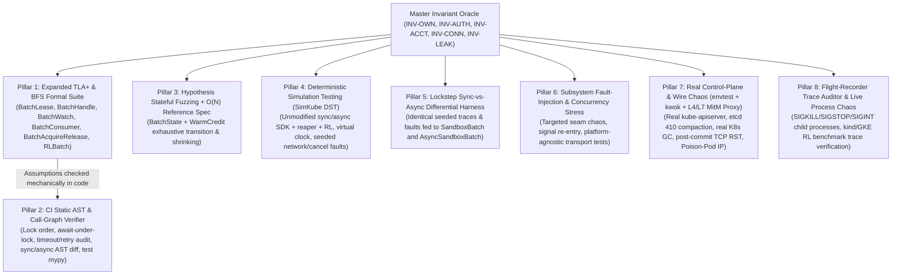

# Comprehensive Batch Verification Strategy

## 1. Executive Summary and Root-Cause Diagnosis

### Why Previous Verification Missed Real Bugs

Across PRs `1/N` through `26/N`, the batch claiming stack already used unit tests (`test_batch_state.py`, `test_sandbox_batch.py`, `test_async_sandbox_batch.py`, `test_k8s_helper.py`, `test_batch_reaper.py`), sync/async test-name alignment, an in-process BFS lock/signal model checker (`handoff/work/verify_delete_lifecycle_model.py` in `15/N`), a 31-configuration cross-process TLA+ Lease model (`handoff/work/tla/BatchLease.tla` in `22/N`), multi-agent reviews, and `kind`/GKE scale runs. Bugs still escaped because every existing check left one of five structural blind spots uncovered:

1. **Subsystem Seam and Shared-Latch Coupling (Janet's Bug, verified in code)**
   - `BatchLease.tla` modeled a handle giving up its Lease as an atomic `GiveUp` action, while unit tests exercised `_watch_loop()` and `_renew_loop()` in isolation.
   - In the live implementation, both shells collapse two distinct authority concepts (**Lease ownership** vs **watch stream liveness**) into one shared field, `BatchState._error`:
     - When `_watch_loop()` hits a non-retryable `ApiException` (`403`, `404`) or unexpected non-transport error (such as a TLS certificate error), it records the error via `self._state.note_error(e)` and exits (`sandbox_batch.py:1640, 1654`, `async_sandbox_batch.py:1625, 1636`).
     - On the next renewal tick, `_renew_once()` sends `_write_renewal()` to the API server (`sandbox_batch.py:1711`, `async_sandbox_batch.py:1691`) and then checks `if self._detached or self._state.error() is not None: return False` (`sandbox_batch.py:1738`, `async_sandbox_batch.py:1720`). That check discards `sent_at`, leaves `_renewal_degraded` as `False` (`lease_degraded()` reports healthy), and terminates `_renew_loop()` while already-connected `Sandbox` handles (`batch.connect(member)`) are still executing user commands. Once the unrenewed Lease expires, `batch_reaper` and Kubernetes garbage collection delete live sandboxes mid-task.
     - Simultaneously, `_check_healthy()` (`sandbox_batch.py:506`, `async_sandbox_batch.py:524`) treats `self._state.error() is not None` as potential Lease loss and blocks `_member_delete` (`release_member`, `release_not_ready`, `release_group`) and `connect()` even though the handle still holds a valid Lease.

2. **The Refinement Gap Between Formal Models and Production Code**
   - Formal specs (`BatchLease.tla`, `verify_delete_lifecycle_model.py`) verify ~150-line abstractions, while the production system spans ~500 KB of Python across `sandbox_batch.py` (114 KB), `async_sandbox_batch.py` (114 KB), `batch_state.py` (45 KB), `k8s_helper.py` and `async_k8s_helper.py` (88 KB), `batch_reaper.py` (12 KB), and `examples/agent-sandbox-rl/agent_sandbox_rl/` (`fleet.py`, `async_fleet.py`, `batch_claims.py`, `failfast.py`, `reaper.py`).
   - Unmodeled helpers (`_check_pool`, warm-credit sequence fencing, paginated `410` re-lists, `connect()` IP invalidation, client `atexit` hooks, RL `BatchWatchdog` and Lease rotation) and silent model-to-code drift (`VER-7`, `VER-12`) let implementation bugs slip past green TLC runs.

3. **The Fake-Fidelity Gap (Idealized Test Doubles vs Real Kubernetes and HTTP Semantics)**
   - In-memory unit fakes (`_Cluster`, `FakeBatch`) simplify API server and HTTP transport behavior.
   - Real `kube-apiserver`, `etcd`, `GarbageCollector`, `agent-sandbox-controller`, `urllib3`, `aiohttp`, and `httpx` exhibit non-atomic `deletecollection`, terminating claims that keep `Ready=True` (`batch_state.py:157-163`), watch cache lag relative to direct reads, `410 Gone` compaction mid-pagination, post-commit TCP resets (where `POST` or `PUT` commits in `etcd` before the client sees a socket error), TLS EOFs without `close_notify`, dirty connection-pool sockets on aborted streams, and Pod IP reuse across sandboxes.

4. **Dual-Runtime State Machine Drift (`Sync` vs `Async`, plus `RL` Sync vs `Async`)**
   - `SandboxBatch` (OS threads, `RLock`, `Condition`, main-thread `SIGINT`, `urllib3`) and `AsyncSandboxBatch` (`asyncio.Task`, `CancelledError` at every `await`, `aiohttp`) duplicate over 2,200 lines of orchestration each. Name-aligned unit tests verify scripted paths, not arbitrary fault, retry, and cancellation schedules.

5. **OS Kernel and Platform Stack Blind Spots (Aditya's Bug, verified in code)**
   - Prow CI and Linux dev containers return an immediate `RST` (`ECONNREFUSED`) when connecting to a bound, non-listening loopback TCP socket (`sock.bind(("127.0.0.1", 0))` prior to `sock.listen()`), raising `urllib3.exceptions.NewConnectionError`.
   - On Darwin/macOS (BSD TCP stack), connecting to a bound, non-listening socket drops `SYN` packets until connect timeout, raising `urllib3.exceptions.ConnectTimeoutError`. Because `NewConnectionError` subclasses `ConnectTimeoutError` (not vice versa, as noted in `sandbox_batch.py:88`), `self.assertRaises(urllib3.exceptions.NewConnectionError)` in `test_k8s_helper.py:1243` fails on macOS even though the production retry configuration is correct.

---

## 2. Core Operating Rule: Test the Harness First (Negative Controls and Mutation Gate)

**Do not fix Janet's bug, Aditya's bug, or newly discovered bugs before building the verification tools that target them.**

A check that starts green proves nothing about its detection power (`VER-6`, `TEST-1`). Every verification layer in this strategy must pass a two-step gate:

1. **Live Baseline Negative Controls:**
   - Run `BatchHandle.tla`, `test_batch_fault_injection.py`, and the deterministic simulation harness against the **unmodified** code (`sandbox_batch.py:1738`, `async_sandbox_batch.py:1720`). Verify that each tool fails and produces a minimal counterexample showing a `403` or TLS watch failure halting Lease renewal while active sandboxes remain connected.
   - Run the socket portability check / simulated BSD SYN-drop test against `test_k8s_helper.py:1243` and verify that it reproduces the `ConnectTimeoutError` failure on non-Linux connect timeouts.
2. **Automated Bug-Seeding Catalog (30+ Historical and Adversarial Mutants):**
   - Maintain a scripted toggle/patch catalog reintroducing historical bugs across `1/N` through `26/N` alongside fresh adversarial mutations (see Section 10). Every layer must kill every mutant assigned to its scope before we sign off on fixes.

---

## 3. Architecture Overview: Eight Defense-in-Depth Layers

Each layer closes the exact blind spot of the layer above it:

---

## 4. Master Executable Invariant Catalog (The Shared Oracle)

Rather than scattering ad-hoc assertions across test files, we encode one **Master Invariant Catalog** in `test/unit/batch_invariant_oracle.py` and mirror it in TLA+ so unit fuzzers, `SimKube` simulations, `envtest` runs, and GKE trace audits evaluate the same rules:

### A. Ownership, Authority Separation, and Fencing (`INV-OWN`, `INV-AUTH`)
- **`INV-OWN-1` (Cross-Incarnation Isolation):** Operations from handle `(batch_id, lease_uid_1)` never delete, adopt, watch-ingest, or mutate claims or Leases belonging to `lease_uid_2 != lease_uid_1`, even under immediate `batch_id` reuse.
- **`INV-OWN-2` (Single Believer and Reaper Safety):** At most one handle believes it holds `(batch_id, lease_uid)` at a time, and while a connected (or skew-bounded stalled) handle holds a non-expired Lease, neither `batch_reaper` nor Kubernetes GC deletes its Lease or non-released claims.
- **`INV-OWN-3` (Self-Fencing Past Expiry or Teardown):** Zero mutating RPCs (`create_sandbox_claim`, `delete_sandbox_claim`, `delete_sandbox_claims_by_label`, `replace_batch_lease`) start once `monotonic() >= _lease_expires_at` or once `detach()`/`release()` drains in-flight work. Every outbound request timeout stays bounded by `min(caller_deadline, remaining_lease_budget)`.
- **`INV-OWN-4` (Ambiguous-Write vs Never-Sent Safety):** A claim whose `POST` never left the client, failed validation (`400`, `403`, `404`, `422`), or hit `409` on attempt 1 is **never** deleted by name. Conversely, any claim whose `POST` may have reached the server (timeout, connection reset, `5xx`, `429`) on a cancelled, timed-out, or failed `acquire()` or released batch is **guaranteed** to be cleaned up by a UID-fenced path or Lease GC.
- **`INV-AUTH-1` (Lease Authority vs Watch Liveness Separation, catches Janet's Bug):** While `not _detached` and `monotonic() < _lease_expires_at` and the handle has not lost Lease ownership (`404` or `409` holder mismatch), `_renew_loop()` **must keep renewing the Lease** regardless of `_watch_loop()`, `_create_worker()`, or quorum failures. If `_renew_loop()` exits for any reason other than clean `detach()` or `release()`, `lease_degraded()` must become sticky `True` and `err()` must surface a Lease error.
- **`INV-AUTH-2` (Watch Death Unblocks Waiters Without Blocking Cleanup):** When `_watch_loop()` terminates with a non-retryable error, all watch-dependent waiters (`wait_for_quorum()`, `group_outcomes()`, `events()`, pending `acquire()`) wake immediately with `BatchError`, while Lease-fenced cleanup operations (`release_member()`, `release_group()`, `release()`, `detach()`) remain operational as long as Lease ownership holds.

### B. Conservation of Mass, Dispatch, and Monotonicity (`INV-ACCT`)
- **`INV-ACCT-1` (Zero Counter Drift):** At every quiescent step in `BatchState`, recomputing per-group counts (`_waiting`, `_failed`, `_lost`, `_released_count`, `_never_created`, `_missing`, `_groups_short_of_quorum`) via a naive `O(N)` scan over ground-truth claim history matches `BatchState`'s incremental `O(1)` counters identically.
- **`INV-ACCT-2` (At-Most-Once Valid Dispatch):** Across `wait_for_quorum()`, `group_outcomes()`, and `events()`, each initial-fill member is yielded at most once. Claims from `acquire()`, `size=0` groups, `released`/`FAILED`/`LOST` claims, terminating claims (`deletionTimestamp != None`), and members of failed groups are never yielded as Ready cohort members.
- **`INV-ACCT-3` (Exact Monotonicity vs Readiness Flaps):**
  - *Allowed non-monotonicity:* A live claim may flap between `READY` and `PENDING` when its pod readiness probe transiently drops (`batch_state.py:142-156, 176-189`); while `PENDING`, it keeps its cached connector if `sandbox_name` and `pod_ip` are unchanged, while `connect()` raises `SandboxNotReadyError` until `READY` returns.
  - *Strict one-way latches:* `FAILED` stays `FAILED` even if later deleted or marked terminating (`batch_state.py:160, 344`); `_released`, `_unable`, `_resolved`, `_dispatched`, `_fill_stopped_pools`, `events()` settlement, `_detached`, `_stop_creating`, `_next_ordinal` (including across `detach() -> get_batch()`), and `_next_delete_seq` never regress.
- **`INV-ACCT-4` (Bounded Liveness / No Hang):** Every blocking SDK and RL batch method unblocks within `min(caller_deadline, lease_expiry) + cleanup_margin` under arbitrary watch drops, stalled sockets, or exceptions.

### C. Data-Plane Routing and Resource Zero-Leak (`INV-CONN`, `INV-LEAK`)
- **`INV-CONN-1` (Zero Stale or Recycled-IP Routing):** `connect(member)` never returns a cached `Sandbox` when Lease ownership is lost, when `member.state != READY`, or when `sandbox_name` or `select_pod_ip(member.pod_ips)` changed or cleared (`batch_state.py:176-189`). Any watch event or `410` re-list that marks a member `LOST`/`FAILED` or changes its IP evicts and closes the cached connector.
- **`INV-LEAK-1` (Cluster Zero-Residue):** After `release()` returns (or after driver crash + reaper + GC, or `shutdownTime`), `0` `SandboxClaim`s, `0` `Lease`s, `0` `Sandbox`es, and `0` `Pod`s remain for that `(batch_id, lease_uid)`. Every raising `acquire()` leaves `0` claims behind after cleanup completes.
- **`INV-LEAK-2` (Client Zero-Residue):** After `release()`, `detach()`, `client.close()`, or `delete_all()`, active background batch threads/tasks equal `0`, cached connectors and port-forwards equal `0`, `_in_flight` semaphore permits return to full capacity, `_prechecks` futures equal `0`, client registry entries equal `0`, and weakrefs to closed handles and list pages clear immediately (`TEST-19`).

---

## 5. Pillar 1: Expanded TLA+ and Explicit-State Formal Verification Suite

We extend `handoff/work/tla/` (alongside `BatchLease.tla`) with modular specifications covering the intra-handle seams, watch cache reconciliation, consumer/ordinal state machines, dynamic `acquire`/`release_*` races, and `agent-sandbox-rl` integration:

| Spec | Scope | Key Bug Classes Targeted |
| :--- | :--- | :--- |
| **`BatchHandle.tla`** | Intra-handle composition of `_renew_loop`, `_watch_loop`, `_create_worker`, `acquire()`, `connect()`, `detach()`, and `release()` | Subsystem error coupling (Janet's bug), orphaned renewals after expiry, hung waiters after watch death, `_renew_once` discarding `sent_at` after server write |
| **`BatchWatch.tla`** | K8s watch stream (`ADDED`, `MODIFIED`, `DELETED`, `BOOKMARK`), `410 Gone` paged `resync_from_list()`, readiness flaps, `deletionTimestamp`, warm-credit exhaustion, and `_connected` eviction | Stale Pod IP retention, missed `DELETED` events across `410` compaction, warm-credit overshoot under concurrent cold starts, false `READY` on terminating claims |
| **`BatchConsumer.tla`** | `wait_for_quorum`, `group_outcomes`, `events`, mode exclusivity, fill deadline, cancellation, and monotonic ordinals across `detach() -> get_batch()` | Double yields, premature or stuck `events()` settlement, readiness flaps while held in `_waiting`, ordinal collisions after re-attach |
| **`BatchAcquireRelease.tla`** | Concurrent initial fill, `acquire()`, `release_member()`, `release_group()`, `release_not_ready()`, ambiguous `POST` retries (`409`), `note_deleted(seq)`, and single-flight `_check_pool` futures | Leaked claims on cancelled/timed-out `acquire()`, deleting unowned claims on attempt-1 `409`, older delete clearing newer failed delete, follower hang on cancelled leader future |
| **`RLBatchLifecycle.tla`** | `agent-sandbox-rl` `BatchClaimer`, held/wave pools, 300s Lease rotation, `BatchWatchdog` fail-fast `release_member`, and fallback direct `delete_claim` | Watchdog `release_member` racing `Batch.release()`, double-delete or orphan during Lease rotation, multi-cluster partial-acquire rollback leaks |

### Detailed Specification Highlights

#### 1. `BatchHandle.tla` (Subsystem Composition and Authority Separation)
- **State Variables:** `renewState \in {"RUNNING", "DEGRADED", "STOPPED"}`, `watchState \in {"STREAMING", "RECONNECTING", "DEAD_FATAL"}`, `createState \in {"ACTIVE", "STOPPED"}`, `activeSandboxes \in 0..MaxSbx`, `leaseHeld \in BOOLEAN`, `leaseExpiresAt`, `detached \in BOOLEAN`, `leaseErr \in BOOLEAN`, `watchErr \in BOOLEAN`.
- **Core Invariants:**
  - `ActiveWorkloadProtected`: `(activeSandboxes > 0 /\ now < leaseExpiresAt /\ ~detached /\ leaseHeld) => renewState /= "STOPPED"` (violated by current unfixed logic when `WatchFailsFatal` sets shared `stateError` and `RenewTick` exits).
  - `StoppedRenewalSetsDegraded`: `(~detached /\ renewState = "STOPPED") => (leaseErr /\ renewDegraded = TRUE)`.
  - `WatchDeadWakesWaiters`: `watchState = "DEAD_FATAL" => \A w \in WatchWaiters : w.unblocked`.
  - `NoRenewalPastExpiry`: `now >= leaseExpiresAt => renewState = "STOPPED"`.

#### 2. `BatchWatch.tla` (Watch Stream, `410` Compaction, Flaps, and Connector Eviction)
- **State Variables:** `k8sClaims` (server state including `ready`, `podIP`, `sandboxName`, `deletionTimestamp`, `terminal`), `cacheClaims` (`BatchState` view), `connectedCache` (map `claim -> (sandboxName, podIP)`), `serverRV`, `watchRV`, `compactionHorizon`, `warmCredit`.
- **Core Invariants:**
  - `TerminalLatchMonotonicity`: `FAILED` never transitions to `LOST`, `PENDING`, or `READY`; `_released` claims never re-enter `cacheClaims` even if late `ADDED`/`MODIFIED` events or `410` re-lists include them.
  - `ConnectorRoutingSafety`: `\A c \in DOMAIN connectedCache : cacheClaims[c].state \in {"READY", "PENDING"} /\ connectedCache[c] = <<cacheClaims[c].sandboxName, cacheClaims[c].podIP>> /\ k8sClaims[c].deletionTimestamp = NONE`.
  - `WarmCreditFencedByColdStart`: Once a claim's initial controller status reports a cold reason, any in-flight warm-pool `GET` started at an older sequence cannot restore positive warm credit.

#### 3. Sync/Async Lock-Model Parity (`verify_delete_lifecycle_model.py`)
- Update `handoff/work/verify_delete_lifecycle_model.py` so it matches the exact shipped lock blocks in both `sandbox_batch.py` and `async_sandbox_batch.py` (`VER-7`), incorporate the `CANCEL-5` double-cancellation check (`verify_cancel5_exercise.py`), and run the checker automatically in CI so lock-order drift fails immediately.

---

## 6. Pillar 2: CI-Enforced Static AST, Call-Graph, and Type Verification

Formal models rely on structural code assumptions (`VER-2`, `VER-10`, `VER-12`). We enforce those assumptions directly against the Python AST in `dev/tools/verify_batch_static.py` (or `test/unit/test_batch_static_invariants.py`) on every test run:

1. **Transitive `await`-Under-Lock Scanner (`CANCEL-5` Enforcement):**
   - Build the intra-module call graph of `async_sandbox_batch.py` and `async_sandbox_client.py`. Fail if any `async with self._lock:` or `async with self._changed:` block executes an `await` directly or transitively through helper calls, other than the explicit `Condition.wait()` suspension point.
2. **Sync Lock-Hierarchy and Drain-Barrier Checker (`LOCK-19` Enforcement):**
   - Verify on `sandbox_batch.py`'s call graph that `_wait_active_deletes()` is never reachable while `_lifecycle_lock` is held, and that `_lock` never acquires `_lifecycle_lock` or `client._batches_lock` in reverse order.
3. **Deadline and Unretried-Client Audit (`VER-12` Enforcement):**
   - Inspect every call to `k8s_helper` inside `sandbox_batch.py`, `async_sandbox_batch.py`, and `batch_reaper.py`. Fail if any network call omits `_request_timeout`, passes an unbounded timeout on a Lease-fenced or caller-deadline path, or routes a batch custom-object operation through the retried `custom_objects_api` instead of `_batch_custom_objects_api` / `coordination_v1_api`.
4. **`BaseException` Rollback Audit (`CANCEL-1` through `CANCEL-24`):**
   - Flag any `try ... except Exception:` block that guards semaphore permits, `_active_deletes`, `_checking_acquires`, `_prechecks` futures, or `_connected` put-backs where `asyncio.CancelledError` or `KeyboardInterrupt` (`BaseException`) would skip cleanup or leave followers parked on an unresolved `Future`.
5. **Normalized Sync-vs-Async AST Parity Diff:**
   - Parse `sandbox_batch.py` and `async_sandbox_batch.py`, strip `async`/`await` syntax and map sync/async lock primitives to a canonical AST, and fail on any unapproved structural branch divergence between twin methods.
6. **Close the `mypy` Test Exclusion Blind Spot (`TEST-25`):**
   - Run `mypy` against `k8s_agent_sandbox/test/unit/` (at minimum all batch test files) and `examples/agent-sandbox-rl/` so internal signature changes (like `BatchState.note_deleted(seq)`) cannot pass `mypy` while breaking unit tests or RL callers.

---

## 7. Pillar 3: Stateful Property-Based Fuzzing and Reference Spec Oracle (`Hypothesis`)

Unit tests in `test_batch_state.py` test hand-picked race sequences (`TEST-3`). We add `test_batch_state_fuzz.py` using `Hypothesis` (`RuleBasedStateMachine`) to explore tens of thousands of arbitrary action sequences and automatically shrink failures to minimal 3-to-5-step reproducers:

- **Fuzzed Action Vocabulary:**
  - Multi-group initialization (`size=0`, `min_ready=0`, `0 < min_ready < size`, `min_ready == size`).
  - `upsert_claim` with `PENDING`, `READY`, cold-start reasons, terminal failure reasons, `READY -> PENDING -> READY` flaps, pod IP rotations, `sandbox_name` changes, and `deletionTimestamp` with stale `Ready=True`.
  - `mark_lost`, paged `resync_from_list` with dropped/added claims, `expire_fill`, `note_error`.
  - `set_mode` (`STREAM`, `GROUP`, `QUORUM`), draining `events()` and `group_outcomes()`.
  - Dynamic `acquire` registration/completion/failure/drop, `release_member`, `release_group`, `release_not_ready`, and out-of-order `note_deleted(claim, seq)` completions.
  - Mid-flight `detach` + fresh `BatchState` reconstruction via `reconstruct_groups()` and `seed_from_claims()` (`get_batch` handoff simulation).
- **Naive `O(N)` Reference Spec Oracle:**
  - Alongside `BatchState` (which maintains `O(1)` incremental counters and sets), step a 150-line `ReferenceBatchSpec` that stores the raw claim history and recomputes group eligibility, quorum outcomes, settlement, and member visibility from scratch on every step. Assert bit-for-bit equality of all outputs and `INV-ACCT-*` invariants after every transition.

---

## 8. Pillar 4: Deterministic Simulation Testing (`SimKube` DST) and Lockstep Sync/Async Differential Testing

This pillar closes both the **Refinement Gap** and the **Dual-Runtime Drift Gap** by running the **actual, unmodified `SandboxBatch`, `AsyncSandboxBatch`, `batch_reaper`, and `agent-sandbox-rl` `BatchClaimer`/`BatchWatchdog` Python code** inside a FoundationDB-style deterministic simulator (`test/simulation/sim_kube.py` + `test_batch_simulation.py`).

### 1. `SimKube`: High-Fidelity Deterministic Kubernetes Control Plane
Unlike simple unit-test dicts, `SimKube` enforces real Kubernetes state-machine rules driven by a single 64-bit `SEED`:
- **MVCC Revision Log and Compaction:** Every mutation increments `resourceVersion`. Configurable compaction advances `compactionHorizon` mid-test to trigger real `410 Gone` errors on both active watches and mid-pagination `list` `continue` tokens (`20/N`).
- **Optimistic Concurrency and Preconditions:** `replace_batch_lease` and `delete_batch_lease(resource_version=...)` enforce exact `resourceVersion` matching (`409 Conflict` / `404 Not Found`) and `MicroTime` timestamp formatting.
- **Asynchronous Garbage Collector Actor:** Separate simulated actor that inspects `ownerReferences` and asynchronously sets `deletionTimestamp` / deletes claims whose owning Lease `uid` no longer exists (catching any missing or wrong-UID `ownerReference`).
- **Controller Quirks and Non-Atomic `deletecollection`:**
  - Terminating claims (`deletionTimestamp != None`) remain visible in `LIST` and `WATCH` with stale `Ready=True` until finalized (`5/N`).
  - `deletecollection` deletes matching claims one by one across simulation ticks, allowing concurrent `create_sandbox_claim` or `claim_batch` reuse of `batch_id` to interleave mid-round (`TLA-1`).
  - Warm pools simulate `status.readyReplicas` lag under two competing batch drivers sharing one pool, transitioning exhausted claims to cold `SandboxCreatePending` (`19/N`) and recycling freed Pod IPs onto new sandboxes (`17/N`).

### 2. Deterministic Virtual Clock, Network Adversary, and Schedule Explorer
- **Zero-Sleep Virtual Clocks with Independent Skew:** Driver 1, Driver 2, `batch_reaper`, and `SimKube` each read an injectable clock with configurable drift/jumps, executing multi-hour Lease/reaper/rotation lifecycles in a few milliseconds.
- **Wire-Semantics Fault Injector:** On any chosen RPC or watch event, the seeded adversary injects:
  - Pre-commit transport failure (server state unchanged),
  - **Post-commit response drop / timeout** (`SimKube` applies the `POST`/`PUT`/`DELETE`, then raises `ReadTimeoutError`, `asyncio.TimeoutError`, `SSLEOFError`, or `502` to the client),
  - `429 Too Many Requests` with integer and HTTP-date `Retry-After` headers, `500`/`503` bursts, non-retryable `403` mid-watch, empty short watches (`< 1s`), and watch stream hangs.
- **Controlled Concurrency Scheduling:**
  - **Async (`AsyncSandboxBatch`):** Custom deterministic single-threaded `asyncio` harness advancing virtual timers, permuting ready-task wakeups via `SEED`, and injecting `task.cancel()` at targeted `await` boundaries.
  - **Sync (`SandboxBatch`):** Cooperative yield wrapper at lock/condition/semaphore and `K8sHelper` boundaries (Probabilistic Concurrency Testing) plus deterministic main-thread `KeyboardInterrupt` re-entry during active I/O and teardown (`15/N`).

### 3. Pillar 5: Lockstep Sync-vs-Async Differential Harness (`test_batch_differential.py`)
- Feed the **exact same** seeded operation script, `SimKube` cluster events, virtual clock steps, and RPC fault schedule to `SandboxBatch` and `AsyncSandboxBatch` side by side.
- Assert identical outbound Kubernetes mutations, identical exception types (`BatchTimeoutError`, `QuorumUnreachableError`, `TerminalMemberError`, `BatchLeaseExpiredError`, `BatchInUseError`), identical `members()`, `err()`, `lease_degraded()`, yielded `events()` / `group_outcomes()`, and `INV-LEAK-2` zero-residue parity.

---

## 9. Pillar 6: Subsystem Fault-Injection, Concurrency Stress, and Platform Invariance

Alongside randomized simulation, we maintain deterministic, fast unit suites in `clients/python/agentic-sandbox-client/k8s_agent_sandbox/test/unit/` for targeted seam regression and cross-platform portability:

### 1. Subsystem Seam Fault-Injection Matrix (`test_batch_fault_injection.py`, Sync and Async Twins)

| Injected Fault | Target Subsystem | Required Behavior Across All Sibling Subsystems |
| :--- | :--- | :--- |
| **Watch `403 Forbidden` or TLS cert error** | `_watch_loop` | **Lease renewal continues uninterrupted** while Lease is held; already-connected sandboxes continue executing commands; `wait_for_quorum()`, `group_outcomes()`, `events()`, and pending `acquire()` fail fast with `BatchError`; `release_member()`, `release_group()`, `detach()`, and `release()` still succeed cleanly. |
| **Watch `410 Gone` across multi-page churn** | `_watch_loop` | Paged `list_sandbox_claim_objects` + `resync_from_list()` reconciles state without holding >1 page in `count_live_sandbox_claims`; stale/IP-changed connectors close; zero duplicate events yield. |
| **Lease Renewal `500` / Timeout -> Recovery vs Expiry** | `_renew_loop` | `lease_degraded()` flips `True` on first failure, resets `False` if renewal succeeds before `sent_at + D`, or latches `True` + sets `BatchLeaseExpiredError` at exact `sent_at + D` (`TEST-5`) while immediately halting creates and deletes. |
| **Lease Renewal `409 Conflict` (lost reply vs takeover)** | `_renew_loop` | `read_batch_lease` inspects `holderIdentity`; if unchanged (lost reply from own prior write), renewal recovers seamlessly; if changed or `404`, handle records `BatchInUseError` / `BatchLeaseExpiredError`, sets `lease_degraded() == True`, and fences all mutations. |
| **Create `429` + Cold-Start Status Race** | `_create_worker` + `_watch_loop` | `429` pauses warm credit for `Retry-After` (`>= 5s`) and paces creates at `create_rps`; cold-start watch status zeroes pool warm credit and fences stale in-flight pool `GET` refreshes (`19/N`); renewal and watch stay healthy. |
| **Warm Pool / Template `404` or Slow `GET` in `acquire()`** | `_check_pool` | `404` raises `SandboxWarmPoolNotFoundError` / `SandboxTemplateNotFoundError` without harming batch Lease or siblings; slow `GET` respects caller `timeout` and `_lease_expires_at` without poisoning longer-deadline concurrent `acquire()` followers (`23/N`). |
| **`acquire()` Timeout / Cancel After Ambiguous `POST`** | `acquire()` | Drops claim from `members()`, deletes claim on server (even if `POST` landed after client timeout), releases `_in_flight` slot, and leaves initial-fill quorum untouched. |
| **Client `close()` / `delete_all()` / `atexit` / `SIGINT`** | `SandboxClient` / `AsyncSandboxClient` | Releases `claim_batch` handles, detaches `get_batch` handles (preserving partial-detach `grace`), waits for active member deletes without ABBA deadlock, and closes all cached connectors even if one `close_connection()` raises. |

### 2. High-Contention Concurrency Stress (`test_batch_concurrency_stress.py`)
- **50-Worker `acquire()` / `release_member()` / `release_group()` Churn:** Hammer one handle across shared and distinct pools while injecting transient `503`s and IP changes; assert unique ordinals, exact `_in_flight` permit restoration, and zero leaked tasks/threads.
- **Concurrent `detach(grace)` vs `get_batch()` Takeover Race:** Race multiple threads/tasks detaching and re-attaching; assert `INV-OWN-2` (at most one active holder, clean `BatchInUseError` on loser, zero orphaned claims).
- **Paced 200-Claim Burst vs Mid-Flight Cancellation / `release_not_ready()`:** Cancel or call `release_not_ready()` mid-burst; assert `_stop_creating` halts unsent creates immediately and every sent non-dispatched claim is deleted.

### 3. Platform and OS Socket Stack Invariance (Eliminating Aditya's Bug Class)
- **Root-Cause Rule:** Unit tests must never depend on Linux-specific TCP state transitions (such as `bind()` without `listen()` returning immediate `RST` on Linux vs dropping `SYN` into `ConnectTimeoutError` on Darwin/BSD).
- **Required Patterns for Transport/Retry Tests (`test_k8s_helper.py` and `test_async_k8s_helper.py`):**
  1. **Verify Both Refused-Connect and SYN-Timeout Paths Explicitly:**
     - For an OS-agnostic immediate `ECONNREFUSED` (`NewConnectionError`), bind an ephemeral loopback socket, read `getsockname()[1]`, **close the socket**, and connect to the closed port (or mock at the `HTTPConnection.connect` / `ClientConnector` layer so zero port-reuse race exists).
     - Explicitly test **both** `NewConnectionError` (refused) and `ConnectTimeoutError` (SYN blackhole, simulated via mock `connect` raising `ConnectTimeoutError` / `socket.timeout`) so Linux CI directly verifies the Darwin timeout path on every run!
  2. **Socket Usage Audit:** Grep all unit tests under `clients/python/` and `examples/agent-sandbox-rl/` for `socket.socket` and ensure every usage either calls `listen()` before client connect or mocks connect-level errors deterministically.
  3. **macOS + Linux CI Execution:** Add a macOS runner leg (`macos-latest`) for Python SDK unit tests in GitHub Actions (`.github/workflows/`) so BSD socket, `kqueue` asyncio event loop, and Darwin clock/signal behaviors are continuously verified alongside Linux `epoll`.

---

## 10. Pillar 7: Real Control-Plane Chaos (`envtest` + `kwok` + Fault-Injecting Proxy) and Pillar 8: Live Trace Auditing

To catch bugs where `SimKube` or mocks diverge from real Kubernetes, Go reconcilers, or `urllib3`/`aiohttp`/`httpx` wire framing:

### 1. Hermetic Real Control-Plane + `kwok` + MitM Fault Proxy (`test/integration/batch_chaos/`)
- **Real Control Plane:** Run real `kube-apiserver` + `etcd` + `kube-controller-manager` (with real `GarbageCollector` enabled) + `agent-sandbox-controller` + `kwok` (simulating 1,000+ Pod schedules, readiness flaps, and IP reassignments in seconds without container pulls).
- **Programmable L4/L7 Fault-Injecting Proxy (between SDK and `kube-apiserver`):**
  - **True Post-Commit TCP Reset:** Forward `POST /sandboxclaims` or `PUT /leases/batch-<id>` to `kube-apiserver`, wait for `201`/`200` from `kube-apiserver`, and reset the client TCP connection before forwarding the response bytes. Verify SDK recovery on `409` retry and zero leaked resources.
  - **Wire Framing & Pool Starvation Torture:** Truncate chunked/gzipped `watch` and `deletecollection` bodies mid-stream (`20/N`), close TLS without `close_notify` (`8/N`), stall reads past `_request_timeout`, run `etcdctl compact` to trigger genuine `kube-apiserver` `410 Gone` across multi-page lists and watches, and run at minimum `pool_size = max_in_flight + 2` (`17/N`) to prove zero dirty or leaked sockets in `urllib3` and `aiohttp`.
- **Poison-Pod IP Reuse Test:** Start two local HTTP sandbox stub servers (`Server A` and `Poison Server B`). Connect to Member 0 (`Server A`), simulate Pod termination + IP reassignment in claim status to `Poison Server B`, and hammer `batch.connect()` and `release_member()` concurrently with watch delivery to prove zero commands ever reach `Poison Server B`.

### 2. Flight-Recorder Trace Verifier (`verify_batch_trace.py`) and Process Signal Chaos
- **Structured Flight Recorder:** Add an opt-in lightweight event sink (`SANDBOX_BATCH_TRACE_PATH`) recording timestamped SDK lifecycle transitions, outbound RPCs, watch events, and Lease state, paired with an offline/post-test auditor `verify_batch_trace.py` that checks `INV-OWN-*`, `INV-AUTH-*`, `INV-ACCT-*`, `INV-CONN-*`, and `INV-LEAK-*`.
- **Every Benchmark Becomes a Correctness Audit:** Enable `verify_batch_trace.py` + cluster post-mortem zero-residue checks on `kind` E2E (`test_batch_e2e.py`) and 1,000-sandbox GKE `agent-sandbox-rl` runs so scale campaigns automatically flag silent anomalies (stray post-expiry calls, warm-credit overshoot, double yields, or slow handle leaks).
- **Real Child-Process Signal Chaos (`test_batch_e2e.py` expansion):**
  - Extend `TEST-23` child-process E2E tests to cover: (a) `SIGKILL` crash + reaper + real K8s GC with lower-bound timing checks, (b) `SIGSTOP` shorter than `D` and `SIGSTOP` across clock-skewed reaper `409` precondition races (closing the `TEST-23` 409 e2e gap!), and (c) `SIGINT` storms hitting main-thread sync `claim_batch`, `wait_for_quorum`, `detach`, and `release`.

---

## 11. Phased Execution Roadmap and Sign-Off Gates

| Phase | Deliverables | Hard Exit Criteria |
| :--- | :--- | :--- |
| **Phase 1: Negative-Control Reproduction & Static Guardrails** | 1. Implement `BatchHandle.tla` and `test_batch_fault_injection.py` (sync + async). 2. Implement BSD `ConnectTimeoutError` simulation test on `test_k8s_helper.py`. 3. Build `verify_batch_static.py` (AST lock/await/timeout/parity auditor) + enable `mypy` on batch unit tests and `agent-sandbox-rl`. | **Must fail on current unfixed code:** TLC prints counterexample for Janet's bug; `test_batch_fault_injection.py` fails live showing Lease renewal stopping on Watch `403`; socket test fails reproducing Aditya's Darwin `ConnectTimeoutError`; AST scanner flags any existing unguarded timeout or `BaseException` gap. |
| **Phase 2: Deep Formal Models, `Hypothesis` Fuzzing & `SimKube` DST** | 1. Implement `BatchWatch.tla`, `BatchConsumer.tla`, `BatchAcquireRelease.tla`, `RLBatchLifecycle.tla`, and sync `verify_delete_lifecycle_model.py` to `HEAD`. 2. Implement `batch_invariant_oracle.py` + `test_batch_state_fuzz.py` (`Hypothesis` + `O(N)` Reference Spec). 3. Build `SimKube` DST (`test_batch_simulation.py`) + Lockstep Sync/Async Differential Harness (`test_batch_differential.py`). | 100% of seeded historical + adversarial mutants in the 30+ mutant catalog are killed automatically; 10,000+ seeded `SimKube` + differential runs complete (or surface unknown bugs with deterministic `SEED` reproducers). |
| **Phase 3: Surgical Fixes & Regression Pinning** | 1. Fix Janet's bug (decouple Lease ownership authority from watch/state errors across `_renew_once`, `_check_healthy`, `connect`, and cleanup in both sync and async shells). 2. Fix Aditya's socket portability bug in `test_k8s_helper.py` and audit all `socket.socket` tests. 3. Fix every additional bug uncovered by Phases 1 and 2 in its owning PR commit (`working_rules.md`), converting every counterexample into a deterministic unit regression test (`VER-9`). | All TLA+ specs, BFS checkers, static AST checks, `mypy`, `Hypothesis` fuzzers, `SimKube` DST, differential sync/async runs, fault-injection matrix, and concurrency stress tests turn 100% green; mutation checks confirm each new test fails when its fix is reverted. |
| **Phase 4: Real Control-Plane Chaos, macOS CI & Scale Audit** | 1. Stand up `envtest` + GC + `agent-sandbox-controller` + `kwok` + MitM Fault Proxy + Poison-Pod IP reuse suite. 2. Wire `verify_batch_trace.py` into `test_batch_e2e.py` (including reaper `409` E2E) and `agent-sandbox-rl` GKE runs. 3. Add macOS unit-test leg to CI. | Zero invariant violations across real-apiserver MitM chaos (`410` compaction, post-commit TCP RST, pool-size minimum torture), Linux + macOS CI green, and zero cluster/client leaks under `agent-sandbox-rl` scale runs. |
