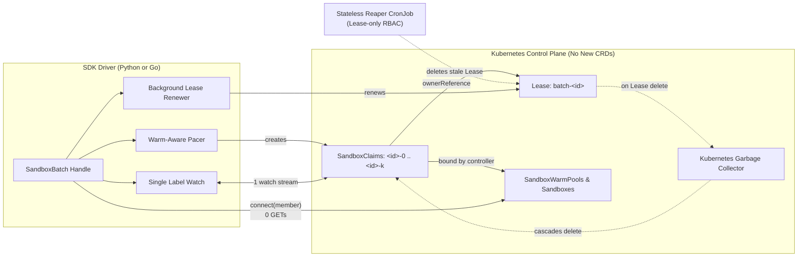
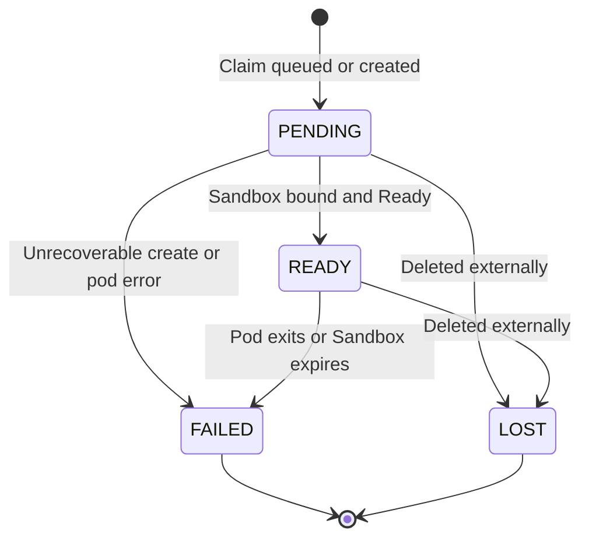
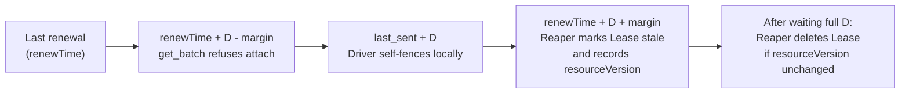

# Sandbox Batch Claim API Design

## 1. Motivation & Scope

The `agent-sandbox` SDKs currently provision one sandbox at a time (`create_sandbox` in Python, `CreateSandbox` in Go). That model fits interactive single-agent sessions well, where one caller waits on one `SandboxClaim`.

Batch workloads such as reinforcement learning rollouts and large-scale evaluation harnesses need hundreds or thousands of sandboxes at once, often spread across multiple `SandboxWarmPool`s with different container images. Scaling single-claim SDK calls in a caller loop creates four structural problems.

- **One watch per claim.** Claiming `N` sandboxes opens `N` concurrent watch streams and holds `N` HTTP connections open for the entire readiness wait, exhausting client connection pools and straining `kube-apiserver` watch dispatch.
- **Redundant lookup calls on connect.** Connecting to `N` sandboxes triggers additional per-sandbox `GET` requests even though the claim controller already mirrors the assigned `Sandbox` name and pod IPs onto each `SandboxClaim` status.
- **Blind creation bursts or over-throttled warm pools.** Firing `N` unpaced creates triggers API server throttling (`429`), while placing a fixed client rate limit in front of every create needlessly slows down warm pools whose pods are already running.
- **Fragile cleanup and orphan leaks.** Deleting `N` claims requires `N` individual `DELETE` calls, and a driver process killed by `SIGKILL`, an OOM kill, or node preemption exits without running cleanup hooks, stranding live sandboxes until their TTLs expire.

### Goals

- Provide a first-class `SandboxBatch` handle in the Python (sync and async) and Go SDKs to claim, observe, connect to, resize, and release `N` sandboxes across one or more `SandboxWarmPool`s.
- Collapse readiness tracking to **one label-scoped watch per batch** and eliminate extra API lookups when connecting to ready members.
- Pace cold pod creation automatically while adopting pre-warmed sandboxes at full concurrency.
- Support cohort readiness barriers (batch-wide and per-group), streaming dispatch, and dynamic single-member acquisition and release.
- Guarantee automatic claim cleanup after ungraceful driver crashes without adding server-side CRDs or modifying `agent-sandbox-controller`.

### Non-Goals

- **No new CRDs or controller changes.** Batching operates entirely over existing `v1beta1` `SandboxClaim`, `SandboxWarmPool`, and `coordination.k8s.io/v1` `Lease` resources.
- **No cross-namespace or multi-cluster batching.** One batch spans one namespace in one cluster. Multi-cluster fleet managers compose one batch per cluster.
- **No automatic pool placement.** Callers specify explicit per-pool sizes rather than delegating pool selection to the SDK.

---

## 2. Design Overview

`SandboxBatch` replaces `N` independent per-claim lifecycles with one coordinated handle backed by a Kubernetes `Lease` and a single label-scoped claim watch.

| Dimension (`N` Sandboxes) | Single-Claim Loop (`create_sandbox` x `N`) | `SandboxBatch` (`claim_batch`) |
| :--- | :--- | :--- |
| **Readiness Watches** | `N` per-claim watch streams | **`1` shared label-scoped watch** across all pools |
| **Connect Metadata Reads** | Per-sandbox `GET` calls | **`0` `GET` calls** (seeded directly from watch status) |
| **Creation Pacing** | Unpaced burst or static rate limit | **Warm-pool fast path** + automatic cold-start rate limit |
| **Bulk Teardown** | `N` individual `DELETE` calls | **`1` `deletecollection` + `1` `Lease` `DELETE`** |
| **Driver Crash (`SIGKILL`)** | Claims leak until `shutdownTime` | **Stateless reaper deletes stale `Lease` -> K8s GC deletes claims** |



When a caller invokes `claim_batch`, the SDK executes five ordered steps.

1. **Validate pools.** Confirm each target `SandboxWarmPool` and its referenced `SandboxTemplate` exist, and record each pool's current `readyReplicas` as warm capacity credit.
2. **Create the batch `Lease`.** Create `Lease` `batch-<id>` before creating any claims so every claim has a live owner UID from birth.
3. **Start one shared watch.** Open a single watch on `SandboxClaim`s matching this batch incarnation before issuing creates so no early readiness transition is missed.
4. **Create claims with adaptive pacing.** Issue deterministic `<id>-<ordinal>` claims across pools, prioritizing quorum slots first.
5. **Return the `SandboxBatch` handle.** Callers consume ready sandboxes through their chosen readiness pattern while a background loop renews the `Lease`.

---

## 3. Core Model & Kubernetes Representation

Python (`k8s_agent_sandbox`) and Go (`clients/go/sandbox`) read and write the exact same Kubernetes metadata. A Python process can `detach` a batch and a Go process can re-attach it with `GetBatch` without translation.

### 3.1 Batches, Groups, and Members

- **Batch (`batch_id`).** Every batch has a DNS-safe identifier (auto-generated or caller-supplied) scoped to a single namespace. Each claim receives a deterministic name `<batch_id>-<ordinal>` from a single monotonically increasing counter across the life of the batch. The batch never reuses ordinals, preventing name collisions with terminating claims.
- **Groups (`BatchGroup`).** A batch spans one or more warm pools. Each `BatchGroup(warmpool, size, min_ready)` requests `size` initial sandboxes from a pool and defines an optional `min_ready` threshold (defaulting to `size`). Setting `size=0` creates an empty group for workloads that acquire sandboxes dynamically on demand.
- **Initial Fill vs. Dynamic `acquire`.** Claims created up front by `claim_batch` form the **initial fill** and drive quorum and event channels. Callers can also add individual claims at any time via `acquire(warmpool)` and remove individual claims via `release_member(member)`. Dynamically acquired claims share the batch's `Lease`, watch stream, pacing, and group/batch teardown, without perturbing initial-fill quorum accounting.
- **Member (`Member`).** The handle exposes each claim as an immutable snapshot carrying its `claim_name`, `warmpool`, `state`, and controller-mirrored `sandbox_name`, `pod_ips`, and `service_fqdn`.



### 3.2 Zero-Lookup `connect` and Cache Invalidation

Standard single-sandbox SDK calls query the API server to resolve a claim's backing `Sandbox` and pod IP before opening a data-plane session. Because `agent-sandbox-controller` already mirrors `sandbox.name` and `podIPs` onto `SandboxClaim.status`, `batch.connect(member)` constructs and caches a `Sandbox` client directly from the watched `Member` with zero extra Kubernetes API calls.

If the shared watch later observes that a member transitioned to `FAILED` or `LOST`, or bound to a different pod IP, the batch automatically closes the cached connection so callers never send traffic to a recycled IP.

### 3.3 Kubernetes Object Layout

The SDK stores batch state across one `Lease` and `N` `SandboxClaim`s so no extra CRD or ConfigMap is needed.

| Resource | Metadata / Spec | Design Purpose |
| :--- | :--- | :--- |
| **`Lease`**<br>`batch-<id>` | `labels`: `batch-id` + caller labels<br>`annotations` (`agents.x-k8s.io/`): `batch-lease-duration`, `batch-quorum-timeout`, `batch-work-budget`, `batch-create-rps`, `batch-next-ordinal` (on detach)<br>`spec`: `holderIdentity`, `leaseDurationSeconds`, `renewTime`, `leaseTransitions` | Tracks driver liveness and stores batch-level configuration so `get_batch` can reconstruct pacing, deadlines, and the next unused ordinal after handoff. |
| **`SandboxClaim`**<br>`<id>-<ordinal>` | `labels`: `batch-id`, `batch-lease-uid`, `batch-group` (hashed pool name), caller labels<br>`annotations`: `batch-group-size`, `batch-group-min-ready` *(initial fill only)*<br>`ownerReferences`: points to `Lease` `batch-<id>`<br>`spec`: `warmPoolRef`, `lifecycle.shutdownTime` (`Delete`) | Binds claim lifetime to the `Lease` for Kubernetes garbage collection, scopes watches and `deletecollection` to this exact `Lease` UID and pool, and lets `get_batch` recover initial group sizes without hitting annotation size limits on the `Lease`. |

Storing `batch-group-size` and `batch-group-min-ready` on initial-fill claims rather than packing a group manifest onto the `Lease` avoids Kubernetes's 256 KiB annotation cap when a batch spans thousands of distinct warm pools.

---

## 4. Consumption & Pool Patterns

Different workloads synchronize on sandboxes differently. `SandboxBatch` supports four patterns over the same underlying handle.

| Pattern | Primary Method | When Work Starts | Best Fit |
| :--- | :--- | :--- | :--- |
| **1. Batch Quorum Barrier** | `wait_for_quorum()` | Once **every** non-empty group reaches `min_ready`. | Synchronous multi-pool RL steps requiring a joint mixture ratio. |
| **2. Per-Group Cohorts** | `group_outcomes()` | Yields per group as soon as **that pool** hits `min_ready` or fails. | Multi-domain evaluations where one slow or broken pool must not block healthy pools. |
| **3. Streaming Dispatch** | `events()` | Streams each initial-fill member the moment it becomes `READY`. | Embarrassingly parallel task sweeps with no cohort barrier. |
| **4. Dynamic Rolling Pool** | `acquire()` / `release_member()` | Each `acquire(pool)` blocks until its new member is `READY`. | Long-lived worker queues, sandbox replacement after stateful runs, and fleet managers. |

### Consumer Exclusivity and Stragglers

Callers choose at most one of `wait_for_quorum` and `group_outcomes` per batch, and invoke it before calling `events`, because both draw from the initial fill's `min_ready` members. Calling `events` after `wait_for_quorum` or alongside `group_outcomes` streams any remaining initial-fill sandboxes beyond `min_ready` without duplicates.

If a caller over-requests capacity to hedge against slow cold starts (for example, `size=140, min_ready=128`) and does not need the extra stragglers once quorum arrives, `release_not_ready()` cancels unsent initial creates and deletes pending initial claims immediately.

### Fail-Fast Quorum Accounting

Both `wait_for_quorum` and `group_outcomes` fail fast with `QuorumUnreachableError` the moment a group can no longer reach `min_ready` (`size - failed - lost - released < min_ready`).

`wait_for_quorum` raises immediately if any group becomes unreachable. `group_outcomes` isolates the error onto that group's `GroupOutcome` so healthy groups continue running; the caller can free the failed group's partial claims with `release_group(warmpool)`.

### Usage Sketches (Python Async)

**Batch Quorum Barrier with Straggler Cleanup:**
```python
batch = await client.claim_batch([
    BatchGroup(warmpool="math-pool", size=140, min_ready=128),
    BatchGroup(warmpool="code-pool", size=140, min_ready=128),
], work_budget=1800)
try:
    cohort = await batch.wait_for_quorum()
    await batch.release_not_ready()
    await asyncio.gather(*(run_rollout(batch, m) for m in cohort))
finally:
    await batch.release()
```

**Per-Group Cohorts with Fault Isolation:**
```python
batch = await client.claim_batch(groups, work_budget=3600)
try:
    async for outcome in batch.group_outcomes():
        if outcome.error is not None:
            await batch.release_group(outcome.warmpool)
            continue
        await run_pool_cohort(batch, outcome.members)
        await batch.release_group(outcome.warmpool)
finally:
    await batch.release()
```

**Dynamic Rolling Pool (`size=0` + `acquire` / `release_member`):**
```python
batch = await client.claim_batch([BatchGroup(warmpool="base-pool", size=0)], work_budget=7200)
try:
    member = await batch.acquire("repo-pool-a")
    try:
        sbx = await batch.connect(member)
        await sbx.commands.run("pytest")
    finally:
        await batch.release_member(member)
finally:
    await batch.release()
```

If `acquire` times out, encounters a terminal sandbox failure, or gets cancelled, it deletes its own claim before raising so callers never leak partial acquisitions.

---

## 5. Adaptive Pacing & Scaling Characteristics

### 5.1 Warm-Pool Fast Path and Cold-Start Pacing

Client-side pacing uses two bounds:

- **`max_in_flight`** caps concurrent claim operations so slow API responses never exhaust client sockets.
- **`create_rps`** caps how many cold-start claims begin per second so pod creation bursts do not overwhelm the API server or scheduler.

Applying `create_rps` blindly would penalize warm pools whose pods are already running, because adopting a warm pod starts no new pod. `SandboxBatch` avoids that penalty with feedback-driven warm credit:

1. **Seed from `readyReplicas`.** During pool validation (and periodic pool checks on `acquire`), the batch records each pool's `status.readyReplicas` as warm credit.
2. **Skip rate-limiting while warm.** While a pool has warm credit, creates bypass `create_rps` and run at full `max_in_flight` concurrency.
3. **Close the loop via the claim watch.** Because `readyReplicas` is a point-in-time snapshot that can lag when multiple drivers share a pool, the batch watches incoming claim statuses. As soon as a claim reports a cold-start pending condition or the API server returns `429`, the batch zeroes warm credit and falls back to `create_rps` pacing automatically.

To reach quorum as early as possible, initial-fill creation sends each group's first `min_ready` claims in group order before sending the remaining `size - min_ready` spare claims.

### 5.2 Complexity Across Scaling Axes

| Axis | Cost Model | Why |
| :--- | :--- | :--- |
| **Batch Size (`N`)** | `1` watch, `O(max_in_flight)` sockets, `O(N)` compact `Member` state | Readiness multiplexes over one watch; list and `release` operations page results so client memory stays bounded rather than buffering full claim objects. |
| **Warm Pools (`G`)** | `1` watch and `1` `Lease` total (independent of `G`) | All groups in a namespace share the `batch-id` label; watch events route to groups in `O(1)` via `spec.warmPoolRef.name`. |
| **Active Batches (`B`)** | `O(B)` `Lease` renewals and `O(B)` reaper list items | Each active driver renews one `Lease` per renewal interval, and the reaper lists only batch `Lease`s from the API server watch cache without reading claims. |

---

## 6. Liveness, Cleanup & Multi-Process Safety

### 6.1 Three-Layer Cleanup Model

A batch never relies on a single cleanup path. Three layers protect cluster capacity from leaks:

1. **Explicit `release()` (Normal Path).** `batch.release()` stops background renewal and watching, issues label-scoped `deletecollection` calls on `SandboxClaim`s until none remain, and deletes the batch `Lease`. Client exit hooks (`with` / `async with` or `cleanup=True`) invoke this automatically on clean process exit.
2. **Stateless Reaper + Kubernetes Garbage Collection (Crash Path).** While alive, the driver renews `Lease` `batch-<id>` every `LeaseDuration / 3`. If the driver dies abruptly (`SIGKILL`, OOM, node loss), renewals stop. A lightweight stateless reaper CronJob deletes the expired `Lease`, and Kubernetes's built-in garbage collector deletes every `SandboxClaim` via `ownerReferences`.
3. **Claim `shutdownTime` Backstop (Controller Path).** Every claim carries `shutdownPolicy: Delete` and a generous `shutdownTime` derived from pacing time, `quorum_timeout`, and `work_budget`. Even in clusters that have not deployed the reaper CronJob, `agent-sandbox-controller` eventually reclaims every sandbox.

If `Lease` renewal encounters transient errors while the driver is still running, `batch.lease_degraded()` returns `True` so long-running workloads can checkpoint before expiry. If renewal fails for a full `LeaseDuration`, the driver stops issuing new creates and exposes `BatchLeaseExpiredError` via `batch.err()`.

### 6.2 Fencing Against Multi-Process Races

Coordinating ownership across crashes, network stalls, and `batch_id` reuse requires two explicit fencing invariants.

#### Incarnation Fencing (`batch-lease-uid`)
Suppose Driver A holds `batch-eval` (`Lease` UID `u1`), stalls across a long network pause until the reaper deletes `Lease` `u1`, and Driver B then starts a new batch reusing `batch_id="eval"` (`Lease` UID `u2`). If Driver A wakes up and runs a label-scoped `deletecollection` matching only `batch-id=eval`, it would delete Driver B's live claims.

To make cross-incarnation interference impossible, every claim carries `agents.x-k8s.io/batch-lease-uid: <uid>`, and every watch, `get_batch` list, `release_group`, and `release` `deletecollection` filters on **both `batch-id` and `batch-lease-uid`**. In addition, all `Lease` renewals, handoffs, and deletes check `resourceVersion` preconditions, fencing any displaced holder immediately on `409 Conflict`.

#### Monotonic Self-Fencing vs. Reaper Confirmation Wait
A driver measures its own `Lease` expiry on its local monotonic clock (`LeaseDuration` after sending its last successful renewal), whereas the reaper observes `spec.renewTime` on wall clocks that may skew slightly or lag behind request transit. Deleting a `Lease` while a slow driver still believes it owns the batch could race with a final in-flight claim create.

To order these transitions safely without requiring synchronized clocks:



Once the reaper observes a `Lease` past `renewTime + LeaseDuration + SkewMargin`, it records the `Lease`'s `resourceVersion`, waits one full `LeaseDuration`, and deletes the `Lease` with that `resourceVersion` precondition. Any live driver either renews during that window (causing the reaper's delete to fail harmlessly with `409`) or has already self-fenced locally before the `Lease` disappears.

### 6.3 Cross-Process Handoff (`detach` / `get_batch`)

Workloads that claim sandboxes in a setup job and consume them in a separate worker process hand off ownership explicitly:

1. Process A calls `batch.detach(grace=300)`, which stops local renewal, clears `holderIdentity`, records the next unused ordinal on the `Lease`, and sets the `Lease` duration to the grace window.
2. Process B calls `client.get_batch(batch_id, namespace)`, which verifies the `Lease` is unheld and unexpired, reconstructs groups and member states from existing claims, increments `leaseTransitions`, claims `holderIdentity` via a `resourceVersion`-checked update, and resumes watching and renewing.
3. If Process B never arrives before `grace` elapses, the `Lease` goes stale and the reaper cleans up the detached batch automatically.

### 6.4 Least-Privilege RBAC

Drivers require namespace-scoped permissions to manage claims, check pools/templates, and maintain their batch `Lease`s:

- `extensions.agents.x-k8s.io`: `sandboxclaims` (`create`, `get`, `list`, `watch`, `delete`, `deletecollection`) and `sandboxwarmpools`, `sandboxtemplates` (`get`).
- `coordination.k8s.io`: `leases` (`create`, `get`, `update`, `delete`).

Because Kubernetes garbage collection deletes owned claims whenever their `Lease` disappears, **the reaper CronJob requires zero permissions on `SandboxClaim`s, `Sandbox`es, or `Pod`s**. Operators grant the reaper only `get`, `list`, and `delete` on `coordination.k8s.io/leases` via a `RoleBinding` in each namespace it covers.

---

## 7. SDK Surface & Language Idioms

### 7.1 Python SDK (`SandboxClient` & `AsyncSandboxClient`)

Sync and async clients expose identical method and model shapes (`async`/`await` and `AsyncIterator` on the async classes; blocking calls and `Iterator` on the sync classes).

```python
class BatchGroup(BaseModel):
    warmpool: str
    size: int
    min_ready: int | None = None

class MemberState(StrEnum):
    PENDING = "pending"
    READY = "ready"
    FAILED = "failed"
    LOST = "lost"

class Member(BaseModel):
    claim_name: str
    sandbox_name: str | None = None
    warmpool: str
    pod_ips: tuple[str, ...] = ()
    service_fqdn: str | None = None
    state: MemberState = MemberState.PENDING
    reason: str | None = None
    message: str | None = None

class BatchEventType(StrEnum):
    MEMBER_READY = "member_ready"
    MEMBER_LOST = "member_lost"
    MEMBER_FAILED = "member_failed"

class BatchEvent(BaseModel):
    type: BatchEventType
    member: Member

@dataclass(frozen=True)
class GroupOutcome:
    warmpool: str
    members: list[Member] = field(default_factory=list)
    error: BatchError | None = None
```

```python
class AsyncSandboxClient:
    async def claim_batch(
        self,
        groups: Sequence[BatchGroup],
        *,
        namespace: str = "default",
        labels: dict[str, str] | None = None,
        batch_id: str | None = None,
        create_rps: float | None = None,
        max_in_flight: int | None = None,
        work_budget: int | None = None,
        quorum_timeout: int | None = None,
        lease_duration: int | None = None,
    ) -> AsyncSandboxBatch: ...

    async def get_batch(
        self,
        batch_id: str,
        namespace: str = "default",
    ) -> AsyncSandboxBatch: ...
```

```python
class AsyncSandboxBatch:
    batch_id: str
    namespace: str
    groups: list[BatchGroup]
    size: int

    # Inspection & health
    def members(self, warmpool: str | None = None) -> list[Member]: ...
    def err(self) -> Exception | None: ...
    def lease_degraded(self) -> bool: ...

    # Readiness consumption
    async def wait_for_quorum(self) -> list[Member]: ...
    def group_outcomes(self) -> AsyncIterator[GroupOutcome]: ...
    def events(self) -> AsyncIterator[BatchEvent]: ...

    # Connectivity & dynamic membership
    async def connect(self, member: Member) -> AsyncSandbox: ...
    async def acquire(
        self,
        warmpool: str,
        timeout: float | None = None,
        *,
        pod_annotations: dict[str, str] | None = None,
    ) -> Member: ...
    async def release_member(self, member: Member) -> None: ...
    async def release_group(self, warmpool: str) -> None: ...
    async def release_not_ready(self) -> None: ...

    # Teardown & handoff
    async def release(self) -> None: ...
    async def detach(self, grace: int | None = None) -> None: ...
```

### 7.2 Go SDK Alignment

The Go SDK (`sigs.k8s.io/agent-sandbox/clients/go/sandbox`) expresses the same lifecycle and wire contract using idiomatic Go conventions:

- **Context and functional options.** `client.ClaimBatch(ctx, groups, namespace, opts...)` and `batch.Acquire(ctx, warmPool, opts...)` accept `context.Context` and `With...` options; `MinReady` is `*int` so `0` is distinguishable from unset (`Size`).
- **Standard iterators.** `Events(ctx)` and `GroupOutcomes(ctx)` return Go `iter.Seq2[T, error]` iterators rather than raw channels so terminal batch errors propagate cleanly to the `range` caller.
- **Borrowed sandbox connections.** `batch.Connect(ctx, member)` returns a borrowed `*Sandbox` whose `Close` disconnects local transport state without deleting the underlying batch member's claim.

### 7.3 Error Boundaries

Batch runtime failures inherit from `BatchError` (a subclass of `SandboxError` in Python; `errors.Is` / `errors.As` types in Go) so callers have clear recovery contracts:

- **Readiness & member errors:** `QuorumUnreachableError` (carries group counts when `min_ready` becomes impossible), `BatchTimeoutError` (quorum or `acquire` deadline exceeded), and `TerminalMemberError` (an `acquire` claim failed terminally or disappeared before `READY`).
- **Ownership & lifecycle errors:** `BatchExistsError` (duplicate `batch_id`), `BatchNotFoundError`, `BatchInUseError` (concurrent holder or takeover), and `BatchLeaseExpiredError` (driver lost its `Lease`).
- **Validation errors:** Invalid caller arguments raise `ValueError` before touching the cluster, and missing warm pools or templates fail fast during precheck.

---

## 8. Trade-Offs & Design Alternatives

### Alternatives Considered

| Alternative | Why Rejected |
| :--- | :--- |
| **Server-side `SandboxBatch` CRD + Controller** | Introduces CRD versioning, RBAC expansion, Helm/OLM upgrades, and an extra controller reconciliation hop before any SDK user can adopt batching, while callers still need client-side streaming and dynamic `acquire` APIs. |
| **Caller-side Semaphore over `create_sandbox`** | Leaves `N` concurrent watches, per-sandbox `GET` lookups, `N` individual `DELETE` calls, no warm-vs-cold pacing awareness, and leaked sandboxes on `SIGKILL`. |
| **One Single-Pool Batch per Warm Pool** | Forces multi-image runs across `G` pools to maintain `G` watches, `G` `Lease` renewal loops, and `G` `deletecollection` calls instead of `1`. |
| **Storing Group Metadata on the `Lease` or a `ConfigMap`** | Packing thousands of groups into `Lease` annotations hits Kubernetes's 256 KiB object metadata limit; adding a `ConfigMap` creates an extra resource to synchronize and garbage-collect. |
| **Reaper Deleting `SandboxClaim`s Directly** | Requires granting `sandboxclaims` delete permissions to a background CronJob and risks label-sweep races against recreated batches, whereas `DELETE Lease` with a `resourceVersion` precondition plus UID-matched Kubernetes GC is atomic and least-privilege. |

### Client-Side Limits and When to Revisit a Server-Side CRD

Because `SandboxBatch` executes fan-out from the client, creating `N` sandboxes still transmits `N` `POST` requests over the client's network link, tracks `O(N)` compact `Member` records in driver memory, and waits for `Lease` expiry plus the reaper window (`~2 * LeaseDuration + SkewMargin`) when an external driver crashes violently.

For batches of hundreds to low thousands of sandboxes, client-side batching eliminates the dominant watch, connection, lookup, and teardown bottlenecks with zero cluster upgrade friction. If future workloads regularly claim tens of thousands of sandboxes per batch from high-latency external networks or require gang-scheduled all-or-nothing pod placement inside Kubernetes, a server-side `SandboxBatch` CRD can assume fan-out and Pod-level `ownerReferences` beneath the same SDK handle abstraction.
