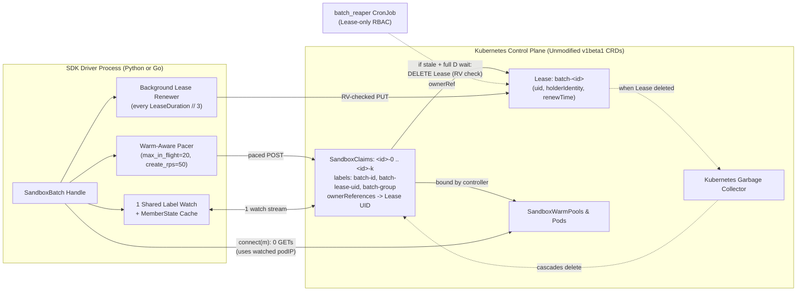
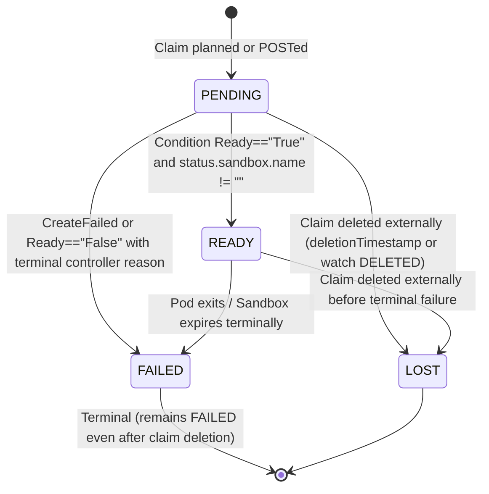
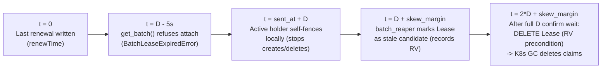

# Sandbox Batch Claim API: First-Principles Design for High-Scale Agent Fleets

## 1. Executive Summary & Problem Statement

In `kubernetes-sigs/agent-sandbox`, a `Sandbox` represents an isolated, stateful pod-backed execution environment for AI agents, and a `SandboxClaim` binds a caller to a pre-warmed `Sandbox` from a `SandboxWarmPool` (or provisions one from a `SandboxTemplate`). The existing Python and Go SDKs manage one sandbox per call (`create_sandbox` / `CreateSandbox`), which works well for interactive single-agent sessions.

Reinforcement learning (RL) post-training (such as GRPO rollout waves across 500 to 1,024 concurrent environments per training step) and large-scale evaluation suites (such as SWE-bench Verified across 500 distinct repository images) acquire and release thousands of sandboxes simultaneously. Scaling single-claim SDK loops to `N = 500..2,560` exposes four compounding bottlenecks.

1. **`O(N)` Watch Fan-Out and Socket Exhaustion.** Opening one watch stream per claim (`N` concurrent HTTP watch streams) plus `1` to `2` follow-up `GET` calls per sandbox saturates client connection pools and stalls `kube-apiserver` watch dispatch. On stock GKE at `N = 500`, `520` open client sockets inflate `claim p99` latency `7.24x` (`139.66s` vs `19.30s`) even when zero HTTP `429` rejections occur.
2. **Unpaced API Bursts vs. Over-Throttled Warm Pools.** Sending `N` unpaced `POST SandboxClaim` calls overflows Kubernetes API Priority and Fairness (APF) queues, causing HTTP `429 Too Many Requests` failures and starving `agent-sandbox-controller` status updates. Conversely, placing a static rate limit in front of `create_sandbox` needlessly throttles pre-warmed pools whose pods are already running.
3. **Missing Cohort Barriers and Incremental Pool Control.** Training drivers need first-class primitives to wait for a joint multi-pool mixture (`min_ready` out of `size` with immediate fail-fast if quorum becomes unreachable), stream completed per-pool cohorts independently, or dynamically acquire and release single sandboxes under one shared watch.
4. **Slow `O(N)` Teardown and Orphaned Pods on Driver Crash.** Deleting `1,000` claims individually issues `1,000` API writes (`35.93s` via sequential `delete_all()`). If a driver pod dies via `SIGKILL`, OOM, or node eviction, `atexit` handlers never fire, stranding hundreds of running sandbox pods until multi-hour TTLs expire.

**Solution in One Sentence.** `SandboxBatch` adds a purely client-side cohort and dynamic-pool primitive to the Python and Go SDKs (requiring **zero new CRDs or controller changes**) that multiplexes an entire fleet onto **one label-scoped watch**, skips cold rate limits using **warm-pool `readyReplicas` credit**, seeds `connect()` pod IPs with **zero `GET` calls**, tears down `1,000` claims in **`2` API calls (`~1.1s`)**, and guarantees crash-safe cleanup through a **fenced `coordination.k8s.io/v1` `Lease`** and Kubernetes garbage collection.

---

## 2. Architectural Mental Model (60-Second Overview)

A `SandboxBatch` replaces `N` independent claim state machines with one coordinated handle per namespace (or per cluster in multi-cluster fleets).

| Lifecycle Dimension (`N` Sandboxes) | Single-Claim Fan-Out (`create_sandbox` x `N`) | `SandboxBatch` (`claim_batch` / `acquire`) | Measured Impact |
| :--- | :--- | :--- | :--- |
| **Readiness Watch Streams** | `N` per-claim HTTP watch streams | **`1` shared label watch** (`batch-id` + `batch-lease-uid`) | `11.1x` fewer warm-burst sockets (`44` vs `488`); `7.24x` lower `claim p99` |
| **Data-Plane `connect()` Setup** | `1-2` `GET` requests per sandbox | **`0` `GET` requests** (`sandboxName` + `podIPs` from watch) | `1.02-1.25` vs `4.00` claim-path API requests per sandbox |
| **Creation Pacing** | Unbounded burst (`429`-prone) or static throttle | **Warm-credit fast path + `max_in_flight` cap + `create_rps` cold pacing** | `100%` completion (`0` task errors across `148,544` GKE rollouts); `103-173 ms` `1st Ready` |
| **Normal Bulk Teardown** | `N` individual `DELETE` requests | **`1` `deletecollection` + `1` `Lease` `DELETE`** | **`500x` fewer writes** at `N=1,000` (`1.10s` best / `1.44s` mean vs `35.93s`) |
| **Ungraceful Driver Crash (`SIGKILL`)** | Claims leak until `shutdownTime` TTL | **`1` `Lease` `DELETE` by `batch_reaper` -> K8s GC cascade** | Automatic recovery via `ownerReferences` using Lease-only reaper RBAC |



---

## 3. Core Concepts & Kubernetes Wire Model

Both the Python SDK (`k8s_agent_sandbox`) and Go SDK (`sigs.k8s.io/agent-sandbox/clients/go/sandbox`), along with `batch_reaper`, read and write an identical Kubernetes wire representation. A Python process can `detach()` a batch and a Go process can `GetBatch()` it (and vice versa) without translation.

### 3.1 Batch Identity, Groups, and Two Ways Claims Join a Batch

- **Batch ID (`batch_id`):** Matches `^[a-z]([-a-z0-9]*[a-z0-9])?$` with length `<= 52` characters so `<batch_id>-<ordinal>` always fits Kubernetes's 63-character DNS label limit. When omitted, the SDK generates `"b"` plus 11 random `[a-z0-9]` characters. Ordinals (`0, 1, 2, ...`) increment monotonically and are never reused.
- **Initial Fill (`BatchGroup`):** Passed to `claim_batch(groups)`. Each `BatchGroup(warmpool, size, min_ready=None)` requests `size >= 0` initial claims from `warmpool` (`min_ready` defaults to `size` and satisfies `0 <= min_ready <= size`). Passing `size=0` creates zero initial claims, serving as an anchor for dynamic `acquire()` workloads.
- **Dynamic Acquisitions (`acquire()`):** Added at any time on an active batch via `batch.acquire(warmpool, timeout=None, *, pod_annotations=None)`. Dynamic claims share the batch's single watch, `Lease` ownership, warm-pool credit, and `release()` / `release_group()` cleanup, while staying completely invisible to initial-fill consumers (`wait_for_quorum`, `group_outcomes`, `events`) and `release_not_ready()`.

### 3.2 Member Lifecycle States

Every tracked claim transitions through four states in `Member.state`:



- **Terminal failure reasons (`FAILED`):** Besides `CreateFailed` (exhausted or rejected claim `POST`), the SDK treats 8 controller `Ready=False` reasons as terminal (`InvalidMetadata`, `EnvVarsInjectionRejected`, `VolumeClaimTemplatesError`, `ClaimExpired`, `SandboxExpired`, `InvalidConfiguration`, `PodFailed`, `PodSucceeded`). Transient controller reasons (`WarmPoolNotFound`, `TemplateNotFound`, `SandboxCreatePending`, `SandboxNotReady`, `DependenciesNotReady`) stay `PENDING`.
- **Zero-GET `connect(member)` and automatic cache invalidation:** When a member is `READY`, `connect(member)` constructs and caches a `Sandbox` handle seeded with the `sandbox_name` and `pod_ips` already delivered by the batch watch. If the watch later reports the member `LOST`, `FAILED`, or bound to a different `sandbox_name` or `pod_ip`, the batch closes the cached connection automatically so subsequent traffic never hits a recycled pod IP; transient `READY -> PENDING` dips preserve the cached connection.

### 3.3 Exact Kubernetes Object Contract

| Object | Field / Key | Value & Invariant |
| :--- | :--- | :--- |
| **`Lease`**<br>`batch-<batch_id>` | `metadata.labels` | Caller `labels` + `agents.x-k8s.io/batch-id: <id>` + `agents.x-k8s.io/created-by: python-client` (`go-client`). |
| | `metadata.annotations` | `agents.x-k8s.io/batch-lease-duration`, `batch-quorum-timeout`, `batch-work-budget`, `batch-create-rps` (`6` significant digits), and `batch-next-ordinal` (written by `detach()`). |
| | `spec` | `holderIdentity` (`<host>_<pid>_<8hex>`, cleared to `None`/`nil` on `detach()`), `leaseDurationSeconds` (default `60`, or `grace` while detached), `acquireTime`, `renewTime`, `leaseTransitions` (`+1` per `get_batch` takeover). Always written via `PUT` with `resourceVersion`. |
| **`SandboxClaim`**<br>`<batch_id>-<ord>` | `metadata.labels` | Caller `labels` + `agents.x-k8s.io/batch-id: <id>` + `agents.x-k8s.io/batch-lease-uid: <lease.metadata.uid>` + `agents.x-k8s.io/batch-group: <sha256(warmpool)[:16]>` + `created-by`. |
| | `metadata.annotations` | `agents.x-k8s.io/client-first-requested-at` (all claims); `agents.x-k8s.io/batch-group-size` and `batch-group-min-ready` (**initial-fill claims only**, omitted on `acquire()` claims); optional `opentelemetry.io/trace-context`. |
| | `metadata.ownerReferences` | `[{apiVersion: "coordination.k8s.io/v1", kind: "Lease", name: "batch-<id>", uid: "<lease.metadata.uid>"}]` (`controller` and `blockOwnerDeletion` unset). |
| | `spec` | `warmPoolRef.name: <warmpool>`, optional `additionalPodMetadata.annotations` (from `acquire(pod_annotations=...)`), and `lifecycle: {shutdownPolicy: "Delete", shutdownTime: <UTC>}`. |

---

## 4. Consumption Modes & Dynamic Pool Patterns

Callers choose one of four workload shapes depending on whether tasks synchronize globally, per pool, per sandbox, or on a rolling queue. The first call to `wait_for_quorum()`, `group_outcomes()`, or `events()` locks the handle's initial-fill consumer mode (calling a conflicting mode raises `BatchError` / `ErrConsumerConflict`), while `acquire()` works alongside any mode or on an empty (`size=0`) batch.

| Workload Pattern | Primary API | When It Unblocks | Failure & Straggler Behavior |
| :--- | :--- | :--- | :--- |
| **1. Joint Cohort Barrier**<br>*(Synchronous multi-pool RL step)* | `wait_for_quorum()` | Once **every** `size > 0` group reaches `min_ready` `READY` members. | Fails fast with `QuorumUnreachableError` the moment `size - failed - lost - released < min_ready` in any group (or `BatchTimeoutError` at deadline). Call `release_not_ready()` to drop spare stragglers, or `events()` to consume extras. |
| **2. Per-Group Cohort Stream**<br>*(Multi-suite / multi-domain eval)* | `group_outcomes()` | Yields one `GroupOutcome` per group as soon as **that pool** hits `min_ready` or fails. | Isolates broken pools (`outcome.error` set to `QuorumUnreachableError` or `BatchTimeoutError`) without aborting healthy pools. |
| **3. Streaming Dispatch**<br>*(1:1 evaluation sweep)* | `events()` | Yields `MEMBER_READY`, `MEMBER_FAILED`, or `MEMBER_LOST` immediately per initial claim. | Zero barrier delay; workers `connect(m)` and `release_member(m)` as each task finishes. |
| **4. Dynamic Rolling Pool**<br>*(Async RL / multi-step `SandboxFleet`)* | `claim_batch([BatchGroup(pool, size=0)])` + `acquire()` / `release_member()` | Each `acquire(pool)` blocks on its own per-claim readiness event and returns one `READY` `Member`. | Failed/cancelled `acquire()` cleans up its own claim automatically; one batch stays open across thousands of episodes across arbitrary pools in the namespace. |

### Concise Recipes (Python Async Shown; Sync and Go Follow Identical Semantics)

**Joint Cohort Barrier (`wait_for_quorum` + `release_not_ready`):**
```python
batch = await client.claim_batch([
    BatchGroup(warmpool="math-pool", size=140, min_ready=128),
    BatchGroup(warmpool="code-pool", size=140, min_ready=128),
], namespace="rl")
try:
    cohort = await batch.wait_for_quorum()
    await batch.release_not_ready()  # Reclaim the 0..24 unneeded over-request claims immediately
    await asyncio.gather(*((await batch.connect(m)).commands.run("python3 step.py") for m in cohort))
finally:
    await batch.release()
```

**Per-Group Cohort Stream (`group_outcomes`):**
```python
batch = await client.claim_batch(groups, namespace="eval")
try:
    async for outcome in batch.group_outcomes():
        if outcome.error is not None:
            await batch.release_group(outcome.warmpool)
            continue
        await run_pool_cohort(batch, outcome.members)
        await batch.release_group(outcome.warmpool)
finally:
    await batch.release()
```

**Dynamic Rolling Pool (`size=0` + `acquire` with optional `pod_annotations`):**
```python
batch = await client.claim_batch([BatchGroup(warmpool="default-pool", size=0)], namespace="rl")
try:
    member = await batch.acquire(
        "repo-pool-42",
        timeout=180,
        pod_annotations={"podsnapshot.gke.io/ps-name": snapshot_uid},
    )
    try:
        sb = await batch.connect(member)
        await sb.commands.run("pytest -q")
    finally:
        await batch.release_member(member)
finally:
    await batch.release()
```

---

## 5. Creation Pacing, Warm-Pool Credit & Connection Scaling

### 5.1 Warm-Pool Credit + Cold-Start Pacing

A static creation rate limit (`create_rps=50`) protects `kube-apiserver` when cold-creating pods from scratch, yet artificially delays warm pools that already have hundreds of `Ready` sandboxes waiting for adoption (`160` warm claims taking `3.37s` instead of `1.27s`). Conversely, disabling pacing altogether causes cold bursts to overwhelm APF and the scheduler.

`SandboxBatch` gets the best of both regimes automatically:
1. **Precheck seeding:** When checking that each `SandboxWarmPool` and `SandboxTemplate` exist, `claim_batch` and first-use `acquire()` record `status.readyReplicas` as warm credit for that pool.
2. **Warm fast path:** While a pool has positive warm credit and is not in a `429` cooldown, creates for that pool skip `create_rps` sleep intervals and issue concurrently up to `max_in_flight` (default `20`).
3. **Cold fallback on watch signal:** The moment the shared watch (or a `410` re-list) sees a pre-Ready claim report a cold-start `Ready=False` reason (`SandboxCreatePending`, `SandboxNotReady`, or `DependenciesNotReady`), the batch zeroes that pool's remaining credit and defers its next `acquire()` credit refresh by `1s`, seamlessly falling back to `create_rps` pacing (`50/s` default).
4. **Periodic `acquire()` credit refresh & `429` cooldown:** Once `acquire()` callers spend a pool's initial credit and `create_rps` would delay the next create, `acquire()` re-reads `status.readyReplicas` at most once per second per pool. Any HTTP `429` response pauses warm credit across the batch for the numeric `Retry-After` header clamped to `[5s, 30s]` (`5s` minimum when missing or non-numeric) while deducting paced creates from remaining credit.
5. **Two-pass group-ordered initial fill:** Initial-fill ordinals `0..N-1` are contiguous per group so `get_batch()` can reconstruct group order. Creation runs in two passes: each group's first `min_ready` claims in group order first (completing early groups for `group_outcomes()` and prioritizing quorum slots), followed by each group's remaining `size - min_ready` spare claims in group order.

### 5.2 Transport Sizing, Unretried Batch Clients, and Constant-Memory Paging

- **Python HTTP pool auto-clamping and single-attempt wire control:** A batch requires `max_in_flight + 2` HTTP pool slots (`max_in_flight` concurrent requests + `1` watch + `1` Lease renewer). `SandboxClient` and `AsyncSandboxClient` expose `pool_size: int | None = None`. When `max_in_flight` is omitted on a small default `urllib3` pool, `claim_batch` automatically clamps `max_in_flight` to `pool_size - 2` (working out of the box whenever `pool_size >= 3`) and raises `ValueError` only if an explicit `max_in_flight` exceeds `pool_size - 2`. In sync Python, all batch claim and Lease calls share an `ApiClient` with `retries=False` so `urllib3`'s default `Retry(3)` cannot multiply request timeouts by `4x` or sleep up to 6 hours on `Retry-After` headers behind the SDK's own retry and Lease-expiry checks.
- **Go HTTP/2 multiplexing and isolated Lease transport:** `client-go` multiplexes 200+ concurrent creates over 2 to 3 HTTP/2 connections without hitting a stream cap, and the Go SDK disables client-side rate limiting (`QPS = -1`) when the caller left `QPS` unset. Because `x/net/http2`'s first-fit pool routes Lease renewals onto saturated create connections where apiserver kernel receive buffers inflate renewal p95 from `143 ms` to `544 ms` (`2.37s` max), the Go SDK runs Lease operations on one dedicated HTTP transport per `Client`.
- **Constant-overhead 500-item paging and streaming `deletecollection`:** Listing or releasing thousands of claims unpaged spikes Python memory (`138.9 MB` at `N = 10,000`). The SDK lists claims in `500`-item pages, strips `metadata.managedFields` on arrival, counts live claims page by page during `release()` rounds, and drains raw `deletecollection` HTTP response chunks unread without decompressing or parsing JSON, cutting `N = 5,000` `release()` peak RAM from **`69.4 MB` to `0.2 MB`** (`138.8 MB` to `9.9 MB` at `N = 10,000`).

---

## 6. Distributed Ownership, Incarnation Fencing & Crash Recovery

### 6.1 Three-Layer Cleanup Defense in Depth

Every batch claim is protected by three independent cleanup layers so neither normal exits, process crashes, nor missing cluster CronJobs can leak sandboxes permanently:

1. **Layer 1: Normal `release()` and Client Exit Hooks (`~1s`).** Calling `batch.release()` in a `try / finally` block issues label-scoped `deletecollection` rounds (`batch-id` + `batch-lease-uid`) until live non-terminating claims reach zero, then deletes `Lease` `batch-<id>` with a `resourceVersion` check. Client `with` / `async with` blocks and `atexit` (`cleanup=True`) release claimed batches and detach `get_batch()`-attached batches automatically.
2. **Layer 2: Lease-Backed `batch_reaper` + Kubernetes Cascading GC (`<= 2*D + skew_margin + poll_period`).** Every claim carries an `ownerReference` to `Lease` `batch-<id>` (`uid: <lease.metadata.uid>`). When a driver crashes (`SIGKILL` / node loss) or a detached batch outlives its `grace` window, `python -m k8s_agent_sandbox.batch_reaper` deletes **only** the stale `Lease`; Kubernetes's built-in garbage collector immediately cascades deletion to all owned `SandboxClaim`s (including any late in-flight create that commits in `kube-apiserver` milliseconds after `Lease` deletion).
3. **Layer 3: Controller `shutdownTime` Backstop (`work_budget` + `600s` margin).** Every initial claim carries `shutdownTime = call_time + ceil(N / create_rps) + quorum_timeout + work_budget + 600s` (`acquire_time + quorum_timeout + work_budget + 600s` for `acquire()`), ensuring `agent-sandbox-controller` reclaims sandboxes even in namespaces running without `batch_reaper`.

### 6.2 Multi-Process Race Scenarios and Fencing Invariants

Designing distributed ownership over reusable `batch_id` names and wall-clock `Lease` timestamps requires closing two subtle multi-process races.

#### Race 1: Stalled Driver vs. Recreated Batch Reusing `batch_id` (Why Claims Carry `batch-lease-uid`)
Suppose Driver A holds `batch-train` (`Lease` UID `u1`), stalls during a network partition or GC pause until its Lease expires and `batch_reaper` deletes `Lease` `u1`, and Driver B then creates a brand-new batch reusing `batch_id="train"` (`Lease` UID `u2`). If Driver A wakes up during an in-flight `release()` or watch reconnect and selects claims using only `agents.x-k8s.io/batch-id=train`, Driver A's `deletecollection` would wipe out Driver B's live claims!
- **Fencing invariant:** Every claim carries `agents.x-k8s.io/batch-lease-uid: <lease.metadata.uid>`, and every post-Lease watch, `get_batch` list, `release_group`, and `release` `deletecollection` selects on **both** `batch-id` and `batch-lease-uid`. In addition, `release()` conditionally replaces (`PUT`) the live `Lease` before each round after verifying Driver A's `uid`, `leaseTransitions`, and `holderIdentity` (blocking concurrent `get_batch()` attaches), and deletes the Lease at that written `resourceVersion` precondition.

#### Race 2: Holder Monotonic Expiry vs. Reaper Wall-Clock Observation (Why Reaper Waits a Full `LeaseDuration`)
An active holder renews its `Lease` every `D // 3` seconds, stamping `spec.renewTime` when constructing the request and setting its local monotonic self-fencing deadline to `sent_at + D`. If a renewal request experiences slow serialization or transit before committing, `renewTime` on the server can lag `sent_at` by up to one request window. If `batch_reaper` observed `now > renewTime + D + skew_margin` and waited only one renewal interval (`D // 3`) before deleting the `Lease`, a stalled holder whose monotonic clock has not quite reached `sent_at + D` could still issue one last claim create just as the Lease disappears.
- **Confirmation invariant:** After `batch_reaper` identifies candidate Leases with `now > renewTime + D + skew_margin` (default `skew_margin = 60s`, minimum `5s`), it sleeps each candidate's **full `leaseDurationSeconds` (`D`)** before issuing `DELETE Lease` with `Preconditions(resource_version=candidate.rv)`. By the end of that `D` wait, any live holder has either renewed the Lease (advancing `resourceVersion`, so the reaper's `DELETE` fails harmlessly with `409 Conflict`) or crossed `sent_at + D` on its monotonic clock and self-fenced completely.



### 6.3 Cross-Process Handoff (`detach` / `get_batch`) and RBAC

- **Handoff protocol:** Calling `batch.detach(grace=300)` stops local background loops, drains in-flight member deletes, clears `spec.holderIdentity`, writes `agents.x-k8s.io/batch-next-ordinal` onto the `Lease`, and sets `spec.leaseDurationSeconds = 300` (while keeping the original duration in `batch-lease-duration`). Another worker calls `client.get_batch(batch_id)`, which refuses attach if `holderIdentity` is set (`BatchInUseError`) or `now > renewTime + grace - 5s` (`BatchLeaseExpiredError`), reconstructs groups and member states from a paged claim list, increments `leaseTransitions`, restores `leaseDurationSeconds` from `batch-lease-duration`, writes its new `holderIdentity` via `resourceVersion`-checked `PUT`, and resumes the single watch from the list's `resourceVersion`.
- **Least-privilege RBAC:** Workload drivers require `sandboxclaims` (`create`, `get`, `list`, `watch`, `delete`, `deletecollection`), `sandboxwarmpools` and `sandboxtemplates` (`get`), and `coordination.k8s.io/leases` (`create`, `get`, `update`, `delete`). Because claims carry `ownerReferences` without `blockOwnerDeletion`, **`batch_reaper` needs only `get`, `list`, and `delete` on `coordination.k8s.io/leases`** and zero permissions on `SandboxClaim`s, `Sandbox`es, or `Pod`s.

---

## 7. SDK Surface & Cross-Language Parity (Python & Go)

### 7.1 Side-by-Side API Reference

| Operation | Python Sync / Async (`k8s_agent_sandbox`) | Go (`sigs.k8s.io/agent-sandbox/clients/go/sandbox`) |
| :--- | :--- | :--- |
| **Client Setup** | `SandboxClient(..., pool_size=None)`<br>`AsyncSandboxClient(..., pool_size=None)` | `sandbox.NewClient(ctx, sandbox.Options{...})`<br>*(auto `QPS=-1` for batch claims + isolated Lease transport)* |
| **Create Batch** | `[await] client.claim_batch(groups, *, namespace="default", labels=None, batch_id=None, create_rps=None, max_in_flight=None, work_budget=None, quorum_timeout=None, lease_duration=None)` | `client.ClaimBatch(ctx, groups, namespace, ...BatchOption)`<br>`WithBatchID`, `WithBatchLabels`, `WithCreateRPS`, `WithMaxInFlight`, `WithWorkBudget`, `WithQuorumTimeout`, `WithLeaseDuration` |
| **Re-attach Batch** | `[await] client.get_batch(batch_id, namespace="default")` | `client.GetBatch(ctx, batchID, namespace)` |
| **Inspect & Health** | `batch.batch_id`, `batch.namespace`, `batch.groups`, `batch.size`<br>`batch.members(warmpool=None)`, `batch.err()`, `batch.lease_degraded()` | `batch.ID()`, `batch.Namespace()`, `batch.Groups()`, `batch.Size()`<br>`batch.Members(warmPool)`, `batch.Err()`, `batch.LeaseDegraded()` |
| **Consume Fill** | `[await] batch.wait_for_quorum() -> list[Member]`<br>`[async] for o in batch.group_outcomes(): ...`<br>`[async] for ev in batch.events(): ...` | `batch.WaitForQuorum(ctx) ([]Member, error)`<br>`for o, err := range batch.GroupOutcomes(ctx)` (`iter.Seq2`)<br>`for ev, err := range batch.Events(ctx)` (`iter.Seq2`) |
| **Dynamic Acquire** | `[await] batch.acquire(warmpool, timeout=None, *, pod_annotations=None) -> Member` | `batch.Acquire(ctx, warmPool, ...AcquireOption) (Member, error)`<br>(`WithPodAnnotations(map[string]string)`) |
| **Connect** | `[await] batch.connect(member) -> Sandbox / AsyncSandbox` | `batch.Connect(ctx, member) (*Sandbox, error)`<br>*(borrowed handle; `sb.Close(ctx)` disconnects without deleting claim)* |
| **Selective Release** | `[await] batch.release_member(m)`<br>`[await] batch.release_group(warmpool)`<br>`[await] batch.release_not_ready()` | `batch.ReleaseMember(ctx, m)`<br>`batch.ReleaseGroup(ctx, warmPool)`<br>`batch.ReleaseNotReady(ctx)` |
| **Teardown / Handoff** | `try: ... finally: [await] batch.release()` (or `with` / `async with` on client)<br>`[await] batch.detach(grace=None)` | `defer batch.Release(context.WithoutCancel(ctx))`<br>`batch.Detach(ctx, grace)` |

### 7.2 Error Model Summary

- **Python:** `BatchError(SandboxError)` (where `SandboxError(RuntimeError)`) is the single catch-all runtime base class for batch failures (`BatchExistsError`, `BatchNotFoundError(BatchError, SandboxNotFoundError)`, `BatchInUseError`, `BatchLeaseExpiredError`, `BatchTimeoutError(BatchError, TimeoutError)`, `QuorumUnreachableError`, `TerminalMemberError`). Pool/template prechecks raise `SandboxWarmPoolNotFoundError` / `SandboxTemplateNotFoundError` (caught by `except SandboxError`), bad caller arguments raise `ValueError`, and raw Kubernetes `ApiException` / network errors propagate directly.
- **Go:** Idiomatic `errors.Is` sentinels (`ErrBatchExists`, `ErrBatchNotFound`, `ErrBatchInUse`, `ErrBatchLeaseExpired`, `ErrBatchClosed`, `ErrConsumerConflict`, `ErrMemberReleased`, `ErrInvalidBatchMetadata`, `ErrTimeout`) pair with `errors.As` structured types (`*QuorumUnreachableError`, `*TerminalMemberError`) and `%w`-wrapped `apimachinery` errors.

---

## 8. Ecosystem Integration (`agent-sandbox-rl`) & Measured Scale

### 8.1 Zero-Code-Change Opt-In for RL & Eval Fleets

`examples/agent-sandbox-rl` wires `SandboxBatch` directly underneath `SandboxFleet` and `AsyncSandboxFleet` via `FleetConfig(claim_mode="batch", batch_claims=BatchClaimConfig(work_budget=3600, lease_duration=300, ...))`:
- **Transparent execution:** Existing callers using `fleet.acquire(task)`, `fleet.acquire_batch(tasks)`, `fleet.release(handle)`, `fleet.run(fn, strategy=...)`, `recycle=True`, multi-cluster placement, and GKE Pod Snapshots (`snapshots=True`, `acquire(snapshot_uid=...)`) work unchanged.
- **Per-cluster shared batch:** On first `acquire()` for a cluster, the fleet opens one `size=0` `SandboxBatch`, routes every claim through `batch.acquire()`, builds `SandboxHandle`s without `GET Sandbox` or `GET pods/status` RPCs, checks batch watch state in `handle.is_alive()`, rotates `recycle=True` handles before `shutdownTime` when `< 2 * max_task_duration + reset_timeout` remains, runs one cold-start `BatchWatchdog` per cluster (ignoring handed-out handles across `suspend`/`resume`), and releases all cluster batches in parallel on `teardown()`.

### 8.2 Verified Scale Benchmarks (Fair Arm Parity)

All comparisons pair `per_claim` and `batch` on identical clusters, node pools, image caches, and driver concurrency limits.

#### Part A: Unlimited vs. Unlimited (SDK Defaults vs. `per_claim` as Shipped)
| Environment & Workload | `per_claim` (Shipped) | `SandboxBatch` Defaults (`mif=20, rps=50`) | Verified Gain |
| :--- | :--- | :--- | :--- |
| **`kind` Warm RL Cohort** (`160` sandboxes across `40` pools, PR `#2166`) | `1.43s` (`640` API reqs, `160` watches) | **`1.27s` sync / `1.32s` async** (`243` reqs, `1` watch) | Faster all-Ready + **`2.6x` fewer API calls**, `160x` fewer watches |
| **GKE Default Controller Step-Suite** (`w640` / `w1280`, `PROVENANCE.md`) | `14.37s` (`w640`) / `31.51s` (`w1280`, `1,280` watches, `218` discards) | **`9.39s` (`w640`) / `19.19s` (`w1280`, `1` watch, `0` discards)** | **`1.53x-1.64x` faster** (`batch-unbounded`: `18.80s`), **`22x` faster `w1280` TTFC** (`661ms` vs `14.84s`) |
| **GKE `w2560` Wide Step** (`2,560` warm pods across `48` gVisor nodes, `Config H`) | `57.29s` (`2,560` watches, `551` discards, `429` error on rep 2) | **`47.40s`** (`0` errors, `TTFC 194ms`, `2` watches, `0` discards) | **`100%` reliability at `2,560` width**, `0` socket discards |
| **GKE `200 x 5 = 1,000` Standing Warm Burst** (`campaign-v2` `Table 2A-2`, `c=1000`) | `8.06s` best (`488` open sockets, `618ms` best `1st Ready`) | **`6.63s` best** (**`44` flat sockets**, **`173ms` `1st Ready`**) | **`11.1x` fewer sockets**, **`3.56x` faster `1st Ready`** (`150.9 claims/s`) |
| **Pure Python SDK `1,000`-Claim Cleanup** (`p2_sdk_1000_cleanup`) | `35.93s` (`delete_all()`, `1,000` `DELETE`s) | **`1.10s` best / `1.44s` mean** (`2` API calls) | **`32.5x` peak / `24.9x` mean faster**, **`500x` fewer API calls** |

#### Part B: Matched `500`-Worker Production GKE Sweeps (Campaign 2: `148,544` Rollouts, `0` Task Errors)
| Production Workload (`10 x 32-vCPU` gVisor Nodes, Regional HA GKE `1.37`) | `HEAD per_claim` (`c=500`) | `SandboxBatch` (`c=500`, `mif=64, rps=200`) | Verified Gain |
| :--- | :--- | :--- | :--- |
| **R2E-Gym Multi-Step Sync RL** (`500` imgs x `2` x `8` steps = `8,000` tasks) | `1,494.54s` wall (`138.32s` steady step barrier) | **`390.77s` wall** (**`28.48s` steady step barrier**) | **`3.82x` faster training wall**, **`4.86x` faster step barrier**, `103ms` `1st Ready` |
| **SWE-bench Verified `3,000` (`T0` Stock APF, `naive` / `sliding` / `pipelined`)** | `403.63s` / `433.13s` / `256.98s` (`naive p99`: `139.66s`) | **`87.40s` / `88.76s` / `96.57s`** (`naive p99`: **`19.30s`**) | **`4.62x` / `4.88x` / `2.66x` faster wall**, **`7.24x` lower `claim p99`** (`4.91x` faster than in-place gVisor `git restore` recycling) |
| **Standing `1,000`-Pod Single-Pool Burst** (`c = 100 / 200 / 500 / 1000`) | `0.48s / 0.90s / 2.15s / 4.38s` mean | **`0.39s / 0.66s / 1.98s / 3.17s` mean** (`183.5/s` peak) | **`2.2x-2.8x` faster than published Blog Table 1** (`1.1s / 1.8s / 4.3s / 8.8s`) |
| **`T1` Secondary Boot Disk SWE-bench `3,000`** (`600 GB` local image cache) | `naive` `281.65s` (`claim p50` `30.48s`); `git+30s` `257.44s` | **`naive` `139.10s`** (`claim p50` **`5.31s`**); **`git+30s` `248.84s`** | **`2.02x` faster `naive` (`5.74x` lower `p50`)**; **`8.91x` faster than prior `T1` record** (`2,218.10s`) |
| **`10,000`-Claim Single-Process Wave Soak** (`50` waves x `200` claims) | `610.37s` (`512.0 MB` RSS, `3,017` threads, `202` socks) | **`573.28s`** (**`320.9 MB` RSS**, **`1,857` threads**, **`125` socks**) | **`-37.3%` memory**, **`-38.4%` threads**, zero leaks across `10,000` lifecycles |

### 8.3 Client-Side vs. Server-Side Scaling Boundaries

Once `SandboxBatch` collapses client watches to `1` and bounds client writes to `max_in_flight`, cluster-side throughput above ~500 concurrent sandboxes is governed by four infrastructure levers:
1. **Controller worker tuning (`Config H`):** Raise `--sandbox-concurrent-workers` (`200-1000`) and `--sandbox-claim-concurrent-workers` (`200-1000`) with `--api-connections=4 --separate-watch-connection=true --cache-label-selectors=true`, while keeping `--sandbox-warm-pool-concurrent-workers` bounded (`2-50`) and paired with `--sandbox-warm-pool-max-refill-rate=100` so background warm-pool refills do not flood foreground claim-binding APF seats.
2. **GKE 3-lane APF insulation:** Within GKE's 30-share custom `PriorityLevelConfiguration` guardrail, allocate `20` non-lendable shares to `agent-sandbox-controller` reconciles, `10` shares to in-cluster batch drivers, and route controller `Lease` renewals to `global-default`.
3. **Full-fleet image hydration:** Pre-populate worker node caches via chunked `DaemonSet`s (`25` images/pod, keeping node SSD occupancy `< 60%` below Kubelet's `85%` `ImageGC` threshold) or attach preloaded GCE Secondary Boot Disks (`CONTAINER_IMAGE_CACHE`).
4. **Zero-grace disposable pod teardown:** Set `terminationGracePeriodSeconds: 0` on disposable sandbox templates so `sleep infinity` containers release node `maxPods` and IPAM slots immediately between RL steps.

---

## 9. Design Alternatives & Trade-Offs

| Option Considered | Latency & Scale | RBAC & Operational Cost | Failure Modes & Complexity | Decision |
| :--- | :--- | :--- | :--- | :--- |
| **Client-side `SandboxBatch` + Fenced `Lease` + K8s GC** *(Chosen)* | `O(1)` watch, `0`-GET connect, warm-credit fast path, `2`-call bulk teardown (`1.1s` at `N=1,000`). | Zero CRD/controller upgrades; driver adds `leases`; optional `batch_reaper` CronJob needs **only** `leases` (`get`, `list`, `delete`). | Handles multi-process `batch_id` reuse via `batch-lease-uid` and stalled holders via monotonic self-fencing + full-`D` reaper confirmation wait. | **Adopted** across Python and Go SDKs. |
| **Server-side `SandboxBatch` CRD + Reconciler** | Adds extra controller hop (`Batch -> Claim -> Sandbox -> Pod`) and apiserver watch traffic; still requires client streaming APIs for `events()`, `group_outcomes()`, and `acquire()`. | Requires CRD installation, API review/deprecation guarantees, OLM/Helm chart bumps, and cluster-wide controller upgrades before any user can adopt batching. | Moves transient caller-local consumption semantics (quorum vs per-group vs rolling queue) into persistent etcd state. | **Rejected for SDK v1**; wire model does not preclude a future server-side gang-scheduling CRD if needed. |
| **Caller-side Semaphore over `create_sandbox`** | Keeps `N` watches (`7.24x` worse `claim p99` on GKE), `N` connect `GET`s, and `N` teardown `DELETE`s (`32.5x` slower). | No new RBAC, but requires custom per-application orphan sweepers. | Leaks claims on `SIGKILL`; cannot distinguish warm vs cold pools for adaptive pacing. | **Rejected**; fails at `500-1,000` concurrency. |
| **Client-side `SharedInformer` Store** | Retains `O(N)` full `SandboxClaim` CRs in driver RAM. | Same RBAC as `SandboxBatch`. | Harder to seed from `get_batch` list `resourceVersion` and awkward with Go unit-test fakes. | **Rejected** in favor of compact paged-list + label-watch `Member` state machine. |
| **Direct Claim-Deleting Reaper** | `O(1)` `deletecollection` per stale batch. | Forces granting `sandboxclaims` `deletecollection` RBAC to a background CronJob. | Cannot atomically fence claim deletion against a concurrent Lease renewal/re-attach the way `Preconditions(resource_version)` on `DELETE Lease` + K8s GC does. | **Rejected** in favor of Lease `ownerReferences` + Lease-only reaper. |
