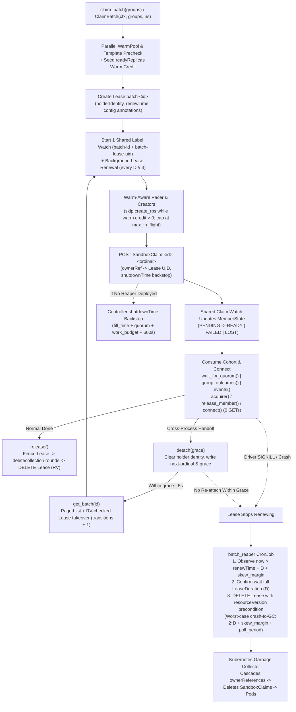

# Sandbox Batch Claim API for SDK

## Summary

We add a client-side `SandboxBatch` primitive to the Agent Sandbox Python and Go SDKs to claim, monitor, connect to, and release cohorts of `SandboxClaim`s across one or more `SandboxWarmPool`s, without introducing any new Kubernetes CRD or server-side controller changes.

## Motivation

Large-scale evaluation sweeps (such as SWE-bench Verified across 500 distinct repository images) and multi-step reinforcement learning (RL) training loops (such as synchronous GRPO rollouts across 500 to 1,024 concurrent environments per step) acquire and tear down hundreds to thousands of sandboxes at once. With the single-claim `create_sandbox` / `CreateSandbox` SDK methods, callers must stitch together fan-out loops that hit four structural scaling walls.

1. **Unbounded watch and socket fan-out (`O(N)` watches).** Every single-sandbox call opens its own per-claim watch stream and performs follow-up `GET Sandbox` or pod reads to resolve connectivity. At 500 to 1,000 concurrent sandboxes, one driver holds 500 to 1,000 open watch streams alongside data-plane connections, exhausting HTTP connection pools and inflating kube-apiserver watch dispatch tail latency (`claim p99` reaching `139.66s` at 500 concurrency even with zero HTTP `429` errors).
2. **Unpaced API bursts and APF rejections.** Firing `N` concurrent `POST SandboxClaim` requests overflows Kubernetes API Priority and Fairness (APF) queues (especially for in-cluster `ServiceAccount` drivers sharing `workload-low`), triggering HTTP `429 Too Many Requests` storms and starving controller status updates. Conversely, applying a naive fixed rate limit slows down already-Ready warm pools unnecessarily.
3. **No cohort coordination or incremental pool primitives.** Synchronous RL training needs a joint cohort barrier across multiple task pools (`min_ready` per pool) that fails fast as soon as quorum becomes unreachable, multi-domain pipelines need per-pool cohorts as each pool fills, and dynamic rolling loops need to acquire and release individual slots on demand under one shared watch.
4. **Slow `O(N)` teardown and leaked orphan claims on driver crash.** Tearing down 1,000 claims via individual `DELETE` calls issues 1,000 API writes (`35.93s` sequentially or `429`-prone concurrently). Worse, when a driver pod crashes (`SIGKILL`, OOM, or node preemption), `atexit` hooks never run, leaving hundreds of `Sandbox` pods consuming cluster capacity until long TTLs expire.

## Proposal

We introduce `claim_batch` and `get_batch` (`ClaimBatch` and `GetBatch` in Go) on the existing SDK clients, returning a `SandboxBatch` (`AsyncSandboxBatch` in async Python, `*Batch` in Go) handle backed purely by standard `SandboxClaim`s and one `coordination.k8s.io/v1` `Lease` per batch.

- **Single shared watch and zero-GET `connect()`.** One label-scoped watch tracks every claim in the batch across all warm pools (`O(1)` watch stream instead of `O(N)`). `connect(member)` builds a cached `Sandbox` handle directly from the `sandboxName` and `podIPs` already observed on the claim watch, skipping per-sandbox `GET` round-trips and closing stale cached connections automatically if a pod is lost or replaced.
- **Warm-pool-aware creation pacing.** Bounded concurrency (`max_in_flight`, default `20`) and creation rate limiting (`create_rps`, default `50`) prevent control-plane stampedes on cold creates while automatically skipping `create_rps` delays for claims covered by each pool's `status.readyReplicas` warm credit.
- **Flexible cohort consumption and dynamic `acquire()`.** Callers consume initial-fill claims through one of three modes (`wait_for_quorum`, `group_outcomes`, or streaming `events`) and dynamically grow or shrink the batch at runtime with `acquire()`, `release_member()`, `release_group()`, and `release_not_ready()`.
- **Fenced `Lease` ownership, `O(1)` bulk release, and crash-safe GC.** Every batch creates a `Lease` (`batch-<id>`) renewed in the background, stamps its `uid` as both an `ownerReference` and a fencing label (`agents.x-k8s.io/batch-lease-uid`) on every claim, tears down the entire cohort via label-scoped `deletecollection` plus `Lease` deletion (`2` API calls for 1,000 claims in `~1.1s`), supports cross-process `detach()` / `get_batch()` handoffs, and enables a lightweight `batch_reaper` CronJob to garbage-collect crashed drivers' sandboxes through Kubernetes cascading GC with Lease-only RBAC.

## Design

### Batch Model

A batch groups `SandboxClaim`s in a single Kubernetes namespace under one shared `batch_id` and one `coordination.k8s.io/v1` `Lease`.

1. **Identity and Naming.** `batch_id` is a DNS-1123 label starting with a lowercase letter (`^[a-z]([-a-z0-9]*[a-z0-9])?$`) of at most `52` characters so `<batch_id>-<ordinal>` always fits Kubernetes's 63-character label and name limit. When omitted, the SDK generates `"b"` followed by 11 cryptographically random `[a-z0-9]` characters. Claims use deterministic decimal ordinals (`<batch_id>-0`, `<batch_id>-1`, ...), and ordinals are never reused within a batch incarnation.
2. **Claim Metadata and Ownership.** Every claim created by the batch carries:
   - `agents.x-k8s.io/batch-id: <batch_id>` (batch identity label),
   - `agents.x-k8s.io/batch-lease-uid: <lease.metadata.uid>` (incarnation fencing label),
   - `agents.x-k8s.io/batch-group: <sha256(warmpool)[:16]>` (64-bit hex group hash safe for arbitrary pool name lengths),
   - `agents.x-k8s.io/created-by: python-client` (`go-client` in Go), plus any caller-supplied `labels`,
   - `agents.x-k8s.io/client-first-requested-at` (RFC3339 request timestamp read by controller startup metrics), and
   - `metadata.ownerReferences` pointing to `coordination.k8s.io/v1` `Lease` `batch-<batch_id>` with `uid: <lease.metadata.uid>` and both `controller` and `blockOwnerDeletion` omitted (requiring no extra RBAC on the Lease under `OwnerReferencesPermissionEnforcement`).
3. **Batch Lease Metadata.** The `Lease` (`batch-<batch_id>`) stores active ownership in `spec.holderIdentity` (`<host>_<pid>_<8hex>`), `spec.leaseDurationSeconds` (default `60`), `spec.acquireTime`, `spec.renewTime`, and `spec.leaseTransitions`. Its annotations persist batch configuration across `detach()` / `get_batch()` handoffs:
   - `agents.x-k8s.io/batch-lease-duration` (restores original `lease_duration` after `detach(grace)` temporarily sets `spec.leaseDurationSeconds` to `grace`),
   - `agents.x-k8s.io/batch-quorum-timeout`,
   - `agents.x-k8s.io/batch-work-budget`,
   - `agents.x-k8s.io/batch-create-rps`, and
   - `agents.x-k8s.io/batch-next-ordinal` (written by `detach()` so a re-attached handle never reuses ordinals even if trailing claims were already deleted).
4. **Groups (`BatchGroup`).** Callers pass one or more `BatchGroup(warmpool, size, min_ready=None)` entries (`size >= 0`; `min_ready` defaults to `size` and satisfies `0 <= min_ready <= size`). Initial-fill claims (`0..N-1`, where `N = sum(group.size)`) carry `agents.x-k8s.io/batch-group-size` and `agents.x-k8s.io/batch-group-min-ready` annotations so `get_batch()` reconstructs initial groups in ordinal order from live claims. A group with `size=0` creates zero initial-fill claims (acting as a placeholder for dynamic `acquire()` calls), and `acquire()` claims omit both group annotations so they never count toward initial-fill quorum or events. On `get_batch()`, a pool that has only `acquire()` claims reconstructs as `BatchGroup(warmpool=..., size=0, min_ready=0)`, while a `size=0` group with zero live claims in the cluster is omitted on the re-attached handle.
5. **Incarnation Fencing via Lease UID.** Pre-Lease collision checks in `claim_batch()` (and `get_batch()` when no Lease exists) query `agents.x-k8s.io/batch-id=<id>` so a caller cannot collide with an existing batch of the same ID. Once a handle creates or adopts its `Lease`, every claim watch, `get_batch()` claim list, `release_group()` `deletecollection`, and `release()` `deletecollection` scopes its label selector to both `agents.x-k8s.io/batch-id=<id>` and `agents.x-k8s.io/batch-lease-uid=<lease.metadata.uid>`. If an old driver stalls past Lease expiry, gets reaped, and a new driver reuses the same `batch_id` under a fresh `Lease` (with a new `uid`), late watch or `deletecollection` calls from the old driver cannot observe or delete the new incarnation's claims.

### Batch Lifecycle

#### Paced Creation

Before creating the `Lease` or any claims, `claim_batch()` validates arguments and verifies in parallel that every group's `SandboxWarmPool` and referenced `SandboxTemplate` exist, failing fast with `SandboxWarmPoolNotFoundError` or `SandboxTemplateNotFoundError` before touching cluster state. During this precheck, the SDK also reads each pool's `status.readyReplicas` to seed **warm-pool pacing credit**.

Once the `Lease` is created and the shared claim watch starts, background creators submit initial-fill claims under two complementary controls:
- **Concurrency cap (`max_in_flight`, default `20`).** Bounds simultaneous in-flight API requests (shared across fill creates, `acquire()` creates, on-demand pool checks, and member deletes) so a single batch never exhausts client sockets or APF seats.
- **Warm-aware rate pacing (`create_rps`, default `50.0`).** Claims covered by a pool's `readyReplicas` credit skip `create_rps` delays and dispatch immediately up to `max_in_flight`, because warm adoption binds pre-running pods without triggering cold pod creation bursts. Claims beyond `readyReplicas` take paced slots (`1 / create_rps` seconds apart).
- **Adaptive `429` cooldown and cold-start fallback.** If a create receives HTTP `429`, the batch pauses warm credit for the numeric `Retry-After` header clamped to `[5s, 30s]` (defaulting to `5s` when absent or formatted as an HTTP date) and deducts paced creates from remaining credit. When the batch watch or a `410` re-list observes a pre-Ready claim report a cold-start `Ready=False` reason (`SandboxCreatePending`, `SandboxNotReady`, or `DependenciesNotReady`), the batch zeroes that pool's remaining credit immediately and defers its next `acquire()` credit refresh by `1s`. In `acquire()`, once initial credit is spent and `create_rps` would delay the next create, the batch re-reads `status.readyReplicas` at most once per second per pool outside any `429` cooldown.
- **Two-pass group-ordered fill plan.** Initial-fill ordinals `0..N-1` are assigned in contiguous blocks per group, while creation executes in two passes: each group's first `min_ready` claims in group order first (so quorum waits only on required slots and earlier groups complete first for `group_outcomes()`), followed by the remaining `size - min_ready` claims in group order.
- **Bounded retries.** Each claim create attempts up to `3` requests, retrying transport errors, `429`, and `5xx` with jittered exponential backoff (`0.5s` base, `30s` cap, honoring numeric `Retry-After` up to `30s`), taking a fresh pacing slot per retry. An HTTP `409` on attempt 1 fails as a name collision, while a `409` on attempt 2+ succeeds (recovering a create whose earlier response was lost). Exhausted or non-retryable (`4xx`) creates record a synthetic `FAILED` member with `reason="CreateFailed"` without stopping the rest of the batch.

#### Membership

Every claim in the batch moves monotonically through four `MemberState` values derived from Kubernetes watch events:
- `PENDING` (`"pending"`): claim is being created or awaiting sandbox binding and readiness.
- `READY` (`"ready"`): claim's `Ready` condition has `status == "True"` and `status.sandbox.name` is non-empty; `Member` populates `sandbox_name`, `pod_ips`, and `service_fqdn`.
- `FAILED` (`"failed"`): terminal failure, either `reason="CreateFailed"` from a failed create or `Ready=False` with one of the 8 terminal controller reasons (`InvalidMetadata`, `EnvVarsInjectionRejected`, `VolumeClaimTemplatesError`, `ClaimExpired`, `SandboxExpired`, `InvalidConfiguration`, `PodFailed`, `PodSucceeded`). Transient reasons such as `WarmPoolNotFound` or `TemplateNotFound` remain `PENDING`.
- `LOST` (`"lost"`): claim carries `deletionTimestamp` or emits a watch `DELETED` event before failing terminally (`FAILED` stays `FAILED` even after deletion). Both `FAILED` and `LOST` clear `pod_ips` and `service_fqdn`.

Callers inspect current membership at any time via `batch.members(warmpool=None)` (sorted by ordinal, excluding caller-released members) and connect to any `READY` member via `batch.connect(member)`. `connect()` caches one borrowed `Sandbox` handle per claim, seeds its pod IP from the watch to avoid `GET Sandbox`, and closes the cached connection automatically if the watch reports the member `LOST`, `FAILED`, or bound to a new sandbox or pod IP.

Dynamic membership methods operate alongside or independently of the initial fill:
- **`acquire(warmpool, timeout=None, *, pod_annotations=None) -> Member`:** Validates an unseen pool once per handle, allocates the next unused ordinal, creates one claim (stamping non-empty `pod_annotations` onto `spec.additionalPodMetadata.annotations`), waits on a dedicated per-claim event until `READY`, and returns the `Member`. If `acquire()` times out, fails, or is cancelled while the batch is still healthy, it drops the member and deletes any created claim.
- **`release_member(member)`:** Stops any pending create retry for `member`, deletes its claim (skipping `CreateFailed` synthetic entries so foreign claims on a `409` collision are never deleted), closes any cached connection, and removes it from `members()`.
- **`release_group(warmpool)`:** Cancels pending creates for `warmpool` and deletes all batch claims in that pool via label-scoped `deletecollection` (`batch-id`, `batch-group`, `batch-lease-uid`).
- **`release_not_ready()`:** Atomically drops remaining uncreated initial-fill claims and deletes all initial-fill claims not currently `READY`, leaving `acquire()` calls untouched.

#### Events and Quorum

A handle fixes its initial-fill consumer mode on the first call to one of three consumers (mixing modes raises `BatchError` / `ErrConsumerConflict`):
1. **`wait_for_quorum() -> list[Member]` (Joint Cohort Barrier):** Blocks until **every** group with `size > 0` reaches `min_ready` `READY` members, returning each group's first `min_ready` `READY` members in batch group order. If any group loses enough members (`size - failed - lost - released < min_ready`) that quorum becomes mathematically impossible, `wait_for_quorum()` fails immediately with `QuorumUnreachableError` and stops remaining initial-fill creates; if the fill deadline (`last_planned_create_slot + quorum_timeout`) expires first, it raises `BatchTimeoutError`. Any early exit (including cancellation) fails the quorum permanently so buffered members are never stranded. Extra initial-fill members beyond `min_ready` can subsequently be consumed via `events()`. When every group has `size == 0`, `wait_for_quorum()` returns `[]` immediately.
2. **`group_outcomes() -> Iterator[GroupOutcome]` (Per-Group Cohort Stream):** Yields one `GroupOutcome(warmpool, members, error)` per group with `size > 0` as soon as that individual group either reaches `min_ready` (`members` populated, `error=None`) or fails (`members=[]`, `error` set to `QuorumUnreachableError` or `BatchTimeoutError`). Failed groups do not abort healthy groups. Calling `events()` afterward streams overflow `READY` members from succeeded groups.
3. **`events() -> Iterator[BatchEvent]` (Pure Streaming):** Yields `MEMBER_READY`, `MEMBER_FAILED`, and `MEMBER_LOST` events for each initial-fill claim as transitions arrive, ending cleanly once all initial-fill claims settle, the fill deadline passes, or `err()` becomes non-`None`. Calling `events()` or `group_outcomes()` again resumes from where the prior iterator stopped, and multiple workers may iterate concurrently for work-stealing dispatch.

#### Liveness

While active, the batch handle runs two background loops:
- **Label-scoped claim watch (`timeoutSeconds=30`, `35s` client read timeout):** Starts from the exact `resourceVersion` of the initial check/attach list so no transition is missed. On `410 Gone`, the loop re-lists claims in `500`-item pages and resumes watching without dropping state; on transient `429`/`5xx`/transport errors (or an empty stream closing within `1s`, preventing proxy hot-spin loops), it backs off with jitter (`0.5s` to `30s`). Non-retryable watch errors (such as `401`/`403`/`404`, malformed watch `ERROR` events, or TLS certificate errors) set sticky `batch.err()` and wake all waiters.
- **Lease heartbeating (`max(1, lease_duration // 3)` seconds):** Replaces `Lease` `batch-<id>` using `metadata.resourceVersion` (`PUT`, never blind `PATCH`). Each renewal bounds its request timeout by `min(renew_interval, remaining_lease_time)`. On transient failures, `batch.lease_degraded()` flips to `True` and retries use exponential backoff (`0.5s` to `30s`) bounded by remaining Lease time rather than waiting a full interval. On `404`, `batch.err()` sets `BatchLeaseExpiredError`; on `409` where another `holderIdentity` took over, `batch.err()` sets `BatchInUseError`.
- **Monotonic holder self-fencing:** The handle tracks `expires_at = last_successful_renewal_send_monotonic + lease_duration`. Before issuing new creates, member deletes, pool checks, or `connect()` calls, and whenever the monotonic clock crosses `expires_at`, the handle immediately fences itself (`BatchLeaseExpiredError`), stopping background work so a paused or partitioned driver never mutates cluster resources after its Lease could expire.

#### Shutdown Backstop

Every `SandboxClaim` created by the batch carries `spec.lifecycle` with `shutdownPolicy: Delete` and an immutable UTC `shutdownTime`:
- **Initial-fill claims:** `call_time + ceil(N / create_rps) + quorum_timeout + work_budget + 600s`.
- **Dynamic `acquire()` claims:** `acquire_create_time + quorum_timeout + work_budget + 600s`.

Even if a driver crashes and no reaper CronJob is deployed in the namespace, `agent-sandbox-controller` automatically deletes expired claims once `shutdownTime` passes. Callers holding sandboxes across long runs size `work_budget` (default `3600s`) above the longest period a claim stays in use.

#### Cleanup

Batch teardown and cross-process handoff use explicit, fenced transitions:
- **`release()`:** Marks the handle closed, stops pacing, waits up to `31s` (`30s` request timeout + `1s` grace) for any in-flight creates or member deletes to finish, closes cached sandbox connections, and runs label-scoped `deletecollection` rounds (`batch-id` + `batch-lease-uid`) followed by paged live-claim counts until zero non-terminating claims remain (aborting after `3` consecutive rounds with no progress). Before each round, `release()` conditionally replaces (`PUT`) the Lease after verifying `uid`, `leaseTransitions`, and `holderIdentity` (blocking concurrent `get_batch()` attaches and raising `BatchInUseError` if another holder took over), and finally deletes the `Lease` at that written `resourceVersion` precondition. Any late create that commits in `kube-apiserver` after `Lease` deletion is swept automatically within tens of milliseconds by Kubernetes garbage collection because its `ownerReference` points to the deleted Lease UID.
- **`detach(grace=None)` and `get_batch(batch_id)`:** `detach()` stops background tasks, drains active deletes, closes cached connections, reads the `Lease`, clears `spec.holderIdentity`, records `batch-next-ordinal`, sets `spec.leaseDurationSeconds` to `grace` (when supplied, `> 5s`) while preserving the original duration in `batch-lease-duration`, and writes the `Lease` with `resourceVersion`. `get_batch()` lists claims in `500`-item pages, refuses attach if `now > renewTime + leaseDurationSeconds - 5s` (`BatchLeaseExpiredError`) or if `holderIdentity` is non-empty (`BatchInUseError`), increments `leaseTransitions`, writes its new `holderIdentity` via `resourceVersion`-checked `PUT`, and resumes watching from the list's `resourceVersion`.
- **Client exit cleanup (`with` / `async with` / `atexit`):** Exiting a client context manager (or `atexit` when `cleanup=True`) **releases** batches created via `claim_batch()` (unless already detached) and **detaches** batches attached via `get_batch()` with their default grace (except async `atexit`, which cannot await `detach()` and leaves attached batches in place). Explicit `client.delete_all()` releases all tracked batches.

#### Reaper

To reclaim sandboxes promptly after an ungraceful driver crash (`SIGKILL`, OOM, or node loss) without waiting hours for `shutdownTime`, the Python SDK ships a stateless one-shot CLI (`python -m k8s_agent_sandbox.batch_reaper`, typically run as a Kubernetes `CronJob` every 1 to 2 minutes) that serves both Python- and Go-created batches.

1. **Candidate scan:** Pages through `Lease` objects carrying `agents.x-k8s.io/batch-id` (`500` per page), validating that the Lease name matches `batch-<id>` with a valid `batch_id`, `resourceVersion`, `renewTime`, and positive `leaseDurationSeconds`.
2. **Staleness filter:** Selects Leases where `now > renewTime + leaseDurationSeconds + skew_margin` (`--skew-margin`, default `60s`, minimum `5s`), covering both crashed active holders and detached batches whose handoff `grace` expired.
3. **Full `leaseDurationSeconds` confirmation wait:** Waits each candidate Lease's full `leaseDurationSeconds` (`D`, ordered shortest-duration first) from completion of the scan before attempting deletion. Because an active holder measures local Lease expiry monotonically from `request_sent_at + D` while `renewTime` reflects when the holder constructed the renewal payload before network transit or process stall, waiting a full `D` guarantees any slow or paused holder has already crossed its local `expires_at` fence and stopped issuing creates before the reaper deletes its Lease.
4. **Optimistic-concurrency `Lease` delete and K8s GC cascade:** Deletes each stale `Lease` with `Preconditions(resource_version=candidate.resource_version)`. If a live holder renewed, detached, or re-attached during the confirmation wait, `resourceVersion` advanced and the API server rejects the delete with `409 Conflict` (which the reaper logs and skips). Once the `Lease` is deleted, Kubernetes's built-in garbage collector cascades deletion to every `SandboxClaim` via its `ownerReference` (and the controller deletes the underlying `Sandbox` and `Pod`), so the reaper never lists or deletes `SandboxClaim`s directly.

### Batch Lifecycle Diagram



### RBAC

Batch drivers add `coordination.k8s.io/leases` permissions to standard `SandboxClaim` driver permissions; `batch_reaper` requires **only** `leases` permissions (`get`, `list`, `delete`) because Kubernetes garbage collection deletes owned `SandboxClaim`s automatically.

```yaml
# 1. Batch Driver Role (per workload namespace)
apiVersion: rbac.authorization.k8s.io/v1
kind: Role
metadata:
  name: agent-sandbox-batch-driver
rules:
  - apiGroups: ["extensions.agents.x-k8s.io"]
    resources: ["sandboxclaims"]
    verbs: ["create", "get", "list", "watch", "delete", "deletecollection"]
  - apiGroups: ["extensions.agents.x-k8s.io"]
    resources: ["sandboxwarmpools", "sandboxtemplates"]
    verbs: ["get"]
  - apiGroups: ["coordination.k8s.io"]
    resources: ["leases"]
    verbs: ["create", "get", "update", "delete"]
---
# 2. Batch Reaper Role (Lease-only least privilege; no claim permissions needed)
apiVersion: rbac.authorization.k8s.io/v1
kind: Role
metadata:
  name: agent-sandbox-batch-reaper
rules:
  - apiGroups: ["coordination.k8s.io"]
    resources: ["leases"]
    verbs: ["get", "list", "delete"]
```

*(Note: When Kubernetes `OwnerReferencesPermissionEnforcement` admission is enabled, omitting `blockOwnerDeletion` on the claim's `ownerReference` requires only `delete` on `sandboxclaims`, which the driver `Role` already grants.)*

## SDK API Additions

### Core Batch Methods

Both SDKs expose the same conceptual lifecycle, membership, consumption, connectivity, and handoff operations over an identical Kubernetes wire contract:

| Category | Python (`SandboxClient` / `SandboxBatch`, plus `Async*`) | Go (`*sandbox.Client` / `*sandbox.Batch`) | Purpose |
| :--- | :--- | :--- | :--- |
| **Entrypoints** | `claim_batch(groups, *, namespace="default", ...)`<br>`get_batch(batch_id, namespace="default")` | `ClaimBatch(ctx, groups, namespace, opts ...BatchOption)`<br>`GetBatch(ctx, batchID, namespace)` | Create a new batch or adopt an existing unheld/detached batch `Lease`. |
| **Inspection & Health** | `batch_id`, `namespace`, `groups`, `size`<br>`members(warmpool=None)`<br>`err()`, `lease_degraded()` | `ID()`, `Namespace()`, `Groups()`, `Size()`<br>`Members(warmPool string)`<br>`Err()`, `LeaseDegraded()` | Inspect static config, live `Member` snapshots, sticky fatal error, or transient Lease renewal degradation. |
| **Initial-Fill Consumers** | `wait_for_quorum() -> list[Member]`<br>`group_outcomes() -> Iterator[GroupOutcome]`<br>`events() -> Iterator[BatchEvent]` | `WaitForQuorum(ctx) ([]Member, error)`<br>`GroupOutcomes(ctx) iter.Seq2[GroupOutcome, error]`<br>`Events(ctx) iter.Seq2[BatchEvent, error]` | Joint all-group quorum, independent per-group quorum outcomes, or streaming member events. |
| **Dynamic Pool Ops** | `acquire(warmpool, timeout=None, *, pod_annotations=None)`<br>`release_member(member)`<br>`release_group(warmpool)`<br>`release_not_ready()` | `Acquire(ctx, warmPool, opts ...AcquireOption)`<br>`ReleaseMember(ctx, member)`<br>`ReleaseGroup(ctx, warmPool)`<br>`ReleaseNotReady(ctx)` | Add one Ready sandbox on demand or release individual members, an entire pool, or unready fill claims. |
| **Connectivity** | `connect(member) -> Sandbox` | `Connect(ctx, member) (*Sandbox, error)` | Return cached, pod-IP-seeded `Sandbox` handle without `GET Sandbox`. |
| **Lifecycle & Handoff** | `release()` (in `try / finally` or via `with client:`)<br>`detach(grace=None)` | `Release(ctx)`<br>`Detach(ctx, grace time.Duration)` | Bulk-delete claims + Lease (`O(1)` calls) or clear `holderIdentity` for cross-process re-attachment. |

### Python

The synchronous (`SandboxClient` / `SandboxBatch`) and asynchronous (`AsyncSandboxClient` / `AsyncSandboxBatch`) surfaces maintain 1-to-1 signature, docstring, and behavioral parity.

```python
from collections.abc import AsyncIterator, Iterator, Sequence
from dataclasses import dataclass, field
from enum import StrEnum
from pydantic import BaseModel, ConfigDict, Field, model_validator

# --- Data Models (k8s_agent_sandbox.models) ---

class BatchGroup(BaseModel):
    model_config = ConfigDict(frozen=True)

    warmpool: str
    size: int = Field(ge=0)
    min_ready: int | None = None  # Defaults to size; must satisfy 0 <= min_ready <= size

class MemberState(StrEnum):
    PENDING = "pending"
    READY = "ready"
    FAILED = "failed"
    LOST = "lost"

class Member(BaseModel):
    model_config = ConfigDict(frozen=True)

    claim_name: str
    sandbox_name: str | None = None
    warmpool: str
    pod_ips: tuple[str, ...] = ()
    service_fqdn: str | None = None
    state: MemberState = MemberState.PENDING
    reason: str | None = None
    message: str | None = None

class BatchEventType(StrEnum):
    MEMBER_READY = "member_ready"
    MEMBER_LOST = "member_lost"
    MEMBER_FAILED = "member_failed"

class BatchEvent(BaseModel):
    model_config = ConfigDict(frozen=True)

    type: BatchEventType
    member: Member

@dataclass(frozen=True)
class GroupOutcome:
    warmpool: str
    members: list[Member] = field(default_factory=list)
    error: "BatchError | None" = None

# --- Exceptions (k8s_agent_sandbox.exceptions) ---

class SandboxError(RuntimeError): ...
class SandboxNotFoundError(SandboxError): ...

class BatchError(SandboxError): ...
class BatchNotFoundError(BatchError, SandboxNotFoundError): ...
class BatchExistsError(BatchError): ...
class BatchInUseError(BatchError): ...
class BatchLeaseExpiredError(BatchError): ...
class BatchTimeoutError(BatchError, TimeoutError): ...

class QuorumUnreachableError(BatchError):
    warmpool: str
    size: int
    min_ready: int
    failed: int
    lost: int
    released: int

class TerminalMemberError(BatchError):
    member: Member

# --- Client Entrypoints (AsyncSandboxClient shown; SandboxClient is identical without async) ---

class AsyncSandboxClient:
    def __init__(
        self,
        connection_config: SandboxConnectionConfig | None = None,
        tracer_config: SandboxTracerConfig | None = None,
        cleanup: bool = True,          # False by default on sync SandboxClient
        api_client: ApiClient | None = None,
        pool_size: int | None = None,  # Optional K8s API HTTP pool size (>= max_in_flight + 2)
        *,
        file_config: SandboxFileConfig | None = None,
    ) -> None: ...

    async def claim_batch(
        self,
        groups: Sequence[BatchGroup],
        *,
        namespace: str = "default",
        labels: dict[str, str] | None = None,
        batch_id: str | None = None,
        create_rps: float | None = None,     # Default 50.0
        max_in_flight: int | None = None,    # Default 20 (clamped to pool_size - 2 when omitted)
        work_budget: int | None = None,      # Default 3600s
        quorum_timeout: int | None = None,   # Default 600s
        lease_duration: int | None = None,   # Default 60s (> 5s)
    ) -> AsyncSandboxBatch: ...

    async def get_batch(
        self,
        batch_id: str,
        namespace: str = "default",
    ) -> AsyncSandboxBatch: ...

# --- Batch Handle (AsyncSandboxBatch shown; SandboxBatch uses sync methods and Iterator) ---

class AsyncSandboxBatch:
    batch_id: str
    namespace: str

    @property
    def groups(self) -> list[BatchGroup]: ...

    @property
    def size(self) -> int: ...

    def members(self, warmpool: str | None = None) -> list[Member]: ...
    def err(self) -> Exception | None: ...
    def lease_degraded(self) -> bool: ...

    async def wait_for_quorum(self) -> list[Member]: ...
    def group_outcomes(self) -> AsyncIterator[GroupOutcome]: ...
    def events(self) -> AsyncIterator[BatchEvent]: ...

    async def acquire(
        self,
        warmpool: str,
        timeout: float | None = None,
        *,
        pod_annotations: dict[str, str] | None = None,
    ) -> Member: ...

    async def connect(self, member: Member) -> AsyncSandbox: ...

    async def release_member(self, member: Member) -> None: ...
    async def release_group(self, warmpool: str) -> None: ...
    async def release_not_ready(self) -> None: ...
    async def detach(self, grace: int | None = None) -> None: ...
    async def release(self) -> None: ...
```

**Error boundary rule:** `except BatchError` catches every batch-specific runtime failure (`QuorumUnreachableError`, `BatchTimeoutError`, `TerminalMemberError`, `BatchLeaseExpiredError`, `BatchInUseError`, `BatchExistsError`, `BatchNotFoundError`, consumer conflicts, and stopped-handle errors). `except SandboxError` additionally catches missing warm pools or templates (`SandboxWarmPoolNotFoundError`, `SandboxTemplateNotFoundError`) and `SandboxNotReadyError` from `connect()`. Invalid caller arguments raise `ValueError`, and direct Kubernetes API errors (`ApiException`) or transport errors during setup/teardown propagate unchanged.

### Go

The Go SDK (`clients/go/sandbox`) matches the Python wire contract byte-for-byte so Python and Go processes can `Detach` and `GetBatch` each other's batches seamlessly, while following idiomatic Go 1.23+ conventions:
- **Functional options (`...BatchOption` and `...AcquireOption`)** match `CreateSandbox(ctx, warmPool, namespace, ...CreateOption)` and validate explicit invalid values (such as `WithCreateRPS(0)`) instead of silently treating zero values as defaults.
- **Pointer `MinReady *int`** distinguishes an explicit `MinReady: ptr.To(0)` on a non-empty group from an unset `nil` (which defaults to `Size`).
- **`iter.Seq2[T, error]` consumers (`Events`, `GroupOutcomes`)** deliver both items and terminal errors cleanly without background channel-producer leaks, support breaking early, and resume cleanly when called again.
- **Borrowed `*Sandbox` handles from `Connect`:** Calling `sb.Close(ctx)` on a batch-connected `*Sandbox` disconnects the local tunnel/session without deleting the `SandboxClaim` (use `batch.ReleaseMember(ctx, m)` to delete the claim).
- **Automatic `QPS = -1` and isolated Lease transport:** When the caller leaves `rest.Config.QPS` at zero, the batch claim client sets `QPS = -1` (disabling `client-go`'s 5 QPS bottleneck) and `MaxRetries(0)` (so one SDK attempt equals one wire request), while the Lease client runs without the caller's `RateLimiter` on a dedicated HTTP transport so heavy create bursts cannot queue Lease renewals behind apiserver per-connection receive buffers.

```go
package sandbox

import (
	"context"
	"iter"
	"time"
)

type BatchGroup struct {
	WarmPool string
	Size     int  // >= 0; 0 creates no initial-fill claims
	MinReady *int // nil => Size; must satisfy 0 <= *MinReady <= Size
}

type MemberState string

const (
	MemberPending MemberState = "pending"
	MemberReady   MemberState = "ready"
	MemberFailed  MemberState = "failed"
	MemberLost    MemberState = "lost"

	MemberReasonCreateFailed = "CreateFailed"
)

type Member struct {
	ClaimName   string
	SandboxName string
	WarmPool    string
	PodIPs      []string
	ServiceFQDN string
	State       MemberState
	Reason      string
	Message     string
}

type BatchEventType string

const (
	BatchEventMemberReady  BatchEventType = "member_ready"
	BatchEventMemberFailed BatchEventType = "member_failed"
	BatchEventMemberLost   BatchEventType = "member_lost"
)

type BatchEvent struct {
	Type   BatchEventType
	Member Member
}

type GroupOutcome struct {
	WarmPool string
	Members  []Member
	Err      error // *QuorumUnreachableError or wraps ErrTimeout
}

type BatchOption func(*batchOptions)

func WithBatchID(id string) BatchOption
func WithBatchLabels(labels map[string]string) BatchOption
func WithCreateRPS(rps float64) BatchOption
func WithMaxInFlight(n int) BatchOption
func WithWorkBudget(d time.Duration) BatchOption
func WithQuorumTimeout(d time.Duration) BatchOption
func WithLeaseDuration(d time.Duration) BatchOption

type AcquireOption func(*acquireOptions)

func WithPodAnnotations(annotations map[string]string) AcquireOption

var (
	ErrBatchExists          = errors.New("batch already exists")
	ErrBatchNotFound        = errors.New("batch not found")
	ErrBatchInUse           = errors.New("batch is held by another handle")
	ErrBatchLeaseExpired    = errors.New("batch lease expired")
	ErrBatchClosed          = errors.New("batch handle was released or detached")
	ErrConsumerConflict     = errors.New("batch consumer mode conflict")
	ErrMemberReleased       = errors.New("batch member was released")
	ErrInvalidBatchMetadata = errors.New("invalid batch metadata")
)

type QuorumUnreachableError struct {
	WarmPool                                string
	Size, MinReady, Failed, Lost, Released int
}

func (e *QuorumUnreachableError) Error() string

type TerminalMemberError struct{ Member Member }

func (e *TerminalMemberError) Error() string

func (c *Client) ClaimBatch(ctx context.Context, groups []BatchGroup, namespace string, opts ...BatchOption) (*Batch, error)
func (c *Client) GetBatch(ctx context.Context, batchID, namespace string) (*Batch, error)

func (b *Batch) ID() string
func (b *Batch) Namespace() string
func (b *Batch) Groups() []BatchGroup
func (b *Batch) Size() int
func (b *Batch) Members(warmPool string) []Member
func (b *Batch) Err() error
func (b *Batch) LeaseDegraded() bool

func (b *Batch) WaitForQuorum(ctx context.Context) ([]Member, error)
func (b *Batch) GroupOutcomes(ctx context.Context) iter.Seq2[GroupOutcome, error]
func (b *Batch) Events(ctx context.Context) iter.Seq2[BatchEvent, error]
func (b *Batch) Acquire(ctx context.Context, warmPool string, opts ...AcquireOption) (Member, error)
func (b *Batch) Connect(ctx context.Context, m Member) (*Sandbox, error)

func (b *Batch) ReleaseMember(ctx context.Context, m Member) error
func (b *Batch) ReleaseGroup(ctx context.Context, warmPool string) error
func (b *Batch) ReleaseNotReady(ctx context.Context) error
func (b *Batch) Detach(ctx context.Context, grace time.Duration) error
func (b *Batch) Release(ctx context.Context) error
```

## SDK Usage

### Python

#### 1. Fixed cohort example

Synchronous RL steps that require a joint mixture across pools over-request slightly (`size=140, min_ready=128`), wait for all groups via `wait_for_quorum()`, trim stragglers with `release_not_ready()`, and execute rollouts concurrently.

```python
import asyncio
from k8s_agent_sandbox import AsyncSandboxClient, BatchGroup, Member

async def run_joint_step(client: AsyncSandboxClient) -> list[str]:
    groups = [
        BatchGroup(warmpool="math-pool", size=140, min_ready=128),
        BatchGroup(warmpool="code-pool", size=140, min_ready=128),
    ]
    batch = await client.claim_batch(
        groups, namespace="rl-train", quorum_timeout=180, work_budget=900
    )
    try:
        cohort: list[Member] = await batch.wait_for_quorum()

        # Free still-pending stragglers so nodes reclaim capacity immediately
        await batch.release_not_ready()

        async def rollout(member: Member) -> str:
            sb = await batch.connect(member)
            res = await sb.commands.run("python3 /workspace/step.py")
            return res.stdout

        return await asyncio.gather(*(rollout(m) for m in cohort))
    finally:
        await batch.release()
```

#### 2. Per-group quorum example

Multi-suite benchmarks where each pool can start as soon as its own `min_ready` threshold arrives consume `group_outcomes()`, isolating any pool that fails to fill while healthy pools run to completion.

```python
import asyncio
from k8s_agent_sandbox import AsyncSandboxClient, BatchGroup, GroupOutcome

async def run_per_suite_cohorts(client: AsyncSandboxClient, pools: list[str]) -> None:
    groups = [BatchGroup(warmpool=p, size=36, min_ready=32) for p in pools]
    batch = await client.claim_batch(groups, namespace="eval")
    try:
        tasks: list[asyncio.Task[None]] = []

        async def run_suite(outcome: GroupOutcome) -> None:
            try:
                await asyncio.gather(*(
                    (await batch.connect(m)).commands.run("pytest -q")
                    for m in outcome.members
                ))
            finally:
                await batch.release_group(outcome.warmpool)

        async for outcome in batch.group_outcomes():
            if outcome.error is not None:
                # Reclaim any partial survivors in the failed pool and keep running others
                await batch.release_group(outcome.warmpool)
                continue
            tasks.append(asyncio.create_task(run_suite(outcome)))

        if batch.err() is not None:
            raise batch.err()
        await asyncio.gather(*tasks)
    finally:
        await batch.release()
```

#### 3. Pure streaming dispatch example

Evaluation sweeps where every task is independent stream `events()` and release each member immediately upon task completion so cluster footprint shrinks monotonically.

```python
import asyncio
from k8s_agent_sandbox import AsyncSandboxClient, BatchEventType, BatchGroup, Member

async def stream_eval(client: AsyncSandboxClient) -> None:
    groups = [BatchGroup(warmpool="swebench-pool", size=500)]
    batch = await client.claim_batch(groups, namespace="eval", work_budget=1800)
    try:
        running: set[asyncio.Task[None]] = set()

        async def evaluate(member: Member) -> None:
            try:
                sb = await batch.connect(member)
                await sb.commands.run("/runner/grade.sh")
            finally:
                await batch.release_member(member)

        async for event in batch.events():
            if event.type is BatchEventType.MEMBER_READY:
                t = asyncio.create_task(evaluate(event.member))
                running.add(t)
                t.add_done_callback(running.discard)

        await asyncio.gather(*running)
        if batch.err() is not None:
            raise batch.err()
    finally:
        await batch.release()
```

#### 4. Pipelined rolling queue example

Long-running asynchronous RL actors or dynamic multi-pool task queues open an empty-fill batch (`size=0`) and call `acquire()` / `release_member()` behind a bounded worker pool, sharing a single watch stream and warm-pool credit across thousands of sequential acquisitions.

```python
import asyncio
from k8s_agent_sandbox import AsyncSandboxClient, BatchGroup

async def rolling_worker_pool(
    client: AsyncSandboxClient, work_items: list[tuple[str, str]], concurrency: int = 128
) -> None:
    # Partition concurrency budget across pools dynamically under one shared watch
    queue: asyncio.Queue[tuple[str, str] | None] = asyncio.Queue()
    for item in work_items:
        queue.put_nowait(item)
    for _ in range(concurrency):
        queue.put_nowait(None)

    placeholder = [BatchGroup(warmpool=work_items[0][0], size=0)]
    batch = await client.claim_batch(
        placeholder, namespace="rl-async", max_in_flight=64, work_budget=3600
    )
    try:
        async def worker() -> None:
            while (item := await queue.get()) is not None:
                pool_name, cmd = item
                member = await batch.acquire(pool_name, timeout=180)
                try:
                    sb = await batch.connect(member)
                    await sb.commands.run(cmd)
                finally:
                    await batch.release_member(member)

        await asyncio.gather(*(worker() for _ in range(concurrency)))
    finally:
        await batch.release()
```

### Go

Go callers use `ClaimBatch` with functional options, pass `context.WithoutCancel(ctx)` in `defer batch.Release(...)` so cleanup still completes after `SIGINT` cancels `ctx`, and range over `iter.Seq2` consumers.

```go
package main

import (
	"context"
	"fmt"
	"time"

	"k8s.io/utils/ptr"
	"sigs.k8s.io/agent-sandbox/clients/go/sandbox"
)

func runCohort(ctx context.Context, client *sandbox.Client) error {
	groups := []sandbox.BatchGroup{
		{WarmPool: "math-pool", Size: 70, MinReady: ptr.To(64)},
		{WarmPool: "code-pool", Size: 70, MinReady: ptr.To(64)},
	}
	batch, err := client.ClaimBatch(
		ctx, groups, "rl-train",
		sandbox.WithQuorumTimeout(3*time.Minute),
		sandbox.WithWorkBudget(30*time.Minute),
	)
	if err != nil {
		return err
	}
	defer batch.Release(context.WithoutCancel(ctx))

	for outcome, err := range batch.GroupOutcomes(ctx) {
		if err != nil {
			return err
		}
		if outcome.Err != nil {
			_ = batch.ReleaseGroup(ctx, outcome.WarmPool)
			continue
		}
		for _, m := range outcome.Members {
			sb, err := batch.Connect(ctx, m)
			if err != nil {
				return err
			}
			res, err := sb.Run(ctx, "python3 /workspace/eval.py")
			_ = sb.Close(ctx) // Disconnects borrowed handle without deleting the claim
			if err != nil {
				return err
			}
			fmt.Println(m.ClaimName, res.ExitCode)
		}
	}
	return nil
}
```

### Agent Sandbox RL

`examples/agent-sandbox-rl` integrates `SandboxBatch` directly into `SandboxFleet` and `AsyncSandboxFleet` through an opt-in configuration flag (`FleetConfig(claim_mode="batch")`), requiring zero changes to existing training or evaluation caller loops (`acquire`, `acquire_batch`, `release`, `run`, `recycle=True`, and GKE `snapshots=True`).

```python
from agent_sandbox_rl import BatchClaimConfig, FleetConfig, SandboxFleet

fleet = SandboxFleet(FleetConfig(
    clusters=[...],
    max_concurrent=500,
    claim_mode="batch",
    batch_claims=BatchClaimConfig(
        work_budget=3600,     # Longest rollout duration in seconds (+ 600s SDK margin)
        lease_duration=300,   # 5m Lease duration protects in-flight rollouts across transient API blips
        create_rps=200.0,     # Optional override (None uses SDK default 50.0)
        max_in_flight=64,     # Optional override (None uses SDK default 20)
    ),
))
```

Under `claim_mode="batch"`, an internal `BatchClaims` coordinator lazily opens one empty-fill (`size=0`) `SandboxBatch` per target cluster on the first `acquire()` for that cluster (tagging the Lease and claims with `agents.x-k8s.io/asrl-run-id`). Every subsequent `fleet.acquire()` calls `batch.acquire(pool, timeout=claim_timeout, pod_annotations=...)`:
- **Zero redundant control-plane reads:** The fleet builds each `SandboxHandle` directly from `Member.sandbox_name` and `Member.pod_ips` without reading `Sandbox` or `pods/{name}/status` on acquire, and `handle.is_alive()` checks the batch watch cache for claim loss or pod replacement before falling back to REST pod status reads.
- **Cold-start fail-fast watchdog:** One lightweight `BatchWatchdog` thread per cluster inspects `PENDING` cold-start claims for fatal pod conditions (`ImagePullBackOff`, `CrashLoopBackOff`, `CreateContainerConfigError`) without ever inspecting or releasing members already handed out to callers (preserving `suspend()` / `resume()` transitions).
- **Snapshot and teardown integration:** `acquire(snapshot_uid=...)` forwards GKE Pod Snapshot pin annotations via `batch.acquire(..., pod_annotations=...)`; `release(delete_snapshots=True)` cleans up manual snapshot triggers; `fleet.teardown()` releases all cluster batches in parallel; and `reap(run_id=...)` sweeps orphaned claims and batch Leases safely (tolerating `per_claim` identities that lack Lease RBAC).

#### Rollout Waves: Per-Step Cohorts

Step-synchronous RL loops (such as GRPO where `G` rollouts run per prompt at every step) acquire a step cohort concurrently via `await fleet.acquire_batch(step_tasks)` under `claim_mode="batch"`. `acquire_batch` fans out bounded concurrent `batch.acquire()` calls over the cluster's single shared watch and warm-pool credit, rolling back and releasing all completed handles automatically if any task fails or the step is cancelled (`CancelledError`). Callers that instead want strict over-request quorum (`size > min_ready`) across fixed warm pools can call `client.claim_batch(groups)` + `wait_for_quorum()` or `group_outcomes()` directly per wave.

#### Held Pools: Reuse Across Steps

When `recycle=True` (such as `GitRestoreReset` reusing held sandboxes across multiple tasks or RL steps), `SandboxFleet` keeps the claimed member across episodes and checks its remaining `shutdownTime` budget before handing it out again. Because a batch claim's `shutdownTime` is fixed at creation (`claim_timeout + work_budget + 600s`), the fleet automatically retires and rotates a recycled batch claim once less than `2 * max_observed_task_duration + reset_timeout` remains before `shutdownTime`, preventing mid-episode claim expiration while keeping the single cluster-wide `SandboxBatch` open across the entire training job.

#### Warm Pools Under a Batch

`SandboxBatch` decouples **warm pool lifecycle** (`SandboxTemplate` and `SandboxWarmPool` provisioning, sizing, DaemonSet pre-pull, and `adopt_existing=True` pool discovery in `SandboxFleet`) from **claim multiplexing**. Multiple distributed RL `RolloutWorker` pods sharing one `FleetConfig(run_id="...", adopt_existing=True, claim_mode="batch")` can claim concurrently from shared standing `SandboxWarmPool`s: each worker pod holds and renews its own independent `SandboxBatch` `Lease`, collapses hundreds of per-worker watches down to `1` watch per worker pod, and scales `BatchClaimConfig(max_in_flight=...)` per replica so aggregate cluster create concurrency stays within APF seats.

#### Upgrading Existing Evaluation Executors

Existing `SandboxFleet.run(fn, strategy="naive" | "sliding" | "pipelined")` and `AsyncSandboxFleet.run(...)` evaluation harnesses upgrade to batch claiming by setting `claim_mode="batch"` in `FleetConfig` with zero changes to `fn` or strategy flags:

```python
from agent_sandbox_rl import AsyncSandboxFleet, BatchClaimConfig, FleetConfig

async def evaluate_swebench(tasks, grade_fn):
    # Evaluates sliding or pipelined windows with bounded cluster concurrency over 1 watch/cluster
    config = FleetConfig(
        clusters=[...],
        max_concurrent=500,
        window_size=200,
        claim_mode="batch",
        batch_claims=BatchClaimConfig(max_in_flight=64, create_rps=200.0, work_budget=3600),
    )
    async with AsyncSandboxFleet(config) as fleet:
        fleet.load_tasks(tasks)
        await fleet.setup(prepull=True)
        return await fleet.run(grade_fn, strategy="pipelined")
```

### Scalability

#### Batch Claim Improvements

Replacing `N` independent per-claim lifecycles with one `SandboxBatch` changes control-plane and client scaling from `O(N)` to `O(1)` on watches and teardown:

| Operation (`N` Sandboxes) | Per-Claim SDK (`create_sandbox` x `N`) | `SandboxBatch` (`claim_batch` / `acquire`) | Scaling Impact |
| :--- | :--- | :--- | :--- |
| **Readiness Watch Streams** | `N` concurrent watch HTTP streams | **`1` namespace label watch** (`batch-id` + `batch-lease-uid`) | Eliminates watch-dispatch tail spikes (`7.24x` lower `claim p99` at `N=500` on GKE) |
| **Connect Metadata Reads** | `1-2` `GET`s per sandbox (`N` to `2N` reads) | **`0` `GET`s** (`sandboxName` + `podIPs` seeded from watch) | Halves steady-state claim-path API requests (`1.02-1.25` vs `4.00` reqs/env) |
| **Creation Burst Control** | Unbounded `N` concurrent `POST`s | **Warm-credit fast path + `max_in_flight` cap + `create_rps` cold pacing** | `0` APF `429` crashes at `500-2,560` concurrency while preserving sub-200ms warm `1st Ready` |
| **Normal Bulk Teardown** | `N` individual `DELETE` calls | **`1` `deletecollection` + `1` `Lease` `DELETE`** | **`500x` fewer teardown writes** at `N=1,000` (`1.10s` best / `1.44s` mean vs `35.93s` `delete_all()`) |
| **Driver Crash Cleanup** | `0` immediate cleanup (leaks until TTL) | **`1` `Lease` `DELETE` by `batch_reaper` -> K8s GC cascade** | Bounded recovery (`<= 2*D + skew_margin + poll_period`) with Lease-only reaper RBAC |

**Verified Benchmark Results (Fair Arm Parity).**
1. **Unlimited vs Unlimited (SDK Defaults vs Per-Claim as Shipped):**
   - **Kind (`160` warm sandboxes across `40` pools, PR `#2166`):** `SandboxBatch` defaults (`max_in_flight=20, create_rps=50` with warm credit) reach all-Ready in **`1.27s` sync / `1.32s` async** (`0` `429`s, `243` API requests, `1` watch) vs **`1.43s`** for `per_claim` (`640` API requests, `160` watches), while cold `300`-claim fills reach first Ready in `1.35s` vs `10.21s` unpaced.
   - **Managed GKE Step-Suite (`PROVENANCE.md` `@ a8dfcb8d`, identical cluster and controller):** Under default controller flags, `batch-default` (`mif=20`) beats `per-claim` at every width (`w160`: `2.12s` vs `2.36s`; `w640`: **`9.39s` vs `14.37s`**, `TTFC 338ms` vs `1300ms`; `w1280`: **`19.19s` vs `31.51s`**, `0` vs `218` socket discards, `1` vs `1,280` watches; `batch-unbounded` `18.80s`). Under `Config H` at `w2560` (`2,560` warm sandboxes across `48` gVisor nodes), `batch-default` completes `2,560/2,560` in **`47.40s`** (`TTFC 194ms`, `2` watches, `0` discards) vs `per-claim` `57.29s` (`2,560` watches, `551` socket discards, `429` error on repeat).
   - **GKE Standing `1,000`-Pod Multi-Pool Burst (`200 x 5 = 1,000`, `campaign-v2` `Table 2A-2`):** SDK default `batch (mif=20)` holds a flat **`44` open sockets** across `c = 100..1000` vs **`488` sockets** on `per_claim` (**`11.1x` fewer**), achieves **`173 ms` `1st Ready`** at `c = 1,000` (`3.56x` faster than `per_claim` best `618 ms`), and finishes the `1,000`-claim burst in **`6.63s` best (`150.9 claims/s`)** vs `8.06s` (`124.1 claims/s`).
2. **Matched-Concurrency `1,000`-Sandbox GKE Campaign 2 (`148,544` Claims & Rollouts Across `36` Runs, `0` Task Errors, `max_concurrent=500` on Both Arms):**
   - **R2E-Gym Multi-Step Sync RL (`500` images x `2` rollouts x `8` steps = `8,000` tasks):** `claim_mode="batch"` (`mif=64, rps=200`) cuts 8-step wall time **`3.82x`** (`1,494.54s` -> **`390.77s`**, `20.47 tasks/s` vs `5.35 tasks/s`) and shrinks the steady-state synchronous step barrier **`4.86x`** (`138.32s` -> **`28.48s`**).
   - **SWE-bench Verified `500 x 6 = 3,000` (`T0` Stock GKE APF):** `batch` accelerates end-to-end wall time **`4.62x` on `naive`** (`403.63s` -> **`87.40s`**, cutting `claim p99` **`7.24x`** from `139.66s` to **`19.30s`**), **`4.88x` on `sliding`** (`433.13s` -> **`88.76s`**), and **`2.66x` on `pipelined`** (`256.98s` -> **`96.57s`**), and beats in-place gVisor `git restore` recycling (`429.24s`) by **`4.91x`** using fresh warm pods.
   - **`10,000`-Claim Single-Process Soak (`50` waves x `200` claims):** `10,000/10,000` succeeded with `-37.3%` driver RSS (`320.9 MB` vs `512.0 MB`), `-38.4%` threads, and `1.62x` fewer open sockets.

#### Transport & Connection Scaling

- **Python HTTP pool sizing and unretried batch transport:** A batch runs up to `max_in_flight` concurrent requests plus `2` long-lived slots (one for the watch stream and one for Lease renewals). `SandboxClient` and `AsyncSandboxClient` accept `pool_size: int | None = None`. When a caller omits `max_in_flight` on a small default pool (for example on low-vCPU containers where `kubernetes` sizes `urllib3` pools to `cpu_count * 5`), `claim_batch()` automatically clamps the default `max_in_flight` down to `pool_size - 2` (so `pool_size >= 3` works out of the box) and raises `ValueError` only if an **explicit** `max_in_flight` exceeds `pool_size - 2` or `pool_size < 3`. In synchronous Python, all batch custom-object and Lease calls share one `ApiClient` configured with `retries=False` so `urllib3`'s hidden `Retry(3)` loop cannot multiply timeouts by `4x` or sleep up to 6 hours on `Retry-After` headers behind the SDK's Lease-bounded retry logic.
- **Go HTTP/2 multiplexing and isolated Lease transport:** `client-go` multiplexes concurrent creates over HTTP/2 (`200` concurrent creates measured across `2-3` TCP connections on `kind` with zero stream-cap failures). However, `golang.org/x/net/http2`'s first-fit connection pool places Lease renewal `PUT`s onto the busiest create connection, where apiserver kernel receive buffers add `544 ms` p95 tail latency (`2.37s` max) vs `143 ms` p95 on an isolated connection (`18/18` paired runs). The Go SDK therefore keeps one lightweight isolated HTTP transport per `Client` for Lease operations while leaving claim creates on the shared HTTP/2 transport with `QPS = -1`.

#### Batch Scaling

Listing or deleting thousands of `SandboxClaim` CRs in one unpaged response creates `O(N)` JSON/dict memory spikes on the client (`138.9 MB` at `N = 10,000`). The SDK bounds client memory across large batches through four mechanisms (PR `#2175`):
1. **500-item paged claim listing (`limit=500`):** `claim_batch`, `get_batch`, and `410 Gone` watch re-lists iterate `continue` tokens in `500`-item pages (matching `client-go`), starting the watch from the first page's `resourceVersion` and restarting once if a `continue` token expires.
2. **Dropping `metadata.managedFields`:** Each listed page strips `managedFields` immediately on arrival, cutting retained claim dictionary memory by more than half.
3. **Page-by-page live counting in `release()`:** Deletion verification rounds count non-terminating claims one page at a time, freeing each page before fetching the next.
4. **Raw `deletecollection` response draining:** `deletecollection` returns a `V1Status` / list body listing every deleted item; the SDK drains raw response chunks unread without decompressing or JSON-parsing them, dropping `N = 5,000` `release()` peak memory from **`69.4 MB` to `0.2 MB`** and `N = 10,000` `release()` peak memory from **`138.8 MB` to `9.9 MB`**.

#### Client-side vs. Server-side Scaling

`SandboxBatch` eliminates **client-side and API- watch/teardown bottlenecks**, turning the SDK driver from the primary failure point into a flat, bounded consumer (`1` watch, `<= max_in_flight` concurrent writes). Above ~500 concurrent sandboxes, end-to-end throughput is governed by **server-side controller and cluster configuration**:
- **Controller worker concurrency:** Default `agent-sandbox-controller` worker counts (`--sandbox-concurrent-workers=100`, `--sandbox-claim-concurrent-workers=50`, `--sandbox-warm-pool-concurrent-workers=1`) serialize binding and replenishment at 1,000+ scale. High-scale deployments raise sandbox/claim workers (`200-1000`), enable `--api-connections=4 --separate-watch-connection=true --cache-label-selectors=true`, and bound `--sandbox-warm-pool-concurrent-workers` (`2-50`) paired with `--sandbox-warm-pool-max-refill-rate=100` so background warm-pool refills do not contend with foreground claim binding in shared APF queues (avoiding a measured `155x` GKE `workload-low` APF queue-wait spike when 100 unpaced warm-pool workers burst simultaneously).
- **APF lane topology:** On managed GKE (where custom `PriorityLevelConfiguration` shares are capped at `30`), splitting `20` non-lendable shares for `agent-sandbox-controller` (`agent-sandbox-critical`) and `10` shares for in-cluster drivers (`agent-sandbox-bulk`) while keeping controller `Lease` traffic on `global-default` eliminates controller starvation.
- **Node image caching and pod teardown:** Hydrating task images across worker nodes via chunked `DaemonSet`s or pre-baked GCE Secondary Boot Disks (`CONTAINER_IMAGE_CACHE`, `370 ms` median `exec`) and setting `terminationGracePeriodSeconds: 0` on disposable sandbox templates remove node-level pull and `maxPods` teardown stalls.

## Alternatives

| Alternative | Mechanism | Cost & Failure Modes | Why Rejected |
| :--- | :--- | :--- | :--- |
| **1. Server-side `SandboxBatch` CRD + Controller** | Add `SandboxBatch` to `extensions.agents.x-k8s.io`, reconciled into child `SandboxClaim`s in Go. | Requires CRD schema review, deprecation/versioning lifecycle, OLM/Helm chart sync, RBAC upgrades across clusters, and controller memory/workqueue overhead for transient job-local cohorts (`wait_for_quorum`, `group_outcomes`, rolling `acquire`). | Every batch invariant (single label watch, `Lease` `ownerReferences` GC, `deletecollection`, warm-credit pacing) works today against unmodified `v1beta1` clusters; client-side iteration also shipped and validated 1,000-sandbox GKE findings immediately without locking premature CRD schemas. A future CRD remains compatible if server-managed gang scheduling is ever needed. |
| **2. Caller-side `asyncio.gather` / `errgroup` over `create_sandbox`** | Keep SDK unchanged; let callers wrap `create_sandbox` with a semaphore. | Still opens `N` per-claim watches, issues `N-2N` extra `GET`s on connect, sends `N` individual `DELETE`s on cleanup (`32.5x` slower at `N=1,000`), lacks warm-aware cold pacing, and leaks claims on `SIGKILL`. | Fails to solve the `O(N)` watch fan-out, teardown write storm, and crash-orphaning problems demonstrated on GKE. |
| **3. Client-side `SharedInformer` / `Reflector` Cache** | Cache full `SandboxClaim` objects in a standard informer store per batch. | Retains full Kubernetes CR payloads in RAM (`O(N)` object overhead), requires complex `WatchList` / quorum-read wrappers in Go fakes, and complicates cross-process `get_batch` initial `resourceVersion` handoff. | A focused paged-list + label-watch state machine stores only compact `Member` records, strips `managedFields`, and passes 100% golden trace parity across Python and Go. |
| **4. Label-Sweeping Reaper (Deleting Claims Directly)** | Have `batch_reaper` list and `deletecollection` `SandboxClaim`s for stale batches before deleting the `Lease`. | Requires granting `sandboxclaims` `list`/`delete`/`deletecollection` RBAC to a cluster/namespace reaper `CronJob`, and introduces a TOCTOU race if a recovering or newly re-attached holder is active while the reaper sweeps claims without atomic Lease fencing. | Tying claims to the `Lease` via `ownerReferences` lets `batch_reaper` delete **only** the `Lease` using an atomic `Preconditions(resource_version)` check (Lease-only RBAC), delegating claim cascade deletion to Kubernetes's built-in garbage collector. |
| **5. Kubernetes `Job` Pods Wrapping Sandboxes** | Run one Kubernetes `Job` pod per rollout to own its `SandboxClaim`. | Doubles pod scheduling, IPAM, and kubelet churn (`2N` pods for `N` sandboxes). | Defeats sub-second warm-pool adoption at 1,000-sandbox scale. |
