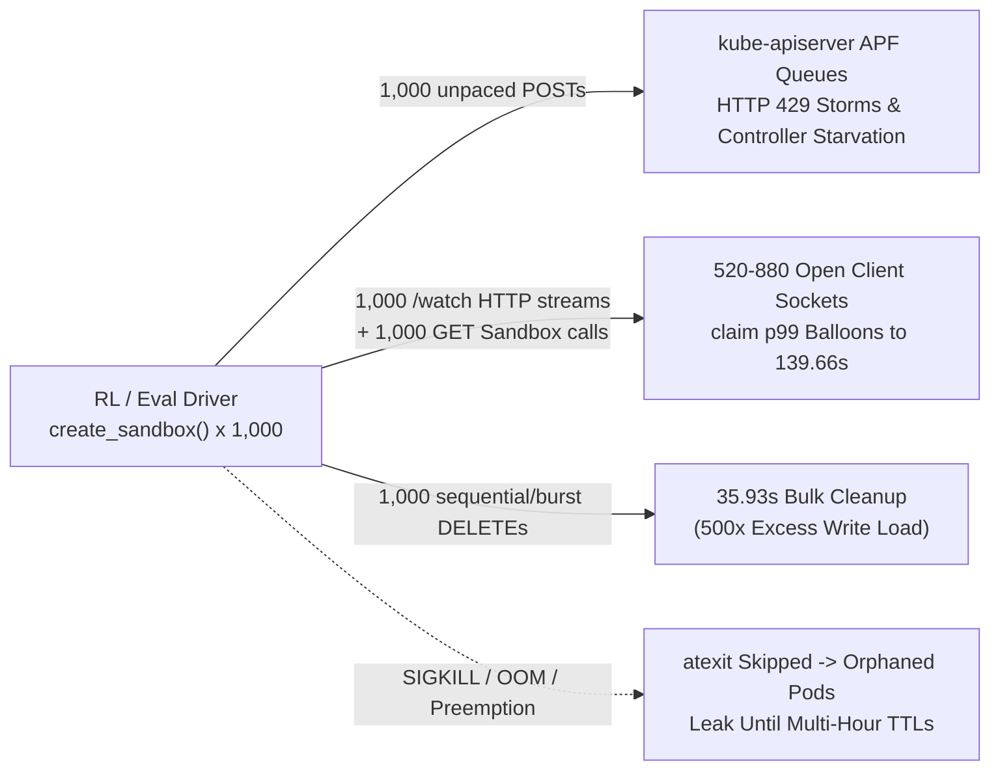
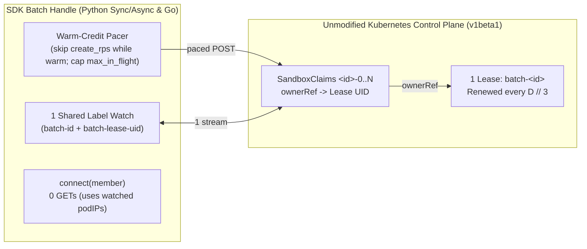
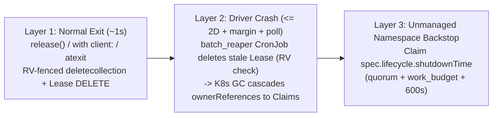

# Internship Presentation: Scaling Kubernetes Agent Sandboxes to 1,000-Sandbox RL & Evaluation Fleets

- **Presenter:** Brian Nguyen (`brianknguyen`, GitHub `@briankhoi`)
- **Project:** `kubernetes-sigs/agent-sandbox` (Kubernetes SIG Apps)
- **Duration:** `10:00` (`600 seconds` across `9` core slides, ~`1,360` spoken words at ~`136 wpm`), plus `3` optional `0:00` Q&A backup slides
- **Provenance Snapshots:**
  - Python SDK & RL batch mode (`origin/feat/rl-batch-claim-mode`): `31a703cdb197497edbe27990bd1a67151bc5ce96` (tree `6529613ce2f4b842ca7b78db14a7a4b5a0b05f2f`, `v1.0.9-79-g31a703cd`)
  - RL batch hardening (`origin/feat/rl-batch-hardening`, commits `8b63a7f7..4018f0dd`): `4018f0ddfa381baf91b41a28c555ac9d0d25903e` (tree `f4e941786f2622a9f43bb2494a1d0d596fa7b24d`, `v1.0.9-92-g4018f0dd`)
  - GKE scale benchmarks (`origin/bench/rl-gke`): `a8dfcb8deef8b521413170fcf213b2b5b992f886` (tree `054f5c27ccd2923c0670189412fd596b17a2c9de`, `v1.0.7-124-ga8dfcb8d`)
  - Upstream `main` (`11` standalone merged PRs): `7ea8b7370a0b895a63255d1d4dcf60c8936bf363` (tree `7b8e8a5b65e74158a781e6dea667cc99fbc3e300`, `v1.0.10-8-g7ea8b737`)
  - Go SDK batch design rev 3.2 (`origin/go-batch-design-notes`): `af1dd651bb59ffd03c5f65bc20d5c2f05d14dd4c` (tree `d364892e5487f2eff403850f49a2ec492bd8b6ae`)

---

## Slide 1 of 9 | `0:00 - 0:45` (`45s`) | Title & Executive Thesis

### Assertion-Evidence Headline
**Scaling `kubernetes-sigs/agent-sandbox` from Single Interactive Sessions to 1,000-Sandbox RL and Evaluation Fleets**

### Visual / Layout
| Pillar 1: `SandboxBatch` SDK & Go Design | Pillar 2: 1,000-Sandbox GKE Validation | Pillar 3: Core Controller & SDK Hardening |
| :--- | :--- | :--- |
| **25-Part Stack (`22` PRs Merged, `3` Open + `25/N` RL)**<br>Client-side cohort & dynamic pool API (`0` new CRDs) + Go SDK rev 3.2 wire-compatible design | **`148,544` GKE Rollouts (`0` Task Errors)**<br>**`3.82x`** faster 8,000-task RL wall time, **`4.88x`** faster 3,000-task SWE-bench, **`32.5x`** faster teardown | **`11` Standalone PRs Merged on `main`**<br>**`2.2x`** faster `Sandbox` reconcile, lifecycle K8s Events, Python SDK memory-leak fixes, **`18x`** faster RL init |

### Slide Bullets
- **Mission:** Enable post-training RL (GRPO) and SWE-bench evaluation drivers to orchestrate `1,000+` isolated gVisor sandboxes reliably on standard Kubernetes clusters.
- **Core Thesis:** Moving from `O(N)` per-claim watches and deletes to `O(1)` client-side multiplexing eliminates API server tail spikes without adding server-side CRDs.
- **Open-Source Footprint:** `36` opened upstream PRs (`33` merged, `3` in review) plus `25/N` `agent-sandbox-rl` batch mode across controller performance, Python/TypeScript/Go SDKs, and crash-safe Lease garbage collection.

### Speaker Notes (`~110 words`, `45s`)
Hi everyone, I am Brian, and today I will share my internship work on `kubernetes-sigs/agent-sandbox`, a Kubernetes SIG Apps project that provides stateful, pod-backed `Sandbox` environments and pre-warmed `SandboxWarmPool`s for AI agents. When I joined, the SDK excelled at interactive single-agent sessions, but reinforcement learning training loops and large evaluation benchmarks needed to acquire and tear down a thousand sandboxes per step. Over my internship, I designed and shipped the `SandboxBatch` SDK across a 25-part stack with a wire-compatible Go SDK design, validated it on GKE across `148,544` zero-error rollouts with up to `3.82x` faster RL training, and merged `11` standalone PRs across the core controller and SDKs.

### Provenance
- **Verified:** PR inventory via `gh pr list --repo kubernetes-sigs/agent-sandbox --author briankhoi` (`36` opened PRs: `11` standalone merged on `main` `@ 7ea8b737` + `22` merged [`1/N`-`21/N` + `#2005`] and `3` open [`#2188`, `#2189`, `#2194`] on `feature/batch-claim`; plus `25/N` ready on branch `@ 31a703cd`).
- **Measured:** `148,544` claims & rollouts across `36` GKE runs (`examples/agent-sandbox-rl/bench-results/gke/campaign-v2/README.md:3-6` `@ a8dfcb8d`); `#1417` (`14.53ms -> 6.51ms`), `#2035` (`2.95s -> 0.16s`).

---

## Slide 2 of 9 | `0:45 - 1:55` (`70s`) | Context & The 1,000-Sandbox Bottleneck

### Assertion-Evidence Headline
**Per-claim SDK fan-out hits `O(N)` watch, socket, and teardown walls at 500 to 1,000 concurrent sandboxes**

### Visual / Layout


### Slide Bullets
- **`O(N)` Watch Fan-Out Inflates Tail Latency:** Opening `500` per-claim watches (`520+` sockets) stalls watch dispatch and pushes `claim p99` to **`139.66s`** on stock GKE even with zero HTTP `429`s.
- **Unpaced Bursts vs. Static Throttles:** Unbounded `POST` bursts trigger APF `429` rejections for in-cluster `ServiceAccount`s, whereas fixed rate limits needlessly slow down pre-warmed pools.
- **Missing Cohort & Crash Primitives:** Synchronous RL steps block on the slowest rollout (`env_ready_all`) with no multi-pool quorum barrier, `35.93s` sequential teardown, and leaked pods on `SIGKILL`.

### Speaker Notes (`~163 words`, `70s`)
To see why scaling broke down, look at what happens when an RL trainer or SWE-bench runner calls `create_sandbox` a thousand times concurrently. First, every single call opens its own Kubernetes watch stream and makes extra `GET` requests to resolve the sandbox and pod IP. On stock GKE at 500 concurrency, holding over 520 open client sockets stalled watch delivery and pushed `claim p99` latency to `139.66` seconds even when zero HTTP `429` errors occurred. Second, firing a thousand unpaced `POST` requests from an in-cluster `ServiceAccount` overflows Kubernetes API Priority and Fairness queues in `workload-low`, triggering `429` storms and starving the controller, yet adding a naive static rate limit needlessly slows down warm pools whose pods are already Ready. Third, RL trainers lacked multi-pool quorum barriers that fail fast when a pool cannot fill. Finally, tearing down a thousand claims issued a thousand `DELETE` calls taking `35.9` seconds, and any `SIGKILL` or OOM crash skipped `atexit` hooks and leaked running pods for hours.

### Provenance
- **Measured:** Stock GKE Phase I `per_claim` `520` sockets and `claim p99 = 139.66s` (`max = 273.31s`) with `0` `429`s (`campaign-v2/README.md:59, 70` `@ a8dfcb8d`); `1,000`-sandbox `AsyncSandboxClient.delete_all()` `35.93s` (`campaign-v2/README.md:143` `@ a8dfcb8d`); in-cluster `workload-low` APF saturation (`EXECUTIVE_SUMMARY.md:145` `@ a8dfcb8d`).

---

## Slide 3 of 9 | `1:55 - 3:10` (`75s`) | `SandboxBatch` Architecture (Zero New CRDs)

### Assertion-Evidence Headline
**`SandboxBatch` collapses `N` claim lifecycles onto one shared watch, one `Lease`, and zero-GET `connect()`**

### Visual / Layout


| Lifecycle Operation (`N = 1,000`) | Legacy `per_claim` | `SandboxBatch` | Architectural Gain |
| :--- | :--- | :--- | :--- |
| **Readiness Watches** | `1,000` streams | **`1` label-scoped stream** | `O(1)` watch sockets (`44` vs `488` held sockets) |
| **`connect()` Metadata Reads** | `1,000-2,000` `GET`s | **`0` `GET`s** (watch seeds `podIPs`) | `1.02-1.25` vs `4.00` claim-path API reqs/sandbox |
| **Normal Bulk `release()`** | `1,000` `DELETE`s (`35.93s`) | **`1` `deletecollection` + `1` `Lease` `DELETE`** | **`500x` fewer calls**, **`1.10s` best (`32.5x` faster)** |

### Slide Bullets
- **Zero Server-Side Changes:** Works immediately against unmodified `v1beta1` clusters using standard `SandboxClaim`s and one `coordination.k8s.io/v1` `Lease`.
- **Warm-Aware Creation Pacing:** Prechecks seed `status.readyReplicas` warm credit so warm claims dispatch immediately up to `max_in_flight`, falling back to `create_rps` on cold-start watch signals.
- **Zero-GET Connectivity:** `connect(member)` seeds the pod IP directly from the shared claim watch and automatically closes cached connections if a pod is lost or replaced.

### Speaker Notes (`~160 words`, `75s`)
Instead of introducing a heavyweight `SandboxBatch` CRD that requires cluster-wide controller upgrades and schema lock-in, I built `SandboxBatch` purely on the client side atop standard `SandboxClaim`s and one Kubernetes `Lease`. This design changes three fundamental scaling laws. First, one label-scoped watch tracks all `N` claims in the namespace, collapsing a thousand watch streams into one and cutting held warm-burst sockets by `11x`. Second, because the claim watch already reports the bound `sandboxName` and `podIPs`, `batch.connect(member)` constructs and caches the data-plane handle with zero `GET` calls, and automatically invalidates that cache if the watch sees the pod replaced. Third, our warm-pool-aware pacer reads each pool's `readyReplicas` count during precheck to skip `create_rps` delays while warm pods are available, then automatically falls back to `50` creates per second the moment the watch observes a cold-start reason or an HTTP `429` cooldown. At teardown, `release()` issues one label-scoped `deletecollection` plus one `Lease` delete, cutting `1,000`-sandbox cleanup from `35.9` seconds down to `1.1` seconds.

### Provenance
- **Verified:** Single watch & zero-GET `connect()` (`sandbox_batch.py:604-649, 1595-1695` `@ 31a703cd`, PR `#2153` `17/N`); warm-pool credit (`sandbox_batch.py:216-248, 1656-1662` `@ 31a703cd`, PR `#2166` `19/N`); `deletecollection` release (`sandbox_batch.py:2092-2206` `@ 31a703cd`).
- **Measured:** `44` vs `488` sockets and `1.10s` (`1.44s` mean) vs `35.93s` teardown (`campaign-v2/README.md:131, 142-143` `@ a8dfcb8d`); `1.02-1.25` vs `4.00` reqs/env (`PROVENANCE.md:85-86, 118` `@ a8dfcb8d`).

---

## Slide 4 of 9 | `3:10 - 4:20` (`70s`) | Four Workload Patterns & Cross-SDK Parity

### Assertion-Evidence Headline
**Three initial-fill modes plus dynamic `acquire()` cover synchronous RL, multi-suite eval, and rolling queues across Python and Go**

### Visual / Layout
| Consumption Pattern | SDK Method | Best-Fit Workload & Behavior |
| :--- | :--- | :--- |
| **1. Joint Cohort Barrier** | `wait_for_quorum()` | **Sync Multi-Pool RL:** Waits until every group hits `min_ready`, fails fast (`QuorumUnreachableError`), trims extras via `release_not_ready()`. |
| **2. Per-Group Cohort Stream** | `group_outcomes()` | **Multi-Suite Eval:** Yields each `GroupOutcome` as its own pool reaches `min_ready`; broken pools do not block healthy pools. |
| **3. Pure Streaming** | `events()` | **1:1 Sweeps:** Streams `MEMBER_READY` / `FAILED` / `LOST` immediately; supports concurrent work-stealing iteration. |
| **4. Dynamic Rolling Pool** | `acquire(pool, *, pod_annotations=...)` | **Async RL & `SandboxFleet`:** Starts at `size=0` and adds/releases individual Ready sandboxes on demand under one shared watch. |

**Byte-for-Byte Wire Parity (`detach` <-> `get_batch` / `GetBatch` tested live both ways on `kind`):**
- **Python (`k8s_agent_sandbox`):** Full sync (`SandboxBatch`) & async (`AsyncSandboxBatch`) parity; `except BatchError` catches all runtime batch failures.
- **Go (`clients/go/sandbox`, rev 3.2):** Idiomatic `ClaimBatch(ctx, groups, ns, ...BatchOption)`, Go 1.23 `iter.Seq2[T, error]` consumers, borrowed `*Sandbox` handles, auto `QPS=-1`, and isolated Lease HTTP transport.

### Slide Bullets
- **One Primitive, Four Dispatch Shapes:** Supports over-requested synchronous quorums (`size > min_ready`), independent pool cohorts, zero-barrier streaming, and dynamic `acquire()` with per-pod annotations.
- **Python Sync & Async Parity:** Identical public signatures, frozen Pydantic models, and error boundaries across threaded and `asyncio` applications.
- **Prototyped Go SDK Alignment:** Golden-tested across `294` wire cases and `33` state-machine traces with live cross-language `Python <-> Go` batch handoffs on `kind`.

### Speaker Notes (`~148 words`, `70s`)
Different agent workloads consume sandboxes in very different shapes, so `SandboxBatch` exposes three initial-fill consumers plus dynamic `acquire()`. Synchronous multi-task RL uses `wait_for_quorum()` with slight over-provisioning, failing immediately via `QuorumUnreachableError` if any pool loses too many claims and trimming stragglers with `release_not_ready()`. Multi-domain evaluation uses `group_outcomes()` so fast pools start grading immediately even if another pool fails. Flat sweeps stream `events()` as each sandbox becomes Ready, and rolling actor loops open a `size=0` batch and call `acquire()` and `release_member()` thousands of times over one watch, passing `pod_annotations` when pinning GKE Pod Snapshots. Every feature ships with strict sync and async parity in Python, and I also authored and prototyped the Go SDK batch design using Go `1.23` `iter.Seq2` iterators, functional options, `QPS=-1`, and an isolated Lease transport. Both SDKs share an identical Kubernetes wire contract, verified with `294` golden test cases and live Python-to-Go-to-Python batch handoffs on `kind`.

### Provenance
- **Verified:** Consumers & `acquire(..., pod_annotations=...)` (`sandbox_batch.py:665-815`, `async_sandbox_batch.py:626-820`, `models.py:382-464` `@ 31a703cd`, PR `#2189` `23/N`); Go SDK design rev 3.2 (`go_batch_final_design.md:81, 340-473` `@ af1dd651`).

---

## Slide 5 of 9 | `4:20 - 5:35` (`75s`) | Crash-Safe Distributed Ownership & Incarnation Fencing

### Assertion-Evidence Headline
**Lease `ownerReferences`, `batch-lease-uid` fencing, and a full `LeaseDuration` reaper wait prevent both leaked and mis-deleted sandboxes**

### Visual / Layout


| Multi-Process Race Scenario | What Could Go Wrong | Shipped Fencing Invariant (`#2154`, `#2188`) |
| :--- | :--- | :--- |
| **Stalled Driver + Reused `batch_id`** | Old driver wakes up after reap and runs `deletecollection` on `batch-id`, wiping new incarnation's claims. | Claims carry `agents.x-k8s.io/batch-lease-uid: <lease.uid>`; all post-Lease watches & deletes select `(batch-id, batch-lease-uid)` + verify Lease `uid`/`transitions`. |
| **Slow Renewal Transit vs. Reaper Delete** | Holder stamps `renewTime` before transit and self-fences at `sent_at + D`; early reap could race one last create. | Holder self-fences monotonically at `sent_at + D`; `batch_reaper` observes `now > renewTime + D + margin`, **waits full `D`**, then deletes Lease with `resourceVersion` precondition. |

### Slide Bullets
- **Three-Layer Cleanup Defense:** Combines `O(1)` `release()`, Lease-backed `batch_reaper` + Kubernetes cascading GC, and per-claim `shutdownTime` controller TTLs.
- **Least-Privilege Reaper RBAC:** Because every claim carries an `ownerReference` to its `Lease`, `batch_reaper` needs **only** `get`, `list`, and `delete` on `leases` and never touches claims.
- **Zero-Orphan Late-Commit Closure:** Even if an in-flight `POST` commits in `kube-apiserver` after `Lease` deletion during a lost cancellation, Kubernetes GC sweeps it in `19-28 ms`.

### Speaker Notes (`~178 words`, `75s`)
At thousand-sandbox scale, distributed cleanup has to solve two opposite hazards at once. It must never leak sandboxes when a driver crashes with `SIGKILL`, and it must never delete a live job's sandboxes during network stalls or `batch_id` reuse. We enforce a three-layer defense. Every claim carries an `ownerReference` pointing to its batch `Lease` UID plus a controller `shutdownTime` backstop. When a driver dies, our stateless `batch_reaper` CronJob deletes only the expired `Lease`, and Kubernetes's built-in garbage collector cascades deletion to all owned claims, even catching late in-flight creates within `28` milliseconds, while needing zero RBAC permissions on `SandboxClaim`s. To make multi-process handoffs and `batch_id` reuse airtight, we closed two subtle races. First, every post-Lease watch and `deletecollection` scopes its selector to both `batch-id` and `batch-lease-uid`, so a stalled old driver waking up after Lease expiry can never delete a new batch reusing the same name. Second, while active holders self-fence monotonically at `sent_at + LeaseDuration`, the reaper waits a full `LeaseDuration` confirmation window before issuing a `resourceVersion`-preconditioned delete, guaranteeing any stalled holder has stopped creating claims first.

> **Optional Q&A Backup Note (Do not read unless asked about verification methodology):** To stress-test multi-process interleavings across Lease renewal, detach/re-attach handoffs, `batch_id` reuse, and reaper confirmation waits, I used AI-assisted state-space model checking to surface candidate race traces and then verified and reproduced each scenario directly in Python code and unit/e2e tests.

### Provenance
- **Verified:** `lease_owner_reference` & `batch_claim_label_selector` (`batch_utils.py:187-208, 405-417` `@ 31a703cd`, PR `#2154` `18/N` & PR `#2188` `22/N`); reaper full `leaseDurationSeconds` wait & RV precondition (`batch_reaper.py:232-279` `@ 31a703cd`, PR `#2188` `22/N`).
- **Measured:** `19-28 ms` K8s GC collection of late-committing claims after Lease deletion on `kind` (`kind_experiments.md:24, 199-201` `@ af1dd651`).

---

## Slide 6 of 9 | `5:35 - 6:50` (`75s`) | Client Optimizations & `agent-sandbox-rl` Integration

### Assertion-Evidence Headline
**Warm-pool credit, per-claim wakeups, and 500-item paging drop release RAM `347x` and wire seamlessly into `SandboxFleet`**

### Visual / Layout
| Bottleneck Discovered Under Load | Shipped SDK Fix (`16/N` - `23/N`) | Measured Before -> After |
| :--- | :--- | :--- |
| **`O(N^2)` `acquire()` Wakeup Contention** | Replaced broadcast `Condition.notify_all()` with per-claim readiness `Event`s (`16/N`, `#1991`). | `1,280`-claim driver CPU: **`113.56s -> 1.32s`** (`86x` lower isolated, `10.5x` in full GKE step) |
| **Warm Cohort Pacing Overhead** | Seeded `status.readyReplicas` warm credit + 1s `acquire()` refresh + cold fallback (`19/N`, `#2166`). | `160`-warm `kind` cohort: **`3.37s -> 1.27s`** (`0` `429`s, `243` vs `640` API calls) |
| **`O(N)` List & `deletecollection` RAM Spike** | `500`-item paged list, stripped `managedFields`, unread raw `deletecollection` drain (`20/N`, `#2175`). | `5,000`-claim `release()` peak RAM: **`69.4 MB -> 0.2 MB` (`347x` lower)**; `10k`: `138.8 -> 9.9 MB` |
| **Hidden `urllib3` `Retry(3)` Stalls** | Shared unretried batch `ApiClient` (`retries=False`) + default `max_in_flight` pool auto-clamping (`#2153`, `#2188`). | Eliminated `4x` timeout amplification & multi-hour `Retry-After` hangs |

```python
# Zero-caller-code-change adoption in examples/agent-sandbox-rl (25/N + hardening)
fleet = AsyncSandboxFleet(FleetConfig(
    clusters=[...], max_concurrent=500,
    claim_mode="batch",
    batch_claims=BatchClaimConfig(work_budget=3600, lease_duration=300, max_in_flight=64),
))
```

### Slide Bullets
- **Profile-Driven SDK Engineering:** Eliminated `notify_all()` GIL contention (`86x` CPU drop), unpaged JSON spikes (`347x` release RAM drop), and hidden `urllib3` retry loops.
- **Drop-In `agent-sandbox-rl` Mode (`claim_mode="batch"`):** Preserves `SandboxFleet` / `AsyncSandboxFleet` APIs (`acquire`, `acquire_batch`, `run`, `recycle=True`, `snapshots=True`) with one shared batch per cluster.
- **Production RL Hardening:** Rotates `recycle=True` handles before `shutdownTime`, forwards snapshot `pod_annotations`, and runs a cold-start pod fail-fast watchdog.

### Speaker Notes (`~160 words`, `75s`)
Building the protocol was half the battle; profiling under real 1,000-sandbox load uncovered four major client bottlenecks that we fixed in the stack. First, `py-spy` profiling on GKE revealed `O(N^2)` Python GIL contention when `1,280` concurrent `acquire()` calls woke on a shared condition variable; switching to per-claim readiness events cut isolated driver CPU from `113.6` seconds down to `1.32` seconds. Second, warm-pool `readyReplicas` credit cut `160`-sandbox warm startup from `3.37` seconds to `1.27` seconds while preserving cold `create_rps` protection. Third, paging claim lists by `500`, stripping `managedFields`, and draining raw `deletecollection` responses without JSON-parsing them slashed `5,000`-claim release peak memory `347x`, from `69.4` megabytes to `0.2` megabytes. Fourth, disabling hidden `urllib3` retries prevented `4x` timeout multiplication. We then wired `SandboxBatch` directly into `agent-sandbox-rl` behind `FleetConfig(claim_mode="batch")`. Existing RL and evaluation loops get one shared batch per cluster, zero redundant pod `GET`s, automatic claim rotation before `shutdownTime` when recycling environments, GKE Pod Snapshot pinning, and cold-start fail-fast watchdogs with zero caller code changes.

### Provenance
- **Measured:** `acquire()` CPU `113.56s -> 1.32s` isolated / `10.86s` step (`PROVENANCE.md:78-86` `@ a8dfcb8d`); warm credit `3.37s -> 1.27s` (PR `#2166` `19/N`); `release()` RAM `69.4 MB -> 0.2 MB` at `5k` and `138.8 MB -> 9.9 MB` at `10k` (PR `#2175` `20/N`).
- **Verified:** Unretried `ApiClient` (PR `#2188` `22/N`); `agent-sandbox-rl` integration (`batch_claims.py`, `README.md:583-634` `@ 31a703cd`, hardening `8b63a7f7..4018f0dd` `@ 4018f0dd`).

---

## Slide 7 of 9 | `6:50 - 8:05` (`75s`) | 1,000-Sandbox GKE Validation (`148,544` Rollouts)

### Assertion-Evidence Headline
**Across `148,544` GKE rollouts, `SandboxBatch` delivers `3.82x` faster RL training, `4.88x` faster SWE-bench sweeps, and `32.5x` faster teardown**

### Visual / Layout
**1. Fair Arm Parity: Unlimited vs. Unlimited (`batch` SDK Defaults `mif=20` vs. `per_claim` as Shipped)**
| GKE Benchmark (Matched Cluster & Controller) | `per_claim` (Shipped) | `SandboxBatch` Defaults (`mif=20`) | Verified Gain |
| :--- | :--- | :--- | :--- |
| **Default Controller Step-Suite (`w640` / `w1280`)** | `14.37s` / `31.51s` (`1,280` watches, `218` discards) | **`9.39s` / `19.19s`** (`1` watch, `0` discards) | **`1.53x-1.64x` faster**, **`22x` faster `w1280` TTFC** |
| **Multi-Pool `200 x 5 = 1,000` Warm Burst (`c=1000`)** | `8.06s` best (`488` sockets, `618ms` `1st Ready`) | **`6.63s` best** (**`44` flat sockets**, **`173ms` `1st Ready`**) | **`11.1x` fewer sockets**, **`3.56x` faster `1st Ready`** |
| **Pure SDK `1,000`-Sandbox Bulk Cleanup** | `35.93s` (`1,000` `DELETE`s) | **`1.10s` best / `1.44s` mean** (`2` API calls) | **`32.5x` peak / `24.9x` mean faster** |

**2. Matched `c = 500` Production GKE Campaign 2 (`36` Runs, `148,544 / 148,544` Succeeded, `0` Errors)**
| Production Workload (`10 x 32-vCPU` gVisor Pool) | `HEAD per_claim` (`c=500`) | `SandboxBatch` (`c=500`, `mif=64`) | Verified Speedup |
| :--- | :--- | :--- | :--- |
| **R2E-Gym Sync RL (`500` imgs x `2` x `8` steps = `8,000`)** | `1,494.54s` (`138.32s` steady step barrier) | **`390.77s`** (**`28.48s` steady step barrier**) | **`3.82x` faster wall**, **`4.86x` faster step barrier** |
| **SWE-bench Verified `3,000` (`T0` Stock APF, `sliding` / `naive`)** | `433.13s` / `403.63s` (`naive p99`: `139.66s`) | **`88.76s` / `87.40s`** (`naive p99`: **`19.30s`**) | **`4.88x` / `4.62x` faster wall**, **`7.24x` lower `p99`** |
| **`T1` Secondary Boot Disk SWE-bench `3,000` (`git + 30s`)** | `257.44s` (`2,218.10s` prior `T1` record `#1`) | **`248.84s`** (`100ms` `1st Ready`, `5.06x` fewer socks) | **`8.91x` faster than published `T1` record** |

### Slide Bullets
- **Default-Out-of-the-Box Wins:** Even at conservative SDK defaults (`mif=20`), `SandboxBatch` beats unthrottled `per_claim` at `640`, `1,000`, `1,280`, and `2,560` warm sandboxes with `11.1x` fewer sockets.
- **`3.82x` Faster Multi-Step RL:** Shrinks the synchronous 1,000-sandbox RL step barrier `4.86x` (`138.3s -> 28.5s`) across `8,000` real R2E-Gym repository rollouts.
- **Fresh Warm Claims Beat gVisor `git restore` by `4.91x`:** Provisioning `3,000` fresh isolated pods via `SandboxBatch` (`87.40s`) outruns in-place gVisor `git restore` resets (`429.24s`).

### Speaker Notes (`~159 words`, `75s`)
We validated `SandboxBatch` on regional GKE clusters up to `2,560` concurrent gVisor sandboxes, enforcing strict arm parity with matched `HEAD` baselines, 100%-node DaemonSet image hydration, and full seven-resource zero-drain barriers between runs. First, comparing out-of-the-box SDK defaults (`max_in_flight=20`) directly against unthrottled `per_claim`, `SandboxBatch` wins at every scale from `160` up to `2,560` sandboxes, holding a flat `44` client sockets versus `488` during a `1,000`-pod warm burst and cutting SDK bulk cleanup `32.5x`. Second, across our `36`-run production Campaign 2 covering `148,544` tasks with zero errors at `500` concurrency on both arms, `SandboxBatch` sped up `8,000` multi-step R2E-Gym RL rollouts by `3.82x` end to end and shrank the steady-state synchronous step barrier `4.86x`, from `138` seconds down to `28.5` seconds. On `3,000` SWE-bench Verified tasks under stock GKE APF, `SandboxBatch` finished `4.88x` faster on `sliding` and `4.62x` faster on `naive`, dropping `claim p99` `7.24x` and beating in-place gVisor `git restore` recycling by `4.91x` while giving every episode a clean pod.

### Provenance
- **Measured:** Step-suite `w640`/`w1280`/`w2560` (`PROVENANCE.md:105-115` `@ a8dfcb8d`); Campaign 2 `148,544` tasks, `Bench 1A` (`1,494.54s -> 390.77s`), Phase I (`433.13s -> 88.76s`, `403.63s -> 87.40s`, recycle `429.24s`), `Bench 2A` (`44` vs `488` sockets), `p2_sdk_1000_cleanup` (`1.10s` vs `35.93s`), Phase III `T1` (`248.84s` vs `2,218.10s`) (`campaign-v2/README.md:3-38, 53-222` `@ a8dfcb8d`).

---

## Slide 8 of 9 | `8:05 - 9:10` (`65s`) | Broader Upstream Contributions on `main`

### Assertion-Evidence Headline
**Eleven standalone merged PRs hardened controller latency, lifecycle observability, memory safety, and multi-cluster SDK ergonomics**

### Visual / Layout
| Area | Merged Upstream PRs (`kubernetes-sigs/agent-sandbox` `main`) | Impact & Measured Improvement |
| :--- | :--- | :--- |
| **Controller Performance** | **`#1417`**, **`#1467`** | Removed legacy `pod-name` metadata patch loop on `Sandbox` objects (plus Go/Python SDK empty-annotation fallback), cutting average `Sandbox` reconcile latency **`2.2x` (`14.53ms -> 6.51ms`, `-55%`)**. |
| **Kubernetes Observability** | **`#1532`**, **`#1826`** | Added `Sandbox` lifecycle Kubernetes Events (`SandboxPodCreated`, `SandboxPodCreateFailed`, `SandboxReady`, `SandboxSuspended`, `SandboxExpired`, `PodSucceeded`, `PodFailed`) gated on both `Status` & `Reason` (resolving `#759` and `volcano-sh/agentcube#302`). |
| **Python & TS SDK Reliability & Memory** | **`#2085`**, **`#2086`**, **`#2087`**<br>**`#1509`**, **`#1512`**, **`#1917`** | Eliminated `~0.7 MiB/sandbox` long-lived client memory retention (untracking terminated handles, breaking connector reference cycles, static `atexit` partial hooks); fixed `AsyncSandboxClient` `atexit` interpreter-shutdown leaks; added multi-cluster `api_client` injection; aligned Python & TypeScript terminal claim `Ready` reasons. |
| **RL Orchestrator Startup** | **`#2035`** | Fixed concurrent first-acquire `Cluster.sandbox_client` lock race in `agent-sandbox-rl` (`160 -> 1` kubeconfig client builds), speeding up first acquire **`18x` (`2.95s -> 0.16s`)** and step start **`3x` (`4.22s -> 1.37s`)**. |

### Slide Bullets
- **Core Controller Speedup (`#1417`):** Eliminated a redundant metadata patch per `Sandbox` reconcile, cutting controller reconcile time by `55%` across all workloads.
- **Zero-Leak Long-Running SDK Clients (`#1512`, `#2085`-`#2087`):** Fixed `atexit` interpreter-shutdown leaks and broke handle/connector retention so multi-thousand-step drivers run in flat RAM.
- **Cross-SDK Parity & Operability (`#1509`, `#1532`, `#1826`, `#1917`, `#2035`):** Delivered `kubectl describe sandbox` lifecycle events, multi-cluster `ApiClient` injection, TypeScript/Python parity, and `18x` faster RL startup.

### Speaker Notes (`~148 words`, `65s`)
Alongside the batch-claim stack, I contributed `11` standalone PRs merged directly onto `upstream/main` to harden the broader `agent-sandbox` ecosystem. In the Go controller, PR `#1417` removed a redundant `pod-name` annotation patch loop on `Sandbox` reconciles, cutting average `Sandbox` reconcile latency by `55%`, from `14.53` milliseconds down to `6.51` milliseconds, paired with `#1467` for SDK backward compatibility. For cluster operators, PRs `#1532` and `#1826` added comprehensive Kubernetes lifecycle Events to `Sandbox` resources so `kubectl describe sandbox` surfaces pod creation, readiness, suspension, and expiry transitions cleanly. In the Python and TypeScript SDKs, PRs `#2085`, `#2086`, and `#2087` eliminated a `0.7` megabyte-per-sandbox memory leak across terminated handles, reference cycles, and `atexit` hooks; `#1512` fixed silent `AsyncSandboxClient` `atexit` leaks during Python interpreter shutdown; `#1509` added multi-cluster `ApiClient` injection; and `#1917` brought terminal claim failure parity to Python and TypeScript. Finally, `#2035` fixed a startup race in `agent-sandbox-rl`, speeding up first acquire `18x`.

### Provenance
- **Verified & Measured:** PRs `#1417` (`14.53ms -> 6.51ms`), `#1467`, `#1509`, `#1512`, `#1532`, `#1826`, `#1917`, `#2035` (`160 -> 1` client builds, `2.95s -> 0.16s` first acquire, `4.22s -> 1.37s` step start), `#2085` (`~0.7 MiB` `AsyncSandbox` retention; `G4-memleak-final.md`), `#2086`, `#2087` (`upstream/main` `@ 7ea8b737`).

---

## Slide 9 of 9 | `9:10 - 10:00` (`50s`) | Key Engineering Takeaways & Roadmap

### Assertion-Evidence Headline
**Client-side multiplexing unlocks 1,000-sandbox scale today and sets a clean wire contract for Go SDK and distributed RL adoption**

### Visual / Layout
| 3 Systems Lessons from `148,544` GKE Rollouts | Next Steps & Handoff |
| :--- | :--- |
| **1. Watch Fan-Out Dominates Tail Latency:** Collapsing `N` watches into `1` cut `claim p99` `7.24x` (`139.66s -> 19.30s`) even when `0` HTTP `429`s occurred. | **1. Finish Batch Stack Merge (`feature/batch-claim` -> `main`):** `1/N`-`21/N` + `#2005` merged; land open `22/N` (`#2188`), `23/N` (`#2189`), `main`-sync `24/N` (`#2194`), and `25/N` (`agent-sandbox-rl`), then merge `feature/batch-claim` into `main`. |
| **2. Separate Foreground Binding from Pool Refills on GKE:** Bounding `--sandbox-warm-pool-concurrent-workers` + `max-refill-rate=100` + 30-share APF split prevents `155x` `workload-low` queue spikes. | **2. Ship Go SDK Implementation (`G0-G10`):** Port golden-tested prototype (`ClaimBatch`, `iter.Seq2`, isolated Lease transport) onto `clients/go/sandbox`. |
| **3. Measure Runtime Reset Cost vs. Fresh Warm Pods:** Fresh `SandboxBatch` warm adoption (`87.40s`) beats in-place gVisor `git restore` (`429.24s`) by `4.91x` with stronger episode isolation. | **3. Multi-Pod Distributed RL Rollout:** Adopt `claim_mode="batch"` with per-worker `max_in_flight` sizing across distributed `RolloutWorker` fleets (`Tunix` / `R2E-Gym`). |

### Slide Bullets
- **Shipped Impact:** `O(1)` watch and bulk teardown, crash-safe Lease GC, `3.82x` faster multi-step RL, `4.88x` faster SWE-bench sweeps, and `11` core `main` improvements.
- **Actionable GKE Playbook:** Documented full controller tuning (`Config H`), 3-lane APF insulation within GKE's 30-share cap, and Secondary Boot Disk (`CONTAINER_IMAGE_CACHE`) recipes.
- **Clean Open-Source Handoff:** `33` of `36` opened upstream PRs merged (`22` on `feature/batch-claim` + `11` on `main`), `3` in review, `25/N` ready on branch, and Go SDK golden test suite ready for implementation.

### Speaker Notes (`~135 words`, `50s`)
Stepping back, three systems lessons stood out from running `148,544` sandboxes on GKE. First, watch fan-out, not just create QPS, drives tail latency; multiplexing onto one label watch dropped `claim p99` `7.24x` without touching cluster APF configs. Second, on managed GKE, background warm-pool refills share `workload-low` seats with urgent foreground claim binding unless you bound warm-pool refill concurrency and split GKE's `30` custom APF shares cleanly. Third, under gVisor, adopting fresh warm pods via `SandboxBatch` is `4.91x` faster than resetting worktrees in place with `git restore`. Looking ahead, `33` of my `36` opened upstream PRs are merged across `main` and `feature/batch-claim`, PRs `#2188`, `#2189`, and branch-sync `#2194` are in review ahead of `25/N` and the final `main` merge, and our golden-tested Go SDK design is ready to land next. Thank you, and I would love to take your questions.

### Provenance
- **Verified & Measured:** `7.24x` `claim p99` & `4.91x` fresh vs gVisor `git restore` (`campaign-v2/README.md:24, 37` `@ a8dfcb8d`); `155x` APF queue spike & 30-share guardrail (`GKE_APF_WARMPOOL_DEEP_DIVE.md:54-85`, `handoff/learnings/gke-benchmarking.md:74-85`); PR status (`#2188`, `#2189`, `#2194` open; `1/N`-`21/N` + `#2005` merged on `feature/batch-claim`; `11` merged on `main`).

---

## Optional Q&A Backup Slides (`0:00` Untimed)

---

### Backup Slide A1 | `0:00` (Q&A) | Managed GKE APF Physics & Controller Tuning (`Config H`)

#### Assertion-Evidence Headline
**Bounding background warm-pool refill workers and splitting GKE's 30 custom APF shares eliminates `155x` `workload-low` queue amplification**

#### Visual / Layout
| GKE `w640` Controller Setting (`160` Pools x `4` Pods) | Cumulative APF Queue Wait (`apf_wait_s`) | Controller `PATCH` Latency | Full-Batch Ready (`batch-default`) |
| :--- | ---: | ---: | ---: |
| **Stock (`warm-pool-workers=1`)** | `9.5s - 22.3s` | `~42 ms` | `9.39s` (`0` `429`s) |
| **Tuned `Config H` (`warm-pool-workers=2`, `max-refill-rate=100`)** | `497.8s` | `~75 ms` | **`8.73s` (`0` `429`s)** |
| **Unbounded Refill Stampede (`warm-pool-workers=100`, `rate=100`)** | **`1,043s - 1,473s` (`155x` spike)** | **`~290 ms` (`+49-104` `429`s)** | `12.30s` (`+41%` slower) |

#### Slide Bullets
- **Why Self-Hosted APF Manifests Fail on GKE:** `flowcontrol-guardrails` blocks mapping user SAs to `exempt` and caps custom `PriorityLevelConfiguration` shares at `<= 30`.
- **GKE 3-Lane APF Split:** `agent-sandbox-critical` (`20` non-lendable shares for controller reconciles), `agent-sandbox-bulk` (`10` shares for in-cluster drivers), and `global-default` for controller `Lease` renewals.
- **Node & Pod Levers:** `terminationGracePeriodSeconds: 0` eliminates 30s `sleep infinity` `maxPods` walls; `600 GB` Secondary Boot Disk (`CONTAINER_IMAGE_CACHE`) drops median `exec` to `370 ms`.

#### Provenance
- **Measured:** `GKE_APF_WARMPOOL_DEEP_DIVE.md:54-85`, `PROVENANCE.md:68, 110`, `campaign-v2/README.md:35, 48` (`@ a8dfcb8d`); `handoff/learnings/gke-benchmarking.md:74-156` (`@ 15137981`).

---

### Backup Slide A2 | `0:00` (Q&A) | Go SDK HTTP/2 Multiplexing & Late-Commit Kind Experiments

#### Assertion-Evidence Headline
**Traced `kind` experiments disproved a 100-stream Go HTTP/2 cap while proving isolated Lease transport cuts renewal `p95` from `544ms` to `143ms`**

#### Visual / Layout
| Experiment (`kind` v1.36.1, `go_batch_final_design.md` rev 3.2) | Setup | Measured Result & Design Decision |
| :--- | :--- | :--- |
| **HTTP/2 Concurrent Create Scaling (`E5`)** | `200` in-flight `SandboxClaim` creates on `1` `rest.Config` (`QPS=-1`) | **`455-924 creates/s`, `0` failures** across `2-3` HTTP/2 connections; no sharding needed. |
| **Shared vs. Isolated Lease Renewal (`U5`, `L0-L3`)** | `200` concurrent creates + `482-1,710` traced renewal `PUT`s (`18` paired runs) | Shared slower in **`18/18` runs** (`p95` **`544ms` vs `143ms`** at 0ms RTT; `2.37s` vs `1.47s` max) due to `x/net` first-fit pool + apiserver socket recv buffer -> **Keep 1 isolated Lease transport per `Client`**. |
| **Lost-Cancellation Late Create Commit (`U6`)** | Freeze TCP proxy drops `RST_STREAM` / close; create commits in `(30, 34]s` (`41s` queued) after `Release()` | Without `ownerRefs`: claim leaks until `shutdownTime`. With Lease `ownerRefs`: **K8s GC deletes late claim `19-28 ms` after commit**. |

#### Slide Bullets
- **Empirical Design Validation:** Every non-obvious Go SDK transport, watch empty-stream backoff, and slot-pacer choice was prototyped and tested against real `kube-apiserver` behavior.
- **Single-Attempt Wire Control (`MaxRetries(0)`):** Prevents `client-go`'s hidden 10-retry loop from turning `Retry-After: 0` responses into 11x request bursts.

#### Provenance
- **Measured:** `go_batch_final_design.md:79, 286` and `kind_experiments.md:18-37, 180-210` (`@ af1dd651`).

---

### Backup Slide A3 | `0:00` (Q&A) | Complete Open-Source PR Inventory (`36` Opened PRs + `25/N` Branch)

#### Assertion-Evidence Headline
**Full Decomposition of the `36` Opened Upstream PRs (`33` Merged, `3` Open) Plus `25/N` RL Batch Mode**

#### Visual / Layout
| Track | PR Numbers & Status | Key Deliverables |
| :--- | :--- | :--- |
| **Batch Core, Watch, Lease & Connect (`1/N` - `8/N`)** | `#1742`, `#1924`, `#1925`, `#1982`, `#1983`, `#1984`, `#1985`, `#2033` (**All 8 Merged**) | Models/exceptions & `get_batch` (`1/N`), watch network & TLS EOF retries (`2/N`, `8/N`), Lease expiry & `lease_degraded()` (`3/N`), `MemberState` & terminating claims (`4/N`, `5/N`), `connect()` readiness checks (`6/N`), ordinal group order (`7/N`). |
| **Batch Claiming, Consumers, Release & `acquire` (`9/N` - `16/N` + Sync)** | `#1986`, `#2049`, `#1996`, `#1824`, `#1988`, `#1989`, `#1990`, `#1991`, plus `#2005` `main` sync (**All 9 Merged**) | Client connection cleanup & concurrent `detach()` (`9/N`-`11/N`), `claim_batch` & `release` (`12/N`), `events()` & `group_outcomes()` (`13/N`), `wait_for_quorum()` (`14/N`), `release_*` (`15/N`), `acquire()` with per-claim wakeups (`16/N`). |
| **Batch Transport, Reaper, Scale & Sync (`17/N` - `24/N`, plus `25/N`)** | `#2153`, `#2154`, `#2166`, `#2175`, `#2176` (**5 Merged**); `#2188`, `#2189`, `#2194` (**3 Open**); plus `25/N` ready on `feat/rl-batch-claim-mode` | Zero-GET pod-IP `connect()` + pool clamping (`17/N`), Lease `ownerReferences` + `batch_reaper` (`18/N`), warm-pool credit (`19/N`), 500-item paging `69.4->0.2 MB` (`20/N`), exact `V1Lease` typing (`21/N`), `batch-lease-uid` + full-`D` reaper wait (`22/N`), `acquire(pod_annotations)` (`23/N`), `main -> feature/batch-claim` sync (`24/N`), and `agent-sandbox-rl` `claim_mode="batch"` (`25/N`, branch-ready). |
| **Standalone `upstream/main` Contributions (`11` PRs)** | `#1417`, `#1467`, `#1509`, `#1512`, `#1532`, `#1826`, `#1917`, `#2035`, `#2085`, `#2086`, `#2087` (**All 11 Merged**) | `2.2x` faster `Sandbox` reconcile, `Sandbox` K8s Events, Python SDK memory-leak & `atexit` fixes, `api_client` injection, TS/Python terminal reasons parity, `18x` faster RL client init. |

#### Provenance
- **Verified:** `handoff/pr_board.md` (`@ 15137981`) cross-checked live via `gh pr list --repo kubernetes-sigs/agent-sandbox --author briankhoi --state all --limit 100` (2026-11-06).
