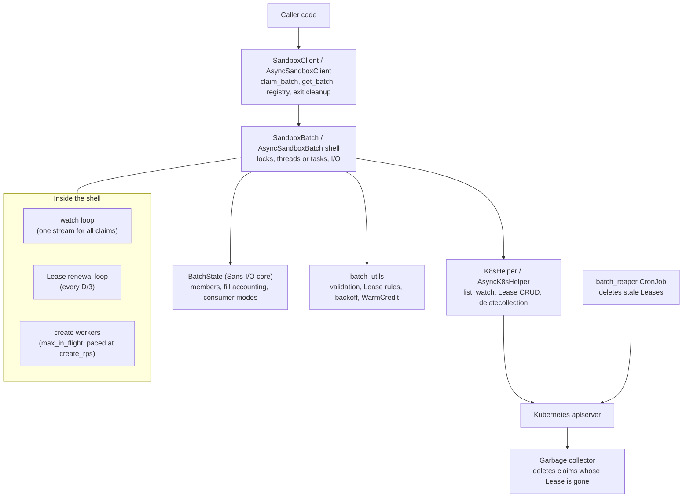

# Learnings: batch claiming in the agent-sandbox Python SDK

This doc collects what we learned building batch claiming (PRs 1/N to 25/N, RL batch hardening, 1,000-sandbox GKE scale benchmarking, and the automated batch verification and chaos suite) so we can reuse it on similar problems. It covers distributed-systems edge cases, concurrency, Kubernetes and GKE semantics, HTTP library quirks, performance, benchmark engineering, API design, testing, formal and differential verification, and how the work itself went. Every entry is grounded in code we shipped or a measurement we took, and cites the PR or campaign that owns it.

You don't need to read it front to back. Use it like a textbook with an index.

## How to read this doc

| If you want to... | Read |
| :-- | :-- |
| Get the big picture in five minutes | [Start here](#start-here) |
| Learn the Kubernetes concepts behind the feature | [Kubernetes primer](learnings/kubernetes-primer.md) |
| See the handful of ideas behind almost every edge case | [Mental models](#sec-models) |
| Borrow elegant code structures | [Patterns and code structure](learnings/patterns.md) |
| Know which industry practice a choice follows, and why it scales | [Best practices](learnings/best-practices.md) |
| See the performance wins side by side, with measured results | [Optimization showcase](learnings/optimizations.md) |
| Scale on GKE (500–1,024 sandboxes) or build clean cloud benchmarks | [Benchmarking and GKE at 1,000-sandbox scale](learnings/gke-benchmarking.md) |
| Look up a specific race, edge case, or optimization | [Field guide](#sec-field-guide) |
| Improve how you test concurrent code (event gates, stateful Hypothesis fuzzing, shadow oracles, lockstep differential & fault simulation) | [Testing techniques](learnings/testing.md) |
| Pick the right verification strategy (10-method menu) or check every interleaving with BFS & AST call graphs | [Verification](learnings/verification.md) |
| Model-check cross-process Lease fencing, subsystem specs, and controller state machines (`TLC`) | [TLA+ spec](learnings/tla.md) |
| Build automated chaos, differential, AST, and multi-agent verification pipelines | [Automated batch verification and chaos suite](learnings/chaos-verification-suite.md) |
| Avoid our process and git mistakes | [Process, git, and working with agents](learnings/process.md) |

**Entry shape.** Field-guide entries have a stable id (`LEASE-4`, `RACE-3`, ...), a title, and a bold **Takeaway** you can read on its own. Click "The full story" to expand the situation, what goes wrong, what we do, and an example. Pattern cards are `PAT-n`, best practices are `BP-n`, optimizations are `OPT-n`, GKE and benchmark lessons are `GKE-n` and `BENCH-n`, verification principles are `VER-n`, TLA+ lessons are `TLA-n`, chaos and verification-pipeline lessons are `CHAOS-n`, and process/git/subagent lessons are `PROC-n`, `GIT-n`, and `AGENT-n`.

**Adding an entry.** Pick the section whose big idea fits, take the next free id, use the same shape, cite the PR and the code (`file.py: Symbol`), and write in active voice. Base every claim on code or a measurement. If an old entry number (like "learnings 3.1") appears in older notes, the [old-to-new table](#appendix-a) maps it.

---

## Start here

### The feature in one paragraph

`SandboxClient.claim_batch()` claims N SandboxClaims across one or more warm pools in one call and returns a `SandboxBatch` handle at once (`AsyncSandboxBatch` for asyncio, with the same behavior). The handle creates the claims in the background at a paced rate, watches all of them through one label-scoped watch, and hands out Ready members through one of three consumers: `events()` (stream), `group_outcomes()` (per group), or `wait_for_quorum()` (all groups at once). A `coordination.k8s.io/v1` Lease records that the batch is alive. Every claim points at the Lease through an ownerReference, so deleting the Lease, whether by `release()`, a reaper CronJob, or a person, makes the Kubernetes garbage collector delete the claims. `detach()` hands the batch to another process, which takes it over with `get_batch()`.

### The moving parts

### Glossary

| Term | Meaning here |
| :-- | :-- |
| **Batch** | A set of SandboxClaims named `<batch-id>-<ordinal>`, labeled `agents.x-k8s.io/batch-id=<batch-id>`, owned by one Lease. |
| **Group** | One warm pool's share of a batch (`BatchGroup(warmpool, size, min_ready)`). |
| **Fill** | The initial claims `claim_batch` creates. They carry the group annotations. Claims from `acquire()` are not part of the fill. |
| **Member** | The SDK's snapshot of one claim: `PENDING`, `READY`, `FAILED`, or `LOST`. |
| **Ordinal** | The number in a claim name. One batch-wide counter that never reuses a value. |
| **Handle** | A `SandboxBatch` object. Several handles can exist for one batch over time, but only the Lease holder may act on it. |
| **Holder identity** | The string in the Lease's `holderIdentity` that names the handle holding it. |
| **D** | The Lease duration (`leaseDurationSeconds`), 60 s by default. The handle renews every D/3. |
| **Pacing** | `create_rps` limits how fast creates start. `max_in_flight` limits how many requests run at once. |
| **Warm credit** | The number of Ready sandboxes in a warm pool. Creates that credit covers skip pacing, because they start no pod. |
| **Release / detach** | `release()` deletes the claims and the Lease. `detach()` keeps everything and gives up the Lease so `get_batch()` can take over. |
| **Reaper** | `python -m k8s_agent_sandbox.batch_reaper`. It deletes Leases whose holders died, and the garbage collector does the rest. |

### Ten ideas worth remembering

If you only read this list, you still get most of the value. Each idea links to the entries that teach it.

1. **Prove ownership from the server's own records, not from local state or a clock.** Compare UIDs, resourceVersions, and transition counters, and make every contended write conditional. ([LEASE-2](learnings/field-guide/lease.md#lease-2), [LEASE-17](learnings/field-guide/lease.md#lease-17), [K8S-1](learnings/field-guide/k8s.md#k8s-1))
2. **Waiting is safe, deleting early is not.** Order thresholds so the destructive actor always acts last, and confirm death before you destroy. ([LEASE-4](learnings/field-guide/lease.md#lease-4), [LEASE-8](learnings/field-guide/lease.md#lease-8))
3. **When a watch and an RPC see the same object, the watch can win.** Reconcile late RPC results against current state. ([RACE-1](learnings/field-guide/race.md#race-1), [RACE-4](learnings/field-guide/race.md#race-4))
4. **Track whether an ambiguous write left the client.** That decides whether you may, or must, delete by name. ([RACE-3](learnings/field-guide/race.md#race-3), [LEASE-13](learnings/field-guide/lease.md#lease-13))
5. **Keep decisions in a pure core and I/O in thin shells.** Then per-event work stays O(1), races become plain call sequences in tests, and sync and async share one brain. ([layering](learnings/patterns.md#layering), [PAT-1](learnings/patterns.md#pat-1), [PERF-1](learnings/field-guide/perf.md#perf-1), [TEST-3](learnings/testing.md#test-3))
6. **Completion is a one-way latch.** Count final decisions, not live gauges. ([COUNT-1](learnings/field-guide/count.md#count-1))
7. **Teardown undoes only what the scope acquired, and a resource is always owned by exactly one closer or still registered.** ([CLEAN-1](learnings/field-guide/clean.md#clean-1), [CLEAN-11](learnings/field-guide/clean.md#clean-11))
8. **Scope backoff, rate limits, and locks to the resource that is actually contended, and check deadlines before you reserve capacity.** ([RETRY-6](learnings/field-guide/retry.md#retry-6), [RETRY-7](learnings/field-guide/retry.md#retry-7), [LOCK-10](learnings/field-guide/lock.md#lock-10))
9. **Read your HTTP library's source before trusting its defaults.** Hidden retries, Retry-After sleeps, and connection reuse broke deadlines here. ([LIB-6](learnings/field-guide/lib.md#lib-6), [LIB-7](learnings/field-guide/lib.md#lib-7), [LIB-13](learnings/field-guide/lib.md#lib-13))
10. **Make races deterministic in tests, and model-check what tests can't enumerate.** Trigger the competing action from inside a test double at the exact interleaving point, mutation-check every test, and let a small BFS model checker explore every interleaving of locks, signals, and cancellation. It caught a deadlock in 15/N that no test had found. ([TEST-8](learnings/testing.md#test-8), [TEST-1](learnings/testing.md#test-1), [Verification](learnings/verification.md))

---

## Mental models

Nearly every edge case in this doc comes from one of these recurring design questions. When you face a new problem, ask them in order.

### 1. Two observers on one object

A background watch and an HTTP call both observe the same resource, and either can see the result first. Ask: what happens if the watch sees it before the response returns? What if the response is lost but the write landed? Validate every failure precondition before you mutate local state.
See [RACE-1](learnings/field-guide/race.md#race-1) to [RACE-10](learnings/field-guide/race.md#race-10), [WATCH-7](learnings/field-guide/watch.md#watch-7), [LOCK-4](learnings/field-guide/lock.md#lock-4).

### 2. Ownership must be provable, and every failure falls toward safety

Ownership of a shared object (the Lease) must be provable from the server's records. Every path fails toward "keep the work" or "let expiry clean up", never toward "delete something that might be live".
See the [LEASE](learnings/field-guide/lease.md) section, especially [LEASE-4](learnings/field-guide/lease.md#lease-4), [LEASE-6](learnings/field-guide/lease.md#lease-6), [LEASE-17](learnings/field-guide/lease.md#lease-17).

### 3. Lifecycle and completion state move in one direction

Teardown flags and "is the stream done?" predicates only ever move forward. Refuse new work before you drain active work. Never compute completion from a live gauge that can drop after you already handed something out.
See [COUNT](learnings/field-guide/count.md), [CLEAN-10](learnings/field-guide/clean.md#clean-10), [LOCK-5](learnings/field-guide/lock.md#lock-5).

### 4. Teardown matches how ownership entered scope

Implicit cleanup undoes only what that scope took: release a claimed batch, detach an attached one, close only connections you still own. Explicit destructive calls act on everything.
See the [CLEAN](learnings/field-guide/clean.md) section and [LEASE-22](learnings/field-guide/lease.md#lease-22).

### 5. Match lock, backoff, and capacity scope to the shared resource

Hold a lock across the whole check-and-mutate step and copy needed values into locals. Restore state in `finally`. Scope retries, cooldowns, and semaphores to the contended resource, so one item's trouble doesn't starve or throttle the rest.
See the [LOCK](learnings/field-guide/lock.md) and [RETRY](learnings/field-guide/retry.md) sections.

### 6. Every observation can arrive late, twice, or by another path

The same fact ("this claim is gone") can come from a deletionTimestamp, a DELETED event, a re-list, or a failed create. Make every transition idempotent, and keep local-only facts sticky against "absent from the server".
See [WATCH-3](learnings/field-guide/watch.md#watch-3), [COUNT-1](learnings/field-guide/count.md#count-1), [RACE-2](learnings/field-guide/race.md#race-2).

### 7. Interrupts are not exceptions

`KeyboardInterrupt` and `asyncio.CancelledError` skip `except Exception`. A signal handler can re-enter your teardown on the same thread. Design every restore-on-failure step and every barrier for that.
See the [CANCEL](learnings/field-guide/cancel.md) section.

### 8. Ask what each limit protects

Every rate limit, cap, or copy exists to protect one resource. Work that doesn't touch that resource may skip the limit, as long as a guard keeps the shortcut honest when conditions change. `create_rps` protects nodes from a burst of pod starts, so a claim a warm pool covers (which starts no pod) skips it, and a 429 puts it back in line.
See the [Optimization showcase](learnings/optimizations.md), [RETRY-15](learnings/field-guide/retry.md#retry-15), [RETRY-16](learnings/field-guide/retry.md#retry-16).

---

## Field guide: edge cases, races, and optimizations

This is the deep part. Each section is its own page and groups entries around one big idea, stated in its intro. Inside a section, entries go from the most fundamental and reusable to the most specialized, so the first few entries of each page are the best place to start. Skim the bold takeaways, and expand "The full story" when an entry matters for what you're doing.

| Section | Ids | Entries |
| :-- | :-- | --: |
| [Watching the cluster: list, watch, and the local cache](learnings/field-guide/watch.md) | `WATCH-` | 11 |
| [Leases, liveness, handoff, and the reaper](learnings/field-guide/lease.md) | `LEASE-` | 36 |
| [Two observers: when the watch and an RPC see the same object](learnings/field-guide/race.md) | `RACE-` | 10 |
| [Retries, backoff, pacing, and deadlines](learnings/field-guide/retry.md) | `RETRY-` | 19 |
| [Concurrency inside one process: locks, waiters, and shared work](learnings/field-guide/lock.md) | `LOCK-` | 23 |
| [Cancellation, interrupts, and sync/async parity](learnings/field-guide/cancel.md) | `CANCEL-` | 25 |
| [Cleanup and resource ownership](learnings/field-guide/clean.md) | `CLEAN-` | 28 |
| [Completion and accounting: when is the batch done?](learnings/field-guide/count.md) | `COUNT-` | 15 |
| [Kubernetes API semantics that bit us (or could have)](learnings/field-guide/k8s.md) | `K8S-` | 22 |
| [HTTP client and Python runtime quirks](learnings/field-guide/lib.md) | `LIB-` | 23 |
| [Performance and memory at scale](learnings/field-guide/perf.md) | `PERF-` | 24 |
| [API design: making the right thing easy and the wrong thing hard](learnings/field-guide/api.md) | `API-` | 31 |

## The other pages

| Page | What it gives you |
| :-- | :-- |
| [Kubernetes primer: the concepts this feature taught us](learnings/kubernetes-primer.md) | The Kubernetes concepts behind the feature, each with how we use it, a gotcha, and a snippet to try. |
| [Patterns and code structure worth stealing](learnings/patterns.md) | Elegant code structures (`PAT-1`..`PAT-35`) with small snippets and when to reach for them. |
| [Best practices we followed, and where they come from](learnings/best-practices.md) | Industry practices (`BP-1`..`BP-37`) we followed, why they scale, and their sources. |
| [Optimization showcase: how batch claim got fast and lean](learnings/optimizations.md) | The performance wins (`OPT-`) side by side: what each limit protects, why a shortcut may skip it, the guard that keeps it correct, and the measured result. |
| [Benchmarking and GKE at 1,000-sandbox scale](learnings/gke-benchmarking.md) | Production GKE control-plane, APF, GCFS vs. Secondary Boot Disk, Kubelet ImageGC, and gVisor lessons (`GKE-1`..`GKE-12`) plus benchmark harness engineering (`BENCH-1`..`BENCH-9`) from `148,544` Campaign 2 rollouts. |
| [Testing techniques for concurrent and distributed code](learnings/testing.md) | Techniques (`TEST-1`..`TEST-35`) for deterministic concurrency testing, stateful Hypothesis fuzzing + `ReferenceBatchModel` shadow oracles, CAS `Barrier` stress & lock-starvation probes, lockstep differential simulation, and in-process OS/wire/clock fault simulation. |
| [Verification: checking every interleaving, not just the ones you thought of](learnings/verification.md) | Model checking and strategy selection (`VER-1`..`VER-17`): the 10-strategy verification menu, in-process BFS over lock/signal/cancel interleavings, cross-class AST lock-rank & sync/async parity checks, two-sided `/tmp` negative controls, and `SimKube`/MitM/flight-recorder chaos. |
| [Verifying the Lease protocol with TLA+](learnings/tla.md) | TLC-checked specs (`TLA-1`..`TLA-10`) covering cross-process Lease fencing (`BatchLease.tla`), 5 decomposed intra-process subsystem specs (`3.27M` states), authority separation, small-scope domains, TLC CLI craft, and next-horizon controller/snapshot specs. |
| [Automated batch verification and chaos suite](learnings/chaos-verification-suite.md) | A 10-stage deterministic verification pipeline (`CHAOS-1`..`CHAOS-12`) combining 5 subsystem TLA+ specs, transitive AST checks, Hypothesis fuzzing, lockstep sync/async differential tests, 5 rounds of adversarial `/tmp` post-fix audits (`29` verified findings), and `7` audited non-bug contracts. |
| [Process, git, and working with agents](learnings/process.md) | Review, git, and subagent lessons (`PROC-`, `GIT-`, `AGENT-`). |

---

## Appendix A: old entry numbers

Older notes (state.md, prompts, decision files) cite entries by their pre-restructure numbers, like "learnings 3.1". This table maps each old number to its new home.

| Old | New |
| :-- | :-- |
| 0 (four mental models) | [Mental models](#sec-models) |
| 1.1 | [CLEAN-4](learnings/field-guide/clean.md#clean-4) |
| 1.2 | [CLEAN-1](learnings/field-guide/clean.md#clean-1) |
| 1.3 | [CLEAN-1](learnings/field-guide/clean.md#clean-1) |
| 1.4 | [CLEAN-6](learnings/field-guide/clean.md#clean-6) |
| 1.5 | [CLEAN-7](learnings/field-guide/clean.md#clean-7) |
| 1.6 | [CLEAN-3](learnings/field-guide/clean.md#clean-3) |
| 1.7 | [CLEAN-10](learnings/field-guide/clean.md#clean-10) |
| 1.8 | [CLEAN-11](learnings/field-guide/clean.md#clean-11) |
| 1.9 | [RACE-3](learnings/field-guide/race.md#race-3) |
| 1.10 | [CLEAN-9](learnings/field-guide/clean.md#clean-9) |
| 1.11 | [LIB-13](learnings/field-guide/lib.md#lib-13) |
| 2.1 | [CANCEL-3](learnings/field-guide/cancel.md#cancel-3) |
| 2.2 | [CANCEL-1](learnings/field-guide/cancel.md#cancel-1) |
| 2.3 | [CANCEL-6](learnings/field-guide/cancel.md#cancel-6) |
| 3.1 | [LEASE-15](learnings/field-guide/lease.md#lease-15) |
| 3.2 | [LEASE-16](learnings/field-guide/lease.md#lease-16) |
| 3.3 | [LEASE-22](learnings/field-guide/lease.md#lease-22) |
| 3.3b | [LOCK-3](learnings/field-guide/lock.md#lock-3) |
| 3.4 | [LEASE-6](learnings/field-guide/lease.md#lease-6) |
| 3.5 | [LIB-1](learnings/field-guide/lib.md#lib-1) |
| 3.6 | [LIB-3](learnings/field-guide/lib.md#lib-3) |
| 3.7 | [RACE-1](learnings/field-guide/race.md#race-1) |
| 3.8 | [COUNT-6](learnings/field-guide/count.md#count-6) |
| 3.9 | [RETRY-6](learnings/field-guide/retry.md#retry-6) |
| 3.10 | [RACE-5](learnings/field-guide/race.md#race-5) |
| 3.10 | [RACE-4](learnings/field-guide/race.md#race-4) |
| 3.11 | [LOCK-16](learnings/field-guide/lock.md#lock-16) |
| 3.12 | [RETRY-7](learnings/field-guide/retry.md#retry-7) |
| 3.13 | [LIB-5](learnings/field-guide/lib.md#lib-5) |
| 3.14 | [COUNT-5](learnings/field-guide/count.md#count-5) |
| 3.15 | [RACE-7](learnings/field-guide/race.md#race-7) |
| 3.16 | [LOCK-7](learnings/field-guide/lock.md#lock-7) |
| 3.17 | [LIB-7](learnings/field-guide/lib.md#lib-7) |
| 3.18 | [RETRY-16](learnings/field-guide/retry.md#retry-16) |
| 3.19 | [RETRY-17](learnings/field-guide/retry.md#retry-17) |
| 4.1 | [LOCK-1](learnings/field-guide/lock.md#lock-1) |
| 4.2 | [TEST-8](learnings/testing.md#test-8) (lock-wrapper successor in [TEST-9](learnings/testing.md#test-9)) |
| 4.3 | [LOCK-4](learnings/field-guide/lock.md#lock-4) |
| 4.4 | [COUNT-1](learnings/field-guide/count.md#count-1) |
| 4.5 | [LOCK-15](learnings/field-guide/lock.md#lock-15) |
| 4.6 | [LOCK-12](learnings/field-guide/lock.md#lock-12), [LOCK-10](learnings/field-guide/lock.md#lock-10) |
| 4.7 | [How the code is layered](learnings/patterns.md#layering), [BP-33](learnings/best-practices.md#bp-33) |
| 4.8 | [CLEAN-12](learnings/field-guide/clean.md#clean-12) |
| 4.9 | [CANCEL-12](learnings/field-guide/cancel.md#cancel-12) |
| 5 (SIGKILL/SIGSTOP e2e bullet) | [TEST-23](learnings/testing.md#test-23) |
| 5 (asynchronous watch delivery bullet) | [TEST-16](learnings/testing.md#test-16) |
| 5 (doubles faithful to lifecycle preconditions bullet) | [TEST-17](learnings/testing.md#test-17) |
| 5 (fix the test double bullet) | [TEST-17](learnings/testing.md#test-17) |
| 5 (gate backoff sleeps bullet) | [TEST-4](learnings/testing.md#test-4) |
| 5 (lint changed lines only bullet) | [TEST-25](learnings/testing.md#test-25) |
| 5 (measure after environment incident bullet) | [TEST-26](learnings/testing.md#test-26) |
| 5 (mutation-check bullet) | [TEST-1](learnings/testing.md#test-1) |
| 5 (one owning test per contract bullet) | [TEST-2](learnings/testing.md#test-2) |
| 5 (run every unit suite / mypy bullet) | [TEST-25](learnings/testing.md#test-25) |
| 6.1 | [PROC-1](learnings/process.md#proc-1) |
| 6.2 | [PROC-2](learnings/process.md#proc-2) |
| 6.3 | [PROC-3](learnings/process.md#proc-3) |
| 6.4 | [PROC-4](learnings/process.md#proc-4) |
| 6.5 | [PROC-5](learnings/process.md#proc-5) |
| 6.6 | [PROC-6](learnings/process.md#proc-6) |
| 6.7 | [PROC-7](learnings/process.md#proc-7) |
| 6.8 | [PROC-8](learnings/process.md#proc-8) |
| 6.9 | [PROC-9](learnings/process.md#proc-9) |
| 6.10 | [PROC-10](learnings/process.md#proc-10) |
| 6.11 | [PROC-11](learnings/process.md#proc-11) |
| 6.12 | [PROC-12](learnings/process.md#proc-12) |
| 7 (--update-refs) | [GIT-4](learnings/process.md#git-4) |
| 7 (PR merged before fixes) | [GIT-6](learnings/process.md#git-6) |
| 7 (atomic push) | [GIT-5](learnings/process.md#git-5) |
| 7 (prove a restack is mechanical) | [GIT-3](learnings/process.md#git-3) |
| 7 (semantic conflicts) | [GIT-7](learnings/process.md#git-7) |
| 7 (squash merges keep trees) | [GIT-2](learnings/process.md#git-2) |
| 7 (stacked PRs show the whole diff) | [GIT-1](learnings/process.md#git-1) |
| 7 (timeout + ls-remote) | [GIT-8](learnings/process.md#git-8) |
| 7.1 | [GIT-9](learnings/process.md#git-9) |
| 7.2 | [GIT-10](learnings/process.md#git-10) |
| 7.3 | [GIT-11](learnings/process.md#git-11) |
| 7.4 | [GIT-12](learnings/process.md#git-12) |
| 7.5 | [GIT-13](learnings/process.md#git-13) |
| 8 (briefs) | [AGENT-4](learnings/process.md#agent-4) |
| 8 (fresh verifier) | [AGENT-1](learnings/process.md#agent-1) |
| 8 (measurements) | [AGENT-2](learnings/process.md#agent-2) |
| 8 (minimality question) | [AGENT-3](learnings/process.md#agent-3) |

## Appendix B: entries by PR

Use this to find every lesson a PR taught. It lists the entries whose story or location cites that PR.

| PR | Entries |
| :-- | :-- |
| 1/N | [WATCH-1](learnings/field-guide/watch.md#watch-1), [WATCH-3](learnings/field-guide/watch.md#watch-3), [LEASE-2](learnings/field-guide/lease.md#lease-2), [LEASE-3](learnings/field-guide/lease.md#lease-3), [LEASE-4](learnings/field-guide/lease.md#lease-4), [LEASE-5](learnings/field-guide/lease.md#lease-5), [LEASE-9](learnings/field-guide/lease.md#lease-9), [LEASE-14](learnings/field-guide/lease.md#lease-14), [LEASE-15](learnings/field-guide/lease.md#lease-15), [LEASE-30](learnings/field-guide/lease.md#lease-30), [RETRY-2](learnings/field-guide/retry.md#retry-2), [RETRY-4](learnings/field-guide/retry.md#retry-4), [LOCK-2](learnings/field-guide/lock.md#lock-2), [LOCK-20](learnings/field-guide/lock.md#lock-20), [CANCEL-2](learnings/field-guide/cancel.md#cancel-2), [CANCEL-10](learnings/field-guide/cancel.md#cancel-10), [CANCEL-15](learnings/field-guide/cancel.md#cancel-15), [CANCEL-17](learnings/field-guide/cancel.md#cancel-17), [CANCEL-21](learnings/field-guide/cancel.md#cancel-21), [CANCEL-24](learnings/field-guide/cancel.md#cancel-24), [CLEAN-5](learnings/field-guide/clean.md#clean-5), [CLEAN-8](learnings/field-guide/clean.md#clean-8), [CLEAN-19](learnings/field-guide/clean.md#clean-19), [CLEAN-22](learnings/field-guide/clean.md#clean-22), [K8S-10](learnings/field-guide/k8s.md#k8s-10), [K8S-11](learnings/field-guide/k8s.md#k8s-11), [K8S-12](learnings/field-guide/k8s.md#k8s-12), [K8S-13](learnings/field-guide/k8s.md#k8s-13), [K8S-15](learnings/field-guide/k8s.md#k8s-15), [K8S-16](learnings/field-guide/k8s.md#k8s-16), [LIB-10](learnings/field-guide/lib.md#lib-10), [LIB-11](learnings/field-guide/lib.md#lib-11), [API-2](learnings/field-guide/api.md#api-2), [API-6](learnings/field-guide/api.md#api-6), [API-9](learnings/field-guide/api.md#api-9), [API-10](learnings/field-guide/api.md#api-10), [API-26](learnings/field-guide/api.md#api-26), [TEST-7](learnings/testing.md#test-7), [TEST-22](learnings/testing.md#test-22), [TEST-24](learnings/testing.md#test-24), [PAT-5](learnings/patterns.md#pat-5), [PAT-7](learnings/patterns.md#pat-7), [PAT-8](learnings/patterns.md#pat-8), [PAT-23](learnings/patterns.md#pat-23), [PAT-25](learnings/patterns.md#pat-25), [PAT-28](learnings/patterns.md#pat-28), [PAT-32](learnings/patterns.md#pat-32), [BP-1](learnings/best-practices.md#bp-1), [BP-3](learnings/best-practices.md#bp-3), [BP-4](learnings/best-practices.md#bp-4), [BP-7](learnings/best-practices.md#bp-7), [BP-10](learnings/best-practices.md#bp-10), [BP-13](learnings/best-practices.md#bp-13), [BP-14](learnings/best-practices.md#bp-14), [BP-20](learnings/best-practices.md#bp-20), [BP-21](learnings/best-practices.md#bp-21), [BP-22](learnings/best-practices.md#bp-22), [BP-31](learnings/best-practices.md#bp-31), [BP-32](learnings/best-practices.md#bp-32), [BP-33](learnings/best-practices.md#bp-33) |
| 2/N | [LEASE-14](learnings/field-guide/lease.md#lease-14), [RETRY-4](learnings/field-guide/retry.md#retry-4), [RETRY-8](learnings/field-guide/retry.md#retry-8), [LIB-1](learnings/field-guide/lib.md#lib-1), [LIB-2](learnings/field-guide/lib.md#lib-2), [LIB-10](learnings/field-guide/lib.md#lib-10), [TEST-7](learnings/testing.md#test-7), [PAT-26](learnings/patterns.md#pat-26), [PAT-32](learnings/patterns.md#pat-32), [BP-20](learnings/best-practices.md#bp-20), [BP-21](learnings/best-practices.md#bp-21) |
| 3/N | [LEASE-2](learnings/field-guide/lease.md#lease-2), [LEASE-4](learnings/field-guide/lease.md#lease-4), [LEASE-5](learnings/field-guide/lease.md#lease-5), [LEASE-6](learnings/field-guide/lease.md#lease-6), [LEASE-7](learnings/field-guide/lease.md#lease-7), [LEASE-14](learnings/field-guide/lease.md#lease-14), [LEASE-28](learnings/field-guide/lease.md#lease-28), [RETRY-9](learnings/field-guide/retry.md#retry-9), [RETRY-10](learnings/field-guide/retry.md#retry-10), [K8S-16](learnings/field-guide/k8s.md#k8s-16), [LIB-3](learnings/field-guide/lib.md#lib-3), [LIB-4](learnings/field-guide/lib.md#lib-4), [LIB-6](learnings/field-guide/lib.md#lib-6), [PERF-8](learnings/field-guide/perf.md#perf-8), [API-12](learnings/field-guide/api.md#api-12), [TEST-5](learnings/testing.md#test-5), [PAT-33](learnings/patterns.md#pat-33), [BP-1](learnings/best-practices.md#bp-1), [BP-2](learnings/best-practices.md#bp-2), [BP-3](learnings/best-practices.md#bp-3), [BP-4](learnings/best-practices.md#bp-4), [BP-20](learnings/best-practices.md#bp-20), [BP-23](learnings/best-practices.md#bp-23), [BP-31](learnings/best-practices.md#bp-31), [BP-34](learnings/best-practices.md#bp-34) |
| 4/N | [WATCH-3](learnings/field-guide/watch.md#watch-3), [COUNT-2](learnings/field-guide/count.md#count-2), [K8S-11](learnings/field-guide/k8s.md#k8s-11), [API-1](learnings/field-guide/api.md#api-1), [API-2](learnings/field-guide/api.md#api-2), [PAT-23](learnings/patterns.md#pat-23) |
| 5/N | [COUNT-2](learnings/field-guide/count.md#count-2), [K8S-4](learnings/field-guide/k8s.md#k8s-4), [BP-12](learnings/best-practices.md#bp-12) |
| 6/N | [WATCH-7](learnings/field-guide/watch.md#watch-7), [WATCH-9](learnings/field-guide/watch.md#watch-9), [LOCK-2](learnings/field-guide/lock.md#lock-2), [API-2](learnings/field-guide/api.md#api-2), [API-10](learnings/field-guide/api.md#api-10) |
| 7/N | [K8S-18](learnings/field-guide/k8s.md#k8s-18), [LIB-12](learnings/field-guide/lib.md#lib-12), [API-26](learnings/field-guide/api.md#api-26), [TEST-21](learnings/testing.md#test-21), [PAT-22](learnings/patterns.md#pat-22), [PAT-30](learnings/patterns.md#pat-30), [BP-23](learnings/best-practices.md#bp-23) |
| 8/N | [WATCH-8](learnings/field-guide/watch.md#watch-8), [LIB-1](learnings/field-guide/lib.md#lib-1), [LIB-2](learnings/field-guide/lib.md#lib-2), [LIB-4](learnings/field-guide/lib.md#lib-4), [PAT-26](learnings/patterns.md#pat-26), [BP-21](learnings/best-practices.md#bp-21), [PROC-7](learnings/process.md#proc-7) |
| 9/N | [LEASE-23](learnings/field-guide/lease.md#lease-23), [LOCK-1](learnings/field-guide/lock.md#lock-1), [LOCK-14](learnings/field-guide/lock.md#lock-14), [CLEAN-1](learnings/field-guide/clean.md#clean-1), [CLEAN-2](learnings/field-guide/clean.md#clean-2), [CLEAN-4](learnings/field-guide/clean.md#clean-4), [CLEAN-5](learnings/field-guide/clean.md#clean-5), [CLEAN-8](learnings/field-guide/clean.md#clean-8), [CLEAN-10](learnings/field-guide/clean.md#clean-10), [CLEAN-12](learnings/field-guide/clean.md#clean-12), [TEST-2](learnings/testing.md#test-2), [TEST-8](learnings/testing.md#test-8), [TEST-14](learnings/testing.md#test-14), [GIT-6](learnings/process.md#git-6) |
| 10/N | [WATCH-9](learnings/field-guide/watch.md#watch-9), [LEASE-20](learnings/field-guide/lease.md#lease-20), [LEASE-22](learnings/field-guide/lease.md#lease-22), [LEASE-23](learnings/field-guide/lease.md#lease-23), [LOCK-1](learnings/field-guide/lock.md#lock-1), [LOCK-3](learnings/field-guide/lock.md#lock-3), [LOCK-6](learnings/field-guide/lock.md#lock-6), [LOCK-14](learnings/field-guide/lock.md#lock-14), [CANCEL-1](learnings/field-guide/cancel.md#cancel-1), [CANCEL-3](learnings/field-guide/cancel.md#cancel-3), [CLEAN-1](learnings/field-guide/clean.md#clean-1), [CLEAN-2](learnings/field-guide/clean.md#clean-2), [CLEAN-3](learnings/field-guide/clean.md#clean-3), [CLEAN-5](learnings/field-guide/clean.md#clean-5), [CLEAN-6](learnings/field-guide/clean.md#clean-6), [CLEAN-7](learnings/field-guide/clean.md#clean-7), [LIB-1](learnings/field-guide/lib.md#lib-1), [TEST-8](learnings/testing.md#test-8), [TEST-14](learnings/testing.md#test-14), [PAT-11](learnings/patterns.md#pat-11), [PROC-1](learnings/process.md#proc-1), [GIT-6](learnings/process.md#git-6) |
| 11/N | [LEASE-15](learnings/field-guide/lease.md#lease-15), [LEASE-16](learnings/field-guide/lease.md#lease-16), [LOCK-3](learnings/field-guide/lock.md#lock-3), [LOCK-18](learnings/field-guide/lock.md#lock-18), [CLEAN-22](learnings/field-guide/clean.md#clean-22), [TEST-14](learnings/testing.md#test-14), [BP-3](learnings/best-practices.md#bp-3), [BP-32](learnings/best-practices.md#bp-32) |
| 12/N | [WATCH-2](learnings/field-guide/watch.md#watch-2), [LEASE-1](learnings/field-guide/lease.md#lease-1), [LEASE-3](learnings/field-guide/lease.md#lease-3), [LEASE-5](learnings/field-guide/lease.md#lease-5), [LEASE-7](learnings/field-guide/lease.md#lease-7), [LEASE-11](learnings/field-guide/lease.md#lease-11), [LEASE-12](learnings/field-guide/lease.md#lease-12), [LEASE-16](learnings/field-guide/lease.md#lease-16), [LEASE-17](learnings/field-guide/lease.md#lease-17), [LEASE-18](learnings/field-guide/lease.md#lease-18), [LEASE-19](learnings/field-guide/lease.md#lease-19), [LEASE-20](learnings/field-guide/lease.md#lease-20), [LEASE-22](learnings/field-guide/lease.md#lease-22), [LEASE-23](learnings/field-guide/lease.md#lease-23), [LEASE-27](learnings/field-guide/lease.md#lease-27), [LEASE-29](learnings/field-guide/lease.md#lease-29), [LEASE-30](learnings/field-guide/lease.md#lease-30), [RACE-2](learnings/field-guide/race.md#race-2), [RACE-8](learnings/field-guide/race.md#race-8), [RETRY-1](learnings/field-guide/retry.md#retry-1), [RETRY-2](learnings/field-guide/retry.md#retry-2), [RETRY-3](learnings/field-guide/retry.md#retry-3), [RETRY-5](learnings/field-guide/retry.md#retry-5), [RETRY-8](learnings/field-guide/retry.md#retry-8), [RETRY-11](learnings/field-guide/retry.md#retry-11), [LOCK-3](learnings/field-guide/lock.md#lock-3), [LOCK-9](learnings/field-guide/lock.md#lock-9), [LOCK-17](learnings/field-guide/lock.md#lock-17), [LOCK-18](learnings/field-guide/lock.md#lock-18), [LOCK-19](learnings/field-guide/lock.md#lock-19), [CANCEL-8](learnings/field-guide/cancel.md#cancel-8), [CANCEL-10](learnings/field-guide/cancel.md#cancel-10), [CANCEL-13](learnings/field-guide/cancel.md#cancel-13), [CANCEL-17](learnings/field-guide/cancel.md#cancel-17), [CANCEL-22](learnings/field-guide/cancel.md#cancel-22), [CLEAN-12](learnings/field-guide/clean.md#clean-12), [CLEAN-13](learnings/field-guide/clean.md#clean-13), [CLEAN-15](learnings/field-guide/clean.md#clean-15), [CLEAN-19](learnings/field-guide/clean.md#clean-19), [CLEAN-20](learnings/field-guide/clean.md#clean-20), [CLEAN-21](learnings/field-guide/clean.md#clean-21), [CLEAN-22](learnings/field-guide/clean.md#clean-22), [K8S-1](learnings/field-guide/k8s.md#k8s-1), [K8S-2](learnings/field-guide/k8s.md#k8s-2), [K8S-4](learnings/field-guide/k8s.md#k8s-4), [K8S-5](learnings/field-guide/k8s.md#k8s-5), [K8S-6](learnings/field-guide/k8s.md#k8s-6), [K8S-7](learnings/field-guide/k8s.md#k8s-7), [K8S-13](learnings/field-guide/k8s.md#k8s-13), [K8S-17](learnings/field-guide/k8s.md#k8s-17), [K8S-18](learnings/field-guide/k8s.md#k8s-18), [LIB-4](learnings/field-guide/lib.md#lib-4), [LIB-10](learnings/field-guide/lib.md#lib-10), [LIB-15](learnings/field-guide/lib.md#lib-15), [LIB-17](learnings/field-guide/lib.md#lib-17), [LIB-19](learnings/field-guide/lib.md#lib-19), [PERF-9](learnings/field-guide/perf.md#perf-9), [PERF-10](learnings/field-guide/perf.md#perf-10), [PERF-14](learnings/field-guide/perf.md#perf-14), [API-4](learnings/field-guide/api.md#api-4), [API-5](learnings/field-guide/api.md#api-5), [API-8](learnings/field-guide/api.md#api-8), [API-24](learnings/field-guide/api.md#api-24), [API-29](learnings/field-guide/api.md#api-29), [TEST-1](learnings/testing.md#test-1), [TEST-7](learnings/testing.md#test-7), [TEST-8](learnings/testing.md#test-8), [TEST-9](learnings/testing.md#test-9), [TEST-11](learnings/testing.md#test-11), [TEST-14](learnings/testing.md#test-14), [TEST-16](learnings/testing.md#test-16), [TEST-18](learnings/testing.md#test-18), [PAT-4](learnings/patterns.md#pat-4), [PAT-8](learnings/patterns.md#pat-8), [PAT-10](learnings/patterns.md#pat-10), [PAT-15](learnings/patterns.md#pat-15), [PAT-17](learnings/patterns.md#pat-17), [PAT-20](learnings/patterns.md#pat-20), [PAT-23](learnings/patterns.md#pat-23), [PAT-26](learnings/patterns.md#pat-26), [PAT-28](learnings/patterns.md#pat-28), [PAT-29](learnings/patterns.md#pat-29), [PAT-31](learnings/patterns.md#pat-31), [PAT-32](learnings/patterns.md#pat-32), [PAT-33](learnings/patterns.md#pat-33), [BP-2](learnings/best-practices.md#bp-2), [BP-5](learnings/best-practices.md#bp-5), [BP-7](learnings/best-practices.md#bp-7), [BP-8](learnings/best-practices.md#bp-8), [BP-10](learnings/best-practices.md#bp-10), [BP-11](learnings/best-practices.md#bp-11), [BP-13](learnings/best-practices.md#bp-13), [BP-18](learnings/best-practices.md#bp-18), [BP-20](learnings/best-practices.md#bp-20), [BP-21](learnings/best-practices.md#bp-21), [BP-22](learnings/best-practices.md#bp-22), [BP-25](learnings/best-practices.md#bp-25), [BP-29](learnings/best-practices.md#bp-29), [BP-32](learnings/best-practices.md#bp-32), [BP-34](learnings/best-practices.md#bp-34), [BP-36](learnings/best-practices.md#bp-36), [PROC-10](learnings/process.md#proc-10), [TLA-1](learnings/tla.md#tla-1) |
| 13/N | [WATCH-6](learnings/field-guide/watch.md#watch-6), [WATCH-7](learnings/field-guide/watch.md#watch-7), [LEASE-22](learnings/field-guide/lease.md#lease-22), [RACE-2](learnings/field-guide/race.md#race-2), [RETRY-2](learnings/field-guide/retry.md#retry-2), [RETRY-5](learnings/field-guide/retry.md#retry-5), [RETRY-6](learnings/field-guide/retry.md#retry-6), [RETRY-13](learnings/field-guide/retry.md#retry-13), [LOCK-13](learnings/field-guide/lock.md#lock-13), [LOCK-14](learnings/field-guide/lock.md#lock-14), [LOCK-20](learnings/field-guide/lock.md#lock-20), [CANCEL-21](learnings/field-guide/cancel.md#cancel-21), [CLEAN-4](learnings/field-guide/clean.md#clean-4), [CLEAN-11](learnings/field-guide/clean.md#clean-11), [CLEAN-12](learnings/field-guide/clean.md#clean-12), [COUNT-1](learnings/field-guide/count.md#count-1), [COUNT-2](learnings/field-guide/count.md#count-2), [COUNT-3](learnings/field-guide/count.md#count-3), [COUNT-4](learnings/field-guide/count.md#count-4), [COUNT-6](learnings/field-guide/count.md#count-6), [COUNT-9](learnings/field-guide/count.md#count-9), [COUNT-12](learnings/field-guide/count.md#count-12), [COUNT-13](learnings/field-guide/count.md#count-13), [COUNT-14](learnings/field-guide/count.md#count-14), [K8S-19](learnings/field-guide/k8s.md#k8s-19), [LIB-3](learnings/field-guide/lib.md#lib-3), [LIB-6](learnings/field-guide/lib.md#lib-6), [PERF-1](learnings/field-guide/perf.md#perf-1), [PERF-2](learnings/field-guide/perf.md#perf-2), [API-2](learnings/field-guide/api.md#api-2), [API-9](learnings/field-guide/api.md#api-9), [API-11](learnings/field-guide/api.md#api-11), [API-13](learnings/field-guide/api.md#api-13), [API-14](learnings/field-guide/api.md#api-14), [API-15](learnings/field-guide/api.md#api-15), [API-16](learnings/field-guide/api.md#api-16), [API-17](learnings/field-guide/api.md#api-17), [API-18](learnings/field-guide/api.md#api-18), [TEST-2](learnings/testing.md#test-2), [TEST-3](learnings/testing.md#test-3), [TEST-6](learnings/testing.md#test-6), [TEST-8](learnings/testing.md#test-8), [TEST-9](learnings/testing.md#test-9), [TEST-10](learnings/testing.md#test-10), [PAT-1](learnings/patterns.md#pat-1), [PAT-3](learnings/patterns.md#pat-3), [PAT-4](learnings/patterns.md#pat-4), [PAT-5](learnings/patterns.md#pat-5), [PAT-8](learnings/patterns.md#pat-8), [PAT-9](learnings/patterns.md#pat-9), [PAT-13](learnings/patterns.md#pat-13), [PAT-14](learnings/patterns.md#pat-14), [PAT-23](learnings/patterns.md#pat-23), [PAT-25](learnings/patterns.md#pat-25), [PAT-26](learnings/patterns.md#pat-26), [PAT-28](learnings/patterns.md#pat-28), [BP-21](learnings/best-practices.md#bp-21), [BP-24](learnings/best-practices.md#bp-24), [BP-30](learnings/best-practices.md#bp-30), [BP-36](learnings/best-practices.md#bp-36) |
| 14/N | [WATCH-6](learnings/field-guide/watch.md#watch-6), [CANCEL-5](learnings/field-guide/cancel.md#cancel-5), [CANCEL-7](learnings/field-guide/cancel.md#cancel-7), [COUNT-10](learnings/field-guide/count.md#count-10), [COUNT-11](learnings/field-guide/count.md#count-11), [PERF-1](learnings/field-guide/perf.md#perf-1), [API-4](learnings/field-guide/api.md#api-4), [API-11](learnings/field-guide/api.md#api-11), [API-13](learnings/field-guide/api.md#api-13), [API-14](learnings/field-guide/api.md#api-14), [API-15](learnings/field-guide/api.md#api-15), [API-17](learnings/field-guide/api.md#api-17), [API-18](learnings/field-guide/api.md#api-18), [TEST-3](learnings/testing.md#test-3), [TEST-6](learnings/testing.md#test-6), [PAT-2](learnings/patterns.md#pat-2), [PAT-23](learnings/patterns.md#pat-23), [PAT-24](learnings/patterns.md#pat-24) |
| 15/N | [WATCH-4](learnings/field-guide/watch.md#watch-4), [WATCH-9](learnings/field-guide/watch.md#watch-9), [LEASE-11](learnings/field-guide/lease.md#lease-11), [LEASE-13](learnings/field-guide/lease.md#lease-13), [LEASE-21](learnings/field-guide/lease.md#lease-21), [RACE-1](learnings/field-guide/race.md#race-1), [RACE-2](learnings/field-guide/race.md#race-2), [RACE-3](learnings/field-guide/race.md#race-3), [RETRY-1](learnings/field-guide/retry.md#retry-1), [RETRY-12](learnings/field-guide/retry.md#retry-12), [RETRY-13](learnings/field-guide/retry.md#retry-13), [RETRY-14](learnings/field-guide/retry.md#retry-14), [LOCK-4](learnings/field-guide/lock.md#lock-4), [LOCK-9](learnings/field-guide/lock.md#lock-9), [LOCK-10](learnings/field-guide/lock.md#lock-10), [LOCK-11](learnings/field-guide/lock.md#lock-11), [LOCK-19](learnings/field-guide/lock.md#lock-19), [CANCEL-4](learnings/field-guide/cancel.md#cancel-4), [CANCEL-11](learnings/field-guide/cancel.md#cancel-11), [CANCEL-12](learnings/field-guide/cancel.md#cancel-12), [CANCEL-23](learnings/field-guide/cancel.md#cancel-23), [CLEAN-10](learnings/field-guide/clean.md#clean-10), [CLEAN-18](learnings/field-guide/clean.md#clean-18), [COUNT-3](learnings/field-guide/count.md#count-3), [COUNT-7](learnings/field-guide/count.md#count-7), [COUNT-9](learnings/field-guide/count.md#count-9), [COUNT-12](learnings/field-guide/count.md#count-12), [K8S-6](learnings/field-guide/k8s.md#k8s-6), [K8S-8](learnings/field-guide/k8s.md#k8s-8), [K8S-14](learnings/field-guide/k8s.md#k8s-14), [LIB-12](learnings/field-guide/lib.md#lib-12), [PERF-1](learnings/field-guide/perf.md#perf-1), [PERF-3](learnings/field-guide/perf.md#perf-3), [PERF-9](learnings/field-guide/perf.md#perf-9), [PERF-18](learnings/field-guide/perf.md#perf-18), [API-9](learnings/field-guide/api.md#api-9), [API-10](learnings/field-guide/api.md#api-10), [API-19](learnings/field-guide/api.md#api-19), [API-20](learnings/field-guide/api.md#api-20), [API-21](learnings/field-guide/api.md#api-21), [API-22](learnings/field-guide/api.md#api-22), [API-24](learnings/field-guide/api.md#api-24), [TEST-1](learnings/testing.md#test-1), [TEST-3](learnings/testing.md#test-3), [TEST-11](learnings/testing.md#test-11), [TEST-17](learnings/testing.md#test-17), [TEST-24](learnings/testing.md#test-24), [PAT-1](learnings/patterns.md#pat-1), [PAT-5](learnings/patterns.md#pat-5), [PAT-16](learnings/patterns.md#pat-16), [PAT-19](learnings/patterns.md#pat-19), [PAT-20](learnings/patterns.md#pat-20), [PAT-25](learnings/patterns.md#pat-25), [PAT-31](learnings/patterns.md#pat-31), [BP-11](learnings/best-practices.md#bp-11), [BP-13](learnings/best-practices.md#bp-13), [BP-27](learnings/best-practices.md#bp-27), [PROC-10](learnings/process.md#proc-10), [GIT-10](learnings/process.md#git-10) |
| 16/N | [WATCH-3](learnings/field-guide/watch.md#watch-3), [WATCH-4](learnings/field-guide/watch.md#watch-4), [WATCH-5](learnings/field-guide/watch.md#watch-5), [LEASE-11](learnings/field-guide/lease.md#lease-11), [LEASE-24](learnings/field-guide/lease.md#lease-24), [LEASE-25](learnings/field-guide/lease.md#lease-25), [LEASE-26](learnings/field-guide/lease.md#lease-26), [LEASE-27](learnings/field-guide/lease.md#lease-27), [RACE-3](learnings/field-guide/race.md#race-3), [RACE-6](learnings/field-guide/race.md#race-6), [RACE-7](learnings/field-guide/race.md#race-7), [RETRY-6](learnings/field-guide/retry.md#retry-6), [RETRY-7](learnings/field-guide/retry.md#retry-7), [RETRY-18](learnings/field-guide/retry.md#retry-18), [LOCK-5](learnings/field-guide/lock.md#lock-5), [LOCK-12](learnings/field-guide/lock.md#lock-12), [LOCK-15](learnings/field-guide/lock.md#lock-15), [CANCEL-5](learnings/field-guide/cancel.md#cancel-5), [CANCEL-6](learnings/field-guide/cancel.md#cancel-6), [CANCEL-14](learnings/field-guide/cancel.md#cancel-14), [CANCEL-18](learnings/field-guide/cancel.md#cancel-18), [CANCEL-19](learnings/field-guide/cancel.md#cancel-19), [CANCEL-20](learnings/field-guide/cancel.md#cancel-20), [CLEAN-16](learnings/field-guide/clean.md#clean-16), [CLEAN-17](learnings/field-guide/clean.md#clean-17), [COUNT-8](learnings/field-guide/count.md#count-8), [COUNT-11](learnings/field-guide/count.md#count-11), [K8S-8](learnings/field-guide/k8s.md#k8s-8), [LIB-18](learnings/field-guide/lib.md#lib-18), [PERF-11](learnings/field-guide/perf.md#perf-11), [PERF-18](learnings/field-guide/perf.md#perf-18), [API-4](learnings/field-guide/api.md#api-4), [API-8](learnings/field-guide/api.md#api-8), [API-9](learnings/field-guide/api.md#api-9), [API-20](learnings/field-guide/api.md#api-20), [API-24](learnings/field-guide/api.md#api-24), [API-25](learnings/field-guide/api.md#api-25), [API-29](learnings/field-guide/api.md#api-29), [TEST-2](learnings/testing.md#test-2), [TEST-3](learnings/testing.md#test-3), [TEST-6](learnings/testing.md#test-6), [TEST-13](learnings/testing.md#test-13), [TEST-15](learnings/testing.md#test-15), [TEST-18](learnings/testing.md#test-18), [PAT-7](learnings/patterns.md#pat-7), [PAT-8](learnings/patterns.md#pat-8), [PAT-10](learnings/patterns.md#pat-10), [PAT-12](learnings/patterns.md#pat-12), [PAT-13](learnings/patterns.md#pat-13), [PAT-17](learnings/patterns.md#pat-17), [PAT-18](learnings/patterns.md#pat-18), [PAT-25](learnings/patterns.md#pat-25), [BP-3](learnings/best-practices.md#bp-3), [BP-5](learnings/best-practices.md#bp-5), [BP-26](learnings/best-practices.md#bp-26), [BP-28](learnings/best-practices.md#bp-28), [BP-29](learnings/best-practices.md#bp-29), [BP-30](learnings/best-practices.md#bp-30), [BP-33](learnings/best-practices.md#bp-33), [PROC-10](learnings/process.md#proc-10) |
| 17/N | [WATCH-3](learnings/field-guide/watch.md#watch-3), [WATCH-8](learnings/field-guide/watch.md#watch-8), [WATCH-9](learnings/field-guide/watch.md#watch-9), [RETRY-19](learnings/field-guide/retry.md#retry-19), [LOCK-2](learnings/field-guide/lock.md#lock-2), [LOCK-6](learnings/field-guide/lock.md#lock-6), [LOCK-14](learnings/field-guide/lock.md#lock-14), [CLEAN-2](learnings/field-guide/clean.md#clean-2), [CLEAN-3](learnings/field-guide/clean.md#clean-3), [LIB-15](learnings/field-guide/lib.md#lib-15), [PERF-12](learnings/field-guide/perf.md#perf-12), [PERF-16](learnings/field-guide/perf.md#perf-16), [PERF-17](learnings/field-guide/perf.md#perf-17), [PERF-18](learnings/field-guide/perf.md#perf-18), [API-2](learnings/field-guide/api.md#api-2), [API-4](learnings/field-guide/api.md#api-4), [API-7](learnings/field-guide/api.md#api-7), [TEST-7](learnings/testing.md#test-7), [TEST-14](learnings/testing.md#test-14), [PAT-11](learnings/patterns.md#pat-11), [BP-27](learnings/best-practices.md#bp-27), [PROC-11](learnings/process.md#proc-11) |
| 18/N | [LEASE-1](learnings/field-guide/lease.md#lease-1), [LEASE-4](learnings/field-guide/lease.md#lease-4), [LEASE-7](learnings/field-guide/lease.md#lease-7), [LEASE-8](learnings/field-guide/lease.md#lease-8), [LEASE-9](learnings/field-guide/lease.md#lease-9), [LEASE-10](learnings/field-guide/lease.md#lease-10), [LEASE-19](learnings/field-guide/lease.md#lease-19), [RACE-8](learnings/field-guide/race.md#race-8), [CLEAN-14](learnings/field-guide/clean.md#clean-14), [CLEAN-20](learnings/field-guide/clean.md#clean-20), [CLEAN-23](learnings/field-guide/clean.md#clean-23), [K8S-1](learnings/field-guide/k8s.md#k8s-1), [K8S-2](learnings/field-guide/k8s.md#k8s-2), [K8S-3](learnings/field-guide/k8s.md#k8s-3), [K8S-5](learnings/field-guide/k8s.md#k8s-5), [K8S-17](learnings/field-guide/k8s.md#k8s-17), [K8S-20](learnings/field-guide/k8s.md#k8s-20), [PERF-15](learnings/field-guide/perf.md#perf-15), [API-6](learnings/field-guide/api.md#api-6), [TEST-23](learnings/testing.md#test-23), [PAT-8](learnings/patterns.md#pat-8), [PAT-34](learnings/patterns.md#pat-34), [BP-6](learnings/best-practices.md#bp-6), [BP-9](learnings/best-practices.md#bp-9), [BP-13](learnings/best-practices.md#bp-13), [BP-17](learnings/best-practices.md#bp-17), [BP-31](learnings/best-practices.md#bp-31), [BP-35](learnings/best-practices.md#bp-35), [PROC-11](learnings/process.md#proc-11), [TLA-2](learnings/tla.md#tla-2), [TLA-3](learnings/tla.md#tla-3) |
| 19/N | [WATCH-4](learnings/field-guide/watch.md#watch-4), [LEASE-26](learnings/field-guide/lease.md#lease-26), [RACE-1](learnings/field-guide/race.md#race-1), [RACE-2](learnings/field-guide/race.md#race-2), [RACE-3](learnings/field-guide/race.md#race-3), [RACE-4](learnings/field-guide/race.md#race-4), [RACE-5](learnings/field-guide/race.md#race-5), [RACE-6](learnings/field-guide/race.md#race-6), [RACE-7](learnings/field-guide/race.md#race-7), [RETRY-7](learnings/field-guide/retry.md#retry-7), [RETRY-15](learnings/field-guide/retry.md#retry-15), [RETRY-16](learnings/field-guide/retry.md#retry-16), [RETRY-17](learnings/field-guide/retry.md#retry-17), [RETRY-18](learnings/field-guide/retry.md#retry-18), [LOCK-7](learnings/field-guide/lock.md#lock-7), [LOCK-8](learnings/field-guide/lock.md#lock-8), [LOCK-9](learnings/field-guide/lock.md#lock-9), [LOCK-15](learnings/field-guide/lock.md#lock-15), [LOCK-16](learnings/field-guide/lock.md#lock-16), [CANCEL-2](learnings/field-guide/cancel.md#cancel-2), [CANCEL-9](learnings/field-guide/cancel.md#cancel-9), [CANCEL-14](learnings/field-guide/cancel.md#cancel-14), [CANCEL-15](learnings/field-guide/cancel.md#cancel-15), [CANCEL-16](learnings/field-guide/cancel.md#cancel-16), [CANCEL-18](learnings/field-guide/cancel.md#cancel-18), [CANCEL-20](learnings/field-guide/cancel.md#cancel-20), [CLEAN-16](learnings/field-guide/clean.md#clean-16), [CLEAN-17](learnings/field-guide/clean.md#clean-17), [CLEAN-18](learnings/field-guide/clean.md#clean-18), [COUNT-4](learnings/field-guide/count.md#count-4), [COUNT-5](learnings/field-guide/count.md#count-5), [COUNT-13](learnings/field-guide/count.md#count-13), [LIB-2](learnings/field-guide/lib.md#lib-2), [LIB-5](learnings/field-guide/lib.md#lib-5), [LIB-9](learnings/field-guide/lib.md#lib-9), [PERF-10](learnings/field-guide/perf.md#perf-10), [PERF-13](learnings/field-guide/perf.md#perf-13), [PERF-21](learnings/field-guide/perf.md#perf-21), [API-23](learnings/field-guide/api.md#api-23), [TEST-4](learnings/testing.md#test-4), [TEST-6](learnings/testing.md#test-6), [TEST-12](learnings/testing.md#test-12), [TEST-16](learnings/testing.md#test-16), [TEST-25](learnings/testing.md#test-25), [PAT-6](learnings/patterns.md#pat-6), [PAT-10](learnings/patterns.md#pat-10), [PAT-18](learnings/patterns.md#pat-18), [PAT-26](learnings/patterns.md#pat-26), [BP-2](learnings/best-practices.md#bp-2), [BP-6](learnings/best-practices.md#bp-6), [BP-25](learnings/best-practices.md#bp-25), [BP-26](learnings/best-practices.md#bp-26), [BP-27](learnings/best-practices.md#bp-27), [BP-28](learnings/best-practices.md#bp-28), [BP-31](learnings/best-practices.md#bp-31), [BP-34](learnings/best-practices.md#bp-34) |
| 20/N | [K8S-4](learnings/field-guide/k8s.md#k8s-4), [K8S-5](learnings/field-guide/k8s.md#k8s-5), [K8S-9](learnings/field-guide/k8s.md#k8s-9), [LIB-13](learnings/field-guide/lib.md#lib-13), [LIB-14](learnings/field-guide/lib.md#lib-14), [LIB-15](learnings/field-guide/lib.md#lib-15), [LIB-16](learnings/field-guide/lib.md#lib-16), [PERF-4](learnings/field-guide/perf.md#perf-4), [PERF-5](learnings/field-guide/perf.md#perf-5), [PERF-6](learnings/field-guide/perf.md#perf-6), [PERF-7](learnings/field-guide/perf.md#perf-7), [TEST-1](learnings/testing.md#test-1), [TEST-19](learnings/testing.md#test-19), [PAT-21](learnings/patterns.md#pat-21), [BP-9](learnings/best-practices.md#bp-9), [BP-10](learnings/best-practices.md#bp-10), [BP-11](learnings/best-practices.md#bp-11), [BP-12](learnings/best-practices.md#bp-12), [BP-15](learnings/best-practices.md#bp-15), [GIT-10](learnings/process.md#git-10) |
| 21/N | [API-28](learnings/field-guide/api.md#api-28), [PAT-27](learnings/patterns.md#pat-27), [BP-18](learnings/best-practices.md#bp-18) |
| 22/N | [LEASE-29](learnings/field-guide/lease.md#lease-29), [LEASE-33](learnings/field-guide/lease.md#lease-33), [LIB-6](learnings/field-guide/lib.md#lib-6), [LIB-7](learnings/field-guide/lib.md#lib-7), [LIB-8](learnings/field-guide/lib.md#lib-8), [LIB-9](learnings/field-guide/lib.md#lib-9), [LIB-12](learnings/field-guide/lib.md#lib-12), [LIB-21](learnings/field-guide/lib.md#lib-21), [LIB-22](learnings/field-guide/lib.md#lib-22), [API-30](learnings/field-guide/api.md#api-30), [TEST-20](learnings/testing.md#test-20), [TEST-21](learnings/testing.md#test-21), [PAT-22](learnings/patterns.md#pat-22), [BP-17](learnings/best-practices.md#bp-17), [BP-19](learnings/best-practices.md#bp-19), [BP-23](learnings/best-practices.md#bp-23), [VER-12](learnings/verification.md#ver-12), [TLA-1](learnings/tla.md#tla-1), [TLA-2](learnings/tla.md#tla-2), [TLA-3](learnings/tla.md#tla-3) |
| 23/N | [LOCK-21](learnings/field-guide/lock.md#lock-21), [LIB-9](learnings/field-guide/lib.md#lib-9), [API-3](learnings/field-guide/api.md#api-3), [API-27](learnings/field-guide/api.md#api-27), [API-30](learnings/field-guide/api.md#api-30), [TEST-24](learnings/testing.md#test-24), [VER-12](learnings/verification.md#ver-12) |
| 24/N | [CLEAN-9](learnings/field-guide/clean.md#clean-9), [CLEAN-12](learnings/field-guide/clean.md#clean-12), [PERF-19](learnings/field-guide/perf.md#perf-19), [GIT-12](learnings/process.md#git-12), [GIT-13](learnings/process.md#git-13) |
| 25/N | [WATCH-10](learnings/field-guide/watch.md#watch-10), [LEASE-31](learnings/field-guide/lease.md#lease-31), [LEASE-32](learnings/field-guide/lease.md#lease-32), [CLEAN-24](learnings/field-guide/clean.md#clean-24), [PERF-20](learnings/field-guide/perf.md#perf-20), [PERF-21](learnings/field-guide/perf.md#perf-21), [API-30](learnings/field-guide/api.md#api-30), [TEST-17](learnings/testing.md#test-17), [PROC-12](learnings/process.md#proc-12) |
| WS-B (`feat/rl-batch-hardening`) | [CLEAN-25](learnings/field-guide/clean.md#clean-25), [K8S-21](learnings/field-guide/k8s.md#k8s-21), [LIB-20](learnings/field-guide/lib.md#lib-20), [PERF-22](learnings/field-guide/perf.md#perf-22), [PERF-23](learnings/field-guide/perf.md#perf-23), [OPT-25..OPT-28](learnings/optimizations.md#sec-optimizations) |
| GKE Campaign 2 (`bench/rl-gke`) | [GKE-1..GKE-12](learnings/gke-benchmarking.md#sec-gke-benchmarking), [BENCH-1..BENCH-9](learnings/gke-benchmarking.md#bench-1), [OPT-1](learnings/optimizations.md#opt-1), [OPT-2](learnings/optimizations.md#opt-2), [OPT-3](learnings/optimizations.md#opt-3) |
| Chaos & Verification Suite (`e84e964c`) | [CHAOS-1..CHAOS-11](learnings/chaos-verification-suite.md#sec-chaos-suite), [WATCH-11](learnings/field-guide/watch.md#watch-11), [LEASE-34](learnings/field-guide/lease.md#lease-34), [LEASE-35](learnings/field-guide/lease.md#lease-35), [RACE-9](learnings/field-guide/race.md#race-9), [RACE-10](learnings/field-guide/race.md#race-10), [LOCK-22](learnings/field-guide/lock.md#lock-22), [CANCEL-25](learnings/field-guide/cancel.md#cancel-25), [CLEAN-26](learnings/field-guide/clean.md#clean-26), [CLEAN-27](learnings/field-guide/clean.md#clean-27), [COUNT-15](learnings/field-guide/count.md#count-15), [K8S-22](learnings/field-guide/k8s.md#k8s-22), [LIB-22](learnings/field-guide/lib.md#lib-22), [LIB-23](learnings/field-guide/lib.md#lib-23), [API-31](learnings/field-guide/api.md#api-31), [PAT-35](learnings/patterns.md#pat-35), [BP-37](learnings/best-practices.md#bp-37), [TEST-27..TEST-34](learnings/testing.md#test-27), [VER-13..VER-17](learnings/verification.md#ver-13), [TLA-6..TLA-10](learnings/tla.md#tla-6), [AGENT-6..AGENT-8](learnings/process.md#agent-6) |
