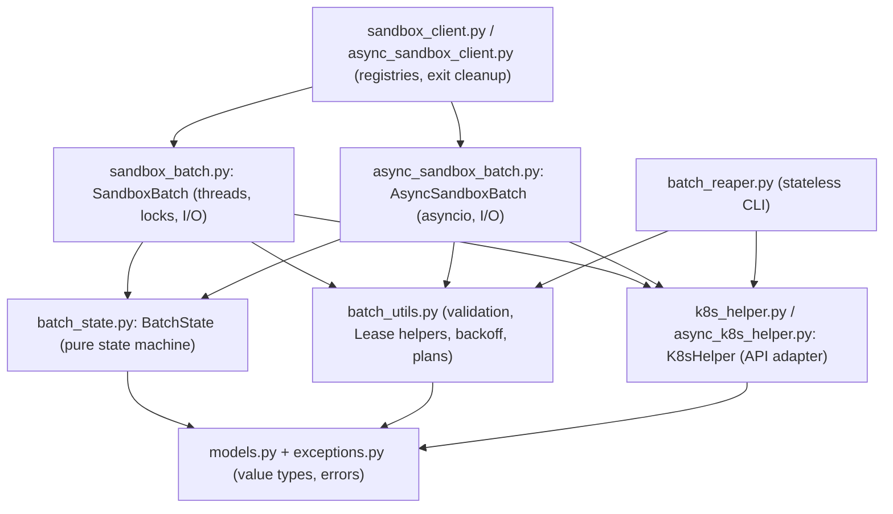

<a id="sec-patterns"></a>

[Learnings home](../learnings.md) · [Field guide index](../learnings.md#sec-field-guide)

# Patterns and code structure worth stealing

The batch code grew over 23 PRs without the retry, pacing, or wait logic being copied around. That happened mostly because of a few structural habits. This section collects them as reusable patterns. Each card says what the idea is, where it lives in our code, why it fits, and what bit us. Cards marked **Elegant** are the "cool programming structures": small tricks that do a lot of work.

You don't need to read this section in order. Skim the layering diagram first, then jump to whatever you're building.

<a id="layering"></a>

## How the code is layered



Arrows point inward. An inner layer never imports an outer one, so you can unit test each inner layer without anything above it.

- **A Sans-I/O core shared by two thin shells.** `batch_state.py: BatchState` holds every state transition and does no network I/O, takes no locks, and reads no clock. The module docstring says it works on "already-fetched Kubernetes objects" and does not "perform any network I/O, threading, or locking of their own." The two shells, `sandbox_batch.py: SandboxBatch` and `async_sandbox_batch.py: AsyncSandboxBatch`, only lock, sleep, call the network, and wake waiters. This dates from 1/N (`3a1607bc`). Its commit body says the logic lives "once, with no I/O, no threads, and no asyncio, so the two shells ... can share it under their own locks." Later PRs extended the core rather than creating it: fill accounting in 13/N, quorum in 14/N, release in 15/N, acquire and fresh ordinals in 16/N, and versioned pending deletes in 19/N. (An older version of this doc credited the core to 16/N, citing `9ba5a6c6`. That commit is a pre-squash commit inside 16/N that added acquired members to an existing core.)
- **Every shell method has the same rhythm.** Lock, check preconditions, call one core method, copy results into locals, unlock, do I/O, then lock again briefly to record the outcome. For example, `SandboxBatch.release_member` decides `needs_delete` under `self._changed` and only then calls `_delete_claim`. Because the core never blocks, the lock is held only for O(1) or O(changed items) work. One watch thread, up to `max_in_flight` creators, and many `acquire()` callers share one lock without fighting over it.
- **The two shells mirror each other line for line.** Same method names, comments, and order, with `with` swapped for `async with`. Reviewing sync/async parity becomes a near-mechanical diff. They differ only where the runtime forces it ([PAT-16](#pat-16), [PAT-12](#pat-12)). See [CANCEL-24](field-guide/cancel.md#cancel-24).
- **Policy goes in, not copies of loops.** Shared engines take small callables: `can_send` and `on_send` ([PAT-18](#pat-18)), `hold`, `finish`, and `guard` ([PAT-19](#pat-19), [PAT-20](#pat-20)), `pop` and `done` ([PAT-14](#pat-14)), `keep` ([PAT-11](#pat-11)). New features in 15/N, 16/N, and 19/N mostly added a closure, not a new loop.
- **Testing follows the layers.** `test_batch_state.py` imports no mocks: it feeds claim dicts in and checks members, events, and outcomes. `test_batch_utils.py` pins backoff exactly by passing `rand=`. See [TEST-3](testing.md#test-3).
- **Watch out:** the core has no lock of its own, so every caller must hold the shell's lock. The sync shell takes `_lock` even for read-only calls like `members()` and `err()`. The async shell's `AsyncSandboxBatch.members()` calls the core with no lock, which is safe only because there is no `await` in it ([LOCK-20](field-guide/lock.md#lock-20), [CANCEL-3](field-guide/cancel.md#cancel-3)). Add an `await` between a read and a write of core state and that guarantee is gone.

```python
# The shape of almost every shell method (sync shell)
with self._changed:                          # 1. lock
    self._check_healthy()                    # 2. preconditions
    names = self._state.release_not_ready()  # 3. pure decision in the core
    self._changed.notify_all()
for name in names:                           # 4. I/O outside the lock
    self._delete_claim(name)
```

**Use it when:** you ship the same behavior as a blocking API and an asyncio API, or a state machine is driven by network events (a watch, a protocol parser). Write and test the core first, then make the shells as boring as you can.

Further reading: [Sans-I/O docs](https://sans-io.readthedocs.io/), Gary Bernhardt's [Functional Core, Imperative Shell](https://www.destroyallsoftware.com/screencasts/catalog/functional-core-imperative-shell) screencast (paid; his free "Boundaries" talk covers the same idea), and Cory Benfield's PyCon 2016 talk [Building Protocol Libraries the Right Way](https://www.youtube.com/watch?v=7cC3_jGwl_U).

## State and data structures

<a id="pat-1"></a>

### PAT-1 O(1) work per watch event, using incremental counters (Elegant)

- **The idea:** keep running counters and sets that each watch event updates in constant time, instead of rescanning all N members to answer "is this group done?"
- **Where:** `batch_state.py: BatchState._on_fill_change`, `_unreachable_error`, `fill_settled`, `groups_done`, and the fields `_unable`, `_resolved`, `_failed`, `_lost`, `_missing`, `_never_created` (13/N `8ad5a407`), `_released_count` (15/N).
- **Why it works here:** a batch can have tens of thousands of claims, and the watch sends one event per change. A scan per event costs O(N) each, so O(N²) total. The 13/N commit body says recomputing per event "would be too slow for tens of thousands of claims." Instead, the first time a member turns FAILED or LOST, `_on_fill_change` adds it to `_unable` and `_resolved` and bumps one per-pool counter. Then every question is arithmetic. `_unreachable_error` checks `size - (failed + lost + released) < min_ready`. `fill_settled` checks `len(_resolved) + _never_created >= size`. You trade a few sets of names for constant work per event.

```python
# per event: constant work
if name not in self._unable and state in (FAILED, LOST):
    self._unable.add(name)
    self._resolved.add(name)
    self._lost[pool] += 1            # or self._failed[pool]
# "is the fill settled?": no scan
return len(self._resolved) + self._never_created >= self.size
```

**Use it when:** you need an aggregate answer over a big collection that changes one item at a time (controllers, progress trackers, quorum checks). Ask: what is the smallest summary I can update per event, and what guard keeps each item from being counted twice? **Watch out:** every counter needs a "counted already?" guard (`name not in self._unable`), see [COUNT-2](field-guide/count.md#count-2). Late arrivals must give back assumed losses (`_missing`, [COUNT-6](field-guide/count.md#count-6)), and only creates that never left the client count as never created ([COUNT-5](field-guide/count.md#count-5)). Some steps are amortized O(1), not strict: reaching the quorum drains every `_waiting` dict once. Snapshot calls stay O(N): `members()` sorts on every call and `has_pool()` scans. Watch those if call rates grow. See [PERF-1](field-guide/perf.md#perf-1).

<a id="pat-2"></a>

### PAT-2 Re-check only the group that changed (a "dirty set")

- **The idea:** keep a set of groups still short of quorum. Each event updates only its own group's entry, and the quorum is reached exactly when the set becomes empty.
- **Where:** `batch_state.py: BatchState._check_quorum` and `_groups_short_of_quorum` (14/N `3b57b191`).
- **Why it works here:** asking every group on every event costs O(G) per event. `_check_quorum(pool)` looks only at `pool`: short means add it (and check if it just became unreachable), enough means discard it. The 14/N commit body says the check "only looks at the group that changed, so it stays O(1) per watch event."

```python
short = set(all_groups)              # start pessimistic: nobody confirmed yet
def on_change(pool):
    if held[pool] < min_ready[pool]:
        short.add(pool)
        return
    short.discard(pool)
    if not short:
        reach_quorum()
```

**Use it when:** you have a barrier or "all N are ready" check driven by per-item events (readiness gates, rollout waves). **Watch out:** the set must start full. If it started empty, the first group to reach `min_ready` would declare the whole quorum reached. Groups of size 0 are left out entirely, so `set_mode(QUORUM)` handles "no groups at all" explicitly (`if not self._group_by_pool: self._quorum_members = []`). See [COUNT-11](field-guide/count.md#count-11) and [PERF-1](field-guide/perf.md#perf-1).

<a id="pat-3"></a>

### PAT-3 `dict[str, None]` as an insertion-ordered set (Elegant)

- **The idea:** a dict whose values are all `None` gives you set-like O(1) add, remove, and membership, plus iteration in insertion order.
- **Where:** `batch_state.py: BatchState._waiting: dict[str, dict[str, None]]` (13/N), used by `_route_ready_member`, `_decide_group_outcome`, `_check_quorum`. The code comment says "A dict is used as an ordered set."
- **Why it works here:** a group hands out its first `min_ready` members in the order they became Ready, and must drop a member fast if it stops being Ready. A list keeps order but removal is O(n). A set removes fast but has no order. Dicts keep insertion order (guaranteed since Python 3.7), so you get both.

```python
waiting: dict[str, None] = {}
waiting["b-3"] = None
waiting["b-1"] = None
waiting.pop("b-3", None)             # O(1) remove
cohort = list(waiting)[:min_ready]   # oldest first
```

**Use it when:** you need FIFO with removal: "ready in arrival order" lists, de-duplicated work queues where order matters. **Watch out:** setting a key that's already there does not move it to the end. That's fine here, because a member that leaves and comes back was popped first. Type it as `dict[str, None]`, not `set[str]`. See [PERF-2](field-guide/perf.md#perf-2).

<a id="pat-4"></a>

### PAT-4 A deque outbox, with stale entries skipped on read

- **The idea:** the core appends "what happened" to `collections.deque` outboxes, and consumers drain them with `popleft()`. Stale entries are skipped when read, not searched for and removed.
- **Where:** `batch_state.py: BatchState._events_to_yield`, `_group_outcomes_to_yield`, `pop_event`, `pop_group_outcome` (13/N). Also `sandbox_batch.py: SandboxBatch._create_plan` (12/N `522dad4c`).
- **Why it works here:** the core never calls back into the consumer, which keeps it Sans-I/O. `deque` gives O(1) append and popleft (`list.pop(0)` is O(n)). `pop_event` skips a `MEMBER_READY` whose member was released after it was queued, so `release_member` never has to search the queue. That "check a tombstone on read" trick is a lazy delete.

```python
self._events_to_yield.append(BatchEvent(type=MEMBER_READY, member=m))
...
while q:
    e = q.popleft()
    if e.type is MEMBER_READY and e.member.claim_name in self._released:
        continue                      # lazy delete
    return e
```

**Use it when:** one loop produces outputs that another loop consumes (event outboxes, work plans, retry queues). **Watch out:** the queue can hold entries that will never be yielded. `events_done()` checks `not self._events_to_yield`, so a released-but-queued event keeps the iterator alive until `pop_event` skips it, which it does in the same call. See [PERF-3](field-guide/perf.md#perf-3) and [WATCH-4](field-guide/watch.md#watch-4).

<a id="pat-5"></a>

### PAT-5 One-way latches: sticky sets and first-write-wins fields

- **The idea:** some facts may only go from false to true. Store them in sets or fields that are never cleared.
- **Where:** `batch_state.py: BatchState._unable`, `_resolved`, `_dispatched` (13/N), `_released` and `_fill_stopped_pools` (15/N), `note_error` (1/N), `expire_fill` (13/N), and `_group_outcomes`, set once per group via `_set_group_outcome` (from `_decide_group_outcome` or `_time_out_undecided_groups`, 13/N).
- **Why it works here:** callers have already been told "group X failed" or "events() ended." If those facts flipped back, the API would contradict itself. `note_error` keeps the first error, so `err()` never changes. `expire_fill` returns `False` if the fill already expired, so the shell notifies waiters once. `upsert_claim` returns early for anything in `_released`, so a late watch event can't bring a released claim back.

```python
def note_error(self, error):
    if self._error is None:          # first error wins, forever
        self._error = error
```

**Use it when:** you have completion checks, terminal states, tombstones for deleted keys, or first-error reporting. If a value decides whether a stream or wait ends, make it monotonic. **Watch out:** a latch built from a live gauge isn't a latch. An early `_ready_count` went up and down and could "un-settle" a finished stream. Decide what "final" means (handed out, dropped, unable, released) and latch only on that. See [COUNT-1](field-guide/count.md#count-1), [COUNT-3](field-guide/count.md#count-3), [API-10](field-guide/api.md#api-10).

<a id="pat-6"></a>

### PAT-6 Version each pending obligation with a sequence number

- **The idea:** map each pending delete to a number from a counter that only goes up. A finishing delete clears the entry only if it still holds the latest number.
- **Where:** `batch_state.py: BatchState._pending_deletes: dict[str, int]`, `_need_delete`, `delete_seq`, `note_deleted` (19/N `a2a19cfa`), used by `sandbox_batch.py: SandboxBatch._delete_claim`.
- **Why it works here:** with a plain set, an old delete that finishes late removes the name even though a newer delete is now owed (for example, a create retry recreated the claim). The number works like a compare-and-swap on an in-memory record. It's the same idea as a Kubernetes `resourceVersion` precondition, applied locally.

```python
seq = state.delete_seq(name)          # under the lock, BEFORE the DELETE
helper.delete_sandbox_claim(name)
with lock:
    state.note_deleted(name, seq)     # no-op if a newer delete was queued
```

**Use it when:** an async completion can arrive after the thing it completes was requested again (cache invalidation, debounced saves, overlapping retries). **Watch out:** take the snapshot before the I/O, not after. Adding the required `seq` argument passed mypy but broke direct calls in `test_batch_state.py`, because the package's mypy config excludes `test/` ([TEST-25](testing.md#test-25)). See [RACE-5](field-guide/race.md#race-5) and [RACE-4](field-guide/race.md#race-4).

<a id="pat-7"></a>

### PAT-7 Ordinals that only go up and are never reused

- **The idea:** claim names are `<batch-id>-<n>`, with `n` from a batch-wide counter that only increases. A released claim's number is never handed out again.
- **Where:** `batch_state.py: BatchState._next_ordinal`, `start_acquire` (16/N `dc9ea439`), and `upsert_claim`, which raises the counter past every ordinal the watch sees. The name format dates from 1/N; `detach` persists the next ordinal on the Lease (16/N).
- **Why it works here:** a released claim may still be terminating when its replacement is created. Reusing its name would cause a 409, or make a dying object look like the new one. A re-attached handle starts from `max(size, next_ordinal)` read from the Lease annotation. Since each group gets a contiguous block of ordinals in group order, the numbers also carry information ([PAT-30](#pat-30)).

```python
name = f"{batch_id}-{self._next_ordinal}"
self._next_ordinal += 1                                   # never decremented
# on every watched claim:
self._next_ordinal = max(self._next_ordinal, ordinal + 1)
```

**Use it when:** names identify objects whose lifetime can overlap their replacement's (job attempts, temp resources). **Watch out:** after a re-attach, ordinals alone can't tell fill claims from `acquire()` claims, because only groups that still have claims are known. Fill membership is stamped on the claim with group annotations instead (13/N). See [LEASE-24](field-guide/lease.md#lease-24), [K8S-18](field-guide/k8s.md#k8s-18), [K8S-19](field-guide/k8s.md#k8s-19).

<a id="pat-8"></a>

### PAT-8 Validate into a NamedTuple; hand out frozen snapshots

- **The idea:** validation returns an immutable, typed bundle with defaults filled in. Anything handed to callers is a frozen model.
- **Where:** `batch_utils.py: ClaimBatchArgs` and `validate_claim_batch_args` (12/N), `LeaseSettings` and `parse_lease_metadata` (16/N), `batch_reaper.py: StaleLease` (18/N). Frozen pydantic models in `models.py: Member`, `BatchGroup` (1/N), `BatchEvent` (13/N), and `GroupOutcome` as a `@dataclass(frozen=True)` (13/N).
- **Why it works here:** "parse, don't validate": once `validate_claim_batch_args` returns, later code never re-checks a value or sees `None`. Frozen `Member`s can be shared across threads and returned from `members()` without copying, because callers can't corrupt the cache. Updates make a new object with `existing.model_copy(update=...)` (`mark_lost`, 1/N). `GroupOutcome` is a dataclass, not pydantic, because it holds a live `Exception`.

```python
class ClaimBatchArgs(NamedTuple):
    groups: list[BatchGroup]
    batch_id: str
    create_rps: float
    ...
args = validate_claim_batch_args(...)   # every default resolved here, once
```

**Use it when:** data crosses a boundary. Validate once into an immutable value, and hand out immutable snapshots of shared state. **Watch out:** `frozen=True` blocks reassigning a field, not mutating a list inside it. That's why `Member.pod_ips` is a tuple. `GroupOutcome.members` is still a list, so it is only shallow-immutable. See [API-2](field-guide/api.md#api-2) and [API-3](field-guide/api.md#api-3). Further reading: Alexis King, [Parse, don't validate](https://lexi-lambda.github.io/blog/2019/11/05/parse-don-t-validate/); pydantic's [models docs](https://docs.pydantic.dev/latest/concepts/models/), section "Faux immutability".

<a id="pat-9"></a>

### PAT-9 Iterators that resume where they stopped

- **The idea:** `events()` and `group_outcomes()` return fresh iterators over a durable outbox that lives in the core. A later call picks up where the last one stopped.
- **Where:** `sandbox_batch.py: SandboxBatch.events`, `group_outcomes`, `_iterate`; `batch_state.py: BatchState.set_mode`, `_events_to_yield` (13/N).
- **Why it works here:** the queue lives in `BatchState`, not in the generator, so the generator holds no state. When the fill settles, the iterator ends, but a member that fails later is still queued, and the next `events()` call yields it. `set_mode` lets `events()` join any mode, lets `group_outcomes()` be called again to continue, and rejects other mixes with a message built from the `_CONSUMER_METHODS` table.

```python
for ev in batch.events(): ...   # ends when the fill settles
# later:
for ev in batch.events(): ...   # yields only what arrived since
```

**Use it when:** callers subscribe for a long time and may stop and come back. Keep the cursor or queue on the object, not in the generator frame. **Watch out:** two concurrent iterators share one queue, and each item goes to only one of them. That follows from the shared queue, but the docstrings only document resuming, not the split; say so in your docs. See [API-16](field-guide/api.md#api-16) and [API-13](field-guide/api.md#api-13).

## Concurrency building blocks

<a id="pat-10"></a>

### PAT-10 Decide under the lock, act outside it, using only locals

- **The idea:** do every check and reservation in one locked block, copy what you need into locals, then do I/O without the lock using only those locals.
- **Where:** `sandbox_batch.py: SandboxBatch.acquire` (the block that checks health, takes warm credit, checks the deadline, allocates the ordinal, installs the waiter, and reserves the pacing slot, 16/N; warm credit 19/N), `_delete_claim` (the `seq` snapshot, 19/N), `release` (`with self._lock: lease = self._lease`, 12/N), and `_refresh_warm_credit`, which re-runs `remaining_if_due()` each time it re-enters the lock (19/N).
- **Why it works here:** nothing decided in the block can change underneath it, and the lock is never held across the network. When the code must come back to the lock later, it re-checks everything that matters instead of trusting an earlier answer.

```python
with self._lock:
    self._check_healthy()
    name = self._state.start_acquire(pool)
    slot = self._reserve_create_slot(now)
# only locals below this line
wait_until(slot)
create(name)
```

**Use it when:** always, in any threaded or async shell around shared state. It's the default shape, not an optimization. **Watch out:** every re-read of shared state after dropping the lock opens a new race window. A field read twice across a lock gap once made `detach()` write a Lease with no duration. See [LOCK-1](field-guide/lock.md#lock-1), [LOCK-3](field-guide/lock.md#lock-3), [LOCK-8](field-guide/lock.md#lock-8), [CLEAN-2](field-guide/clean.md#clean-2).

<a id="pat-11"></a>

### PAT-11 Take out, act, put back, with the put-back passed in as a `partial` (Elegant)

- **The idea:** to give exactly one caller ownership of a shared resource, pop it under the lock, do the slow work without the lock, and put it back only if the work failed. Pass the "how to put it back" step in as a zero-argument callable.
- **Where:** `sandbox_batch.py: SandboxBatch._close_one(sandbox, action, keep)`, called from `_close_cached_connections` with `partial(self._connected.setdefault, claim_name, entry)` and from `_close_connections` with `partial(self._stale_connections.append, sandbox)` (17/N `6feedc5c`; the take-out/put-back idea from 10/N `74cd8fa5`). Async twin in `async_sandbox_batch.py`.
- **Why it works here:** holding the lock across `close_connection()` would block the watch. Leaving the entry in place lets two cleanups close it twice. Popping first gives single ownership. Connections live in two places (a dict of live ones, a list of stale ones), and only the restore step differs, so one `_close_one` serves both. `setdefault` is a nice touch: if someone already cached a newer connection under that name, the put-back doesn't overwrite it.

```python
with lock:
    entry = self._connected.pop(name, None)       # take ownership
if entry:
    self._close_one(entry[0], "release",
                    partial(self._connected.setdefault, name, entry))

def _close_one(self, sandbox, action, keep):
    closed = False
    try:
        sandbox.close_connection()
        closed = True
    finally:                                      # runs on Ctrl-C too
        if not closed:
            with self._lock:
                keep()
            self._client._track_closing(self)
```

**Use it when:** a pool or cache item needs slow cleanup (connections, subprocesses, temp files), or a generic helper must undo something in a caller-specific way. **Watch out:** key the put-back on a success flag in `finally`, not on `except Exception`, because `KeyboardInterrupt` and `CancelledError` skip `except Exception` ([CANCEL-1](field-guide/cancel.md#cancel-1)). In the async shell, `keep()` runs with no lock and no `await`, so a second cancel can't interrupt it ([CANCEL-3](field-guide/cancel.md#cancel-3)); don't wrap it in `async with lock`. After a put-back, tell the client to keep tracking the handle (`_track_closing`), or a concurrent unregister may orphan it ([CLEAN-6](field-guide/clean.md#clean-6)). See [CLEAN-1](field-guide/clean.md#clean-1).

<a id="pat-12"></a>

### PAT-12 Single-flight futures for a shared one-time check (Elegant)

- **The idea:** the first `acquire()` on an unseen pool installs a future and runs the check. Concurrent callers wait on that same future. Only success is cached, and a failed or interrupted leader hands off to a waiter.
- **Where:** `sandbox_batch.py: SandboxBatch._check_pool` with `concurrent.futures.Future`; `async_sandbox_batch.py: AsyncSandboxBatch._check_pool` with `asyncio.shield`, `task.cancelling()`, and `add_done_callback` (16/N `dc9ea439`).
- **Why it works here:** without it, 500 concurrent acquires on a new pool would send 500 identical GETs. The leader decides under the lock, then does the I/O outside it. Followers call `check.result(timeout=remaining)` (sync) or `await asyncio.wait_for(asyncio.shield(check), remaining)` (async). Three async details are worth learning:
  - `asyncio.shield` stops one impatient follower's timeout from cancelling the shared future.
  - `task.cancelling()` (Python 3.11+) tells "my leader was cancelled" apart from "I was cancelled."
  - `add_done_callback(lambda d: d.cancelled() or d.exception())` marks a failure as retrieved, so asyncio doesn't log "Future exception was never retrieved" when nobody is waiting.

```python
with lock:
    f = prechecks.get(pool)
    if f is None:
        f = prechecks[pool] = Future()
        leader = True
if not leader:
    return f.result(timeout=remaining)
try:
    do_check()
except BaseException as e:
    with lock: del prechecks[pool]     # cache only success
    f.cancel()                         # (or set_exception) so a follower takes over
    raise
with lock: del prechecks[pool]
f.set_result(None)
```

**Use it when:** many callers would do the same expensive read or setup at once (config fetch, token refresh, cache fill). **Watch out:** if the leader itself timed out, followers must report the leader's error, not their own timeout. That's why the code checks `if not check.done() or check.cancelled()` after a `TimeoutError`. See [LOCK-15](field-guide/lock.md#lock-15), [CANCEL-18](field-guide/cancel.md#cancel-18), [CANCEL-19](field-guide/cancel.md#cancel-19), [LIB-18](field-guide/lib.md#lib-18), [RETRY-18](field-guide/retry.md#retry-18). Further reading: Go's [singleflight](https://pkg.go.dev/golang.org/x/sync/singleflight).

<a id="pat-13"></a>

### PAT-13 Per-key Events for many single-key waiters, one Condition for a few broadcast waiters

- **The idea:** stream consumers share one `Condition` on the state lock. Each `acquire()` waits on its own `Event`, set only when its claim stops being PENDING.
- **Where:** `sandbox_batch.py: SandboxBatch._changed = threading.Condition(self._lock)` (13/N), and `_acquire_waiters`, `_wake_acquire`, `_notify_all`, `_wait_acquired` (16/N).
- **Why it works here:** `notify_all()` wakes every waiter. That's fine for a few consumers, but N acquires on the same Condition would mean every watch event wakes all N: O(N) wake-ups per event, O(N²) overall. Per-claim Events make it one wake-up per relevant event. `_notify_all` wakes both kinds on teardown.

```python
while True:
    with lock:
        ev.clear()                       # clear BEFORE reading state
        m = state.acquired_member(name)
        if m:
            return m
    ev.wait(remaining)                   # anything after clear() sets ev
```

**Use it when:** many waiters each care about one key. Keep a broadcast Condition for "something changed, everyone re-check" with few waiters. **Watch out:** clear the Event under the same lock you read state with, and before reading. Clearing after reading can lose a wake-up. Install the waiter before sending the create, so a fast watch event finds it. See [LOCK-12](field-guide/lock.md#lock-12).

<a id="pat-14"></a>

### PAT-14 One generic wait loop, parameterized by `pop` and `done`

- **The idea:** a single `_next(pop, done)` waits on the Condition until `pop()` returns an item, `done()` is true, or an error is set. It also wakes at the fill deadline. `_iterate` wraps it into a generator.
- **Where:** `sandbox_batch.py: SandboxBatch._next`, `_iterate`, `_expire_fill_if_due`, `_T = TypeVar("_T")` (13/N). The async twin waits with `asyncio.wait_for(self._changed.wait(), timeout)`.
- **Why it works here:** three public APIs share one correct loop. `events()` passes `(state.pop_event, state.events_done)`, `group_outcomes()` passes `(state.pop_group_outcome, state.groups_done)`, and `wait_for_quorum()` passes `(state.quorum_result, lambda: False)`. Typing `pop` as `Callable[[], _T | None]` with a TypeVar keeps the item type flowing to each caller. The wait timeout `max(0, fill_deadline - monotonic())` makes time pass inside the loop, and `_expire_fill_if_due` turns "the deadline passed" into a state change in the core.

```python
def _next(self, pop, done):
    with self._changed:
        while True:
            self._check_active()
            self._expire_fill_if_due()
            if (item := pop()) is not None:
                return item
            if done() or self._state.error() is not None:
                return None
            self._changed.wait(timeout)
```

**Use it when:** several blocking APIs differ only in what they take from shared state. **Watch out:** `None` means "stop," so `pop()` must never return `None` for a real item. Re-check `_check_active()` on every wake-up, so `detach()` or `release()` ends the iterator with `BatchError`. See [LOCK-13](field-guide/lock.md#lock-13) and [LOCK-7](field-guide/lock.md#lock-7).

<a id="pat-15"></a>

### PAT-15 `Event.wait(timeout)` as an interruptible sleep

- **The idea:** sleep with `stop_event.wait(delay)` instead of `time.sleep(delay)`. It returns `True` at once when the handle stops, so backoff never delays shutdown.
- **Where:** `sandbox_batch.py: SandboxBatch._create_worker` and `_create_one` (`if self._stop_creating.wait(...): return`, 12/N), `_watch_loop` (`self._watch_stop.wait(retry_delay(...))`), `_renew_loop` (`self._renew_stop.wait(min(wait, deadline - now))`).
- **Why it works here:** creators can sit in pacing or backoff for many seconds. `release()` sets `_stop_creating`, and every waiting worker returns right away. The renew loop caps its wait at the Lease deadline, so it wakes in time to declare expiry even mid-backoff.

```python
if self._stop_creating.wait(max(0.0, slot - time.monotonic())):
    return     # stopped while waiting
```

**Use it when:** any background loop sleeps (pollers, retries, renewals). In asyncio, wait on an Event inside `asyncio.wait_for`, or rely on task cancellation. **Watch out:** `Event.wait` returns a bool; check it. A few sleeps still use `time.sleep`: `_delete_claim` retries (which call `_check_lease_held()` right before sleeping) and `_delete_claims_in_rounds`, where a `with guard(): pass` right before the sleep gives the fast exit instead ([PAT-19](#pat-19)). See [CANCEL-8](field-guide/cancel.md#cancel-8) and [RETRY-9](field-guide/retry.md#retry-9).

<a id="pat-16"></a>

### PAT-16 The same drain barrier in two concurrency models

- **The idea:** before giving up the Lease, refuse new deletes and wait for in-flight ones. The sync shell counts per thread and waits on a Condition. The async shell uses an int plus an `asyncio.Event`.
- **Where:** `sandbox_batch.py: SandboxBatch._active_deletes: Counter[int]` and `_wait_active_deletes` (`while self._active_deletes.total() > self._active_deletes[tid]`); `async_sandbox_batch.py: AsyncSandboxBatch._active_deletes` (an int) and `_no_active_deletes` (15/N `113fae28`).
- **Why it works here:** a signal handler can run on the very thread that is mid-delete and call `release()`. A plain int would make that thread wait for itself forever. Subtracting its own count avoids that. Asyncio code isn't re-entered in the middle of a statement, so a plain int is enough there, and the Event avoids polling. `Counter.total()` (Python 3.10+) keeps the check short.

```python
# sync
while counts.total() > counts[me]:
    cond.wait()
# async: no await between these lines
self._active_deletes -= 1
if self._active_deletes == 0:
    self._no_active_deletes.set()
```

**Use it when:** teardown must wait for in-flight work. Pick the primitive that fits your runtime, and think about signal re-entry in threaded code. **Watch out:** in sync code, delete zero entries (`del counter[tid]`) so the Counter doesn't grow with thread ids. In async code, never `await` between the decrement and `set()`. See [CANCEL-12](field-guide/cancel.md#cancel-12), [CANCEL-4](field-guide/cancel.md#cancel-4), [LEASE-21](field-guide/lease.md#lease-21).

<a id="pat-17"></a>

### PAT-17 A shared pacing cursor: a whole rate limiter in one float (Elegant)

- **The idea:** one float `_next_create_at` and a fixed `_create_interval = 1 / create_rps` make the whole limiter. Each reservation takes `max(now, cursor)` and moves the cursor forward one interval.
- **Where:** `sandbox_batch.py: SandboxBatch._reserve_create_slot`, `_next_create_at`, `_create_interval` (12/N); the deadline gates `_check_retry_deadline` and acquire's `max(now, _next_create_at) >= deadline` (16/N).
- **Why it works here:** `max_in_flight` workers share one cursor under the lock, so together they never exceed `create_rps`. Memory is O(1) and there's no timer thread. The slot is a time to sleep until, so workers sleep in parallel, outside the lock. Since the cursor is visible, a caller with a deadline can see ahead of time that no slot will come in time and fail fast instead of creating a doomed claim.

```python
def reserve(self, earliest):
    slot = max(earliest, self._next_create_at)
    self._next_create_at = slot + self._create_interval
    return slot
```

**Use it when:** many workers share a client-side rate limit and you don't need bursts. **Watch out:** a reserved slot is a commitment. Dropping planned creates must recompute the fill deadline from `_next_create_at - _create_interval` (see `_drop_planned_creates`). Server `Retry-After` moves the shared cursor, while a single connection's blip sleeps locally ([RETRY-6](field-guide/retry.md#retry-6)). See [RETRY-5](field-guide/retry.md#retry-5), [RETRY-7](field-guide/retry.md#retry-7), [LOCK-9](field-guide/lock.md#lock-9). Further reading: the closely related [GCRA](https://en.wikipedia.org/wiki/Generic_cell_rate_algorithm), whose virtual-scheduling form keeps one theoretical arrival time and updates it as `max(now, TAT) + interval`.

## Hooks and composition

<a id="pat-18"></a>

### PAT-18 Closures as policy hooks into one shared retry loop (Elegant)

- **The idea:** pass small closures into one shared `_create_one` / `_send_create` loop. The fill worker and `acquire()` plug in different "may I still send?" rules and "I just sent" bookkeeping without forking the loop.
- **Where:** `sandbox_batch.py: SandboxBatch._create_one`, `_send_create`, `_can_still_send`, with closures in `_create_worker` and `acquire`. The `on_send` hook first appeared in 16/N (`dc9ea439`), fed by an `acquire()` closure named `mark_sent`; 19/N (`a2a19cfa`) renamed the closure and added `can_send` and `_can_still_send`. Same in `async_sandbox_batch.py`.
- **Why it works here:** both callers need the same pacing, `max_in_flight` slot, retry classification, and `Retry-After` handling, but stop for different reasons. Fill creates stop if the group was released, the watch already saw the claim, or the group failed before anything was sent. `acquire()` stops if its claim was released or already exists. The loop calls `can_send()` under the batch lock before each attempt and each retry wait, and calls `on_send()` right before the socket write. With `nonlocal sent`, the caller learns exactly how many attempts left the client. That number then decides whether a rollback delete is needed: `may_exist = sent > 1 or _is_transient_error(e)`. It's the Strategy pattern, done with plain functions.

```python
sent = 0
def can_send():
    return state.get_member(name) is None     # watch hasn't seen attempt 1
def on_send():
    nonlocal sent
    sent += 1
self._create_one(name, pool, ..., can_send=can_send, on_send=on_send)
```

**Use it when:** two callers share 90% of a loop (retry, pagination, polling) but differ in stop rules or bookkeeping. Prefer a couple of tiny callables over boolean flags or subclasses. **Watch out:** the closures run while the shell's lock is held, so they must not block or take the lock again. The fill closure may mutate state (`record_skipped_create`, `release_claim`) and notify, because it already holds the lock. A test mock that delivered the watch event synchronously inside the POST once hid why `can_send` checks `get_member` ([TEST-16](testing.md#test-16)). See [RACE-3](field-guide/race.md#race-3), [RACE-6](field-guide/race.md#race-6), [CANCEL-11](field-guide/cancel.md#cancel-11), [COUNT-5](field-guide/count.md#count-5).

<a id="pat-19"></a>

### PAT-19 A context manager used as a guard and as a predicate (Elegant)

- **The idea:** `_member_delete()` checks health and counts an active delete. `_delete_claims_in_rounds` wraps each HTTP call in it, and also runs an empty `with guard(): pass` as a cheap "may I keep going?" check before sleeping.
- **Where:** `sandbox_batch.py: SandboxBatch._member_delete` (`@contextlib.contextmanager`) and `_delete_claims_in_rounds(guard=contextlib.nullcontext)`; `release_group` passes `guard=self._member_delete` (15/N). The async twin uses `@contextlib.asynccontextmanager`.
- **Why it works here:** entering checks `_check_healthy()` under the lock and bumps the per-thread counter. Leaving decrements it and wakes `detach()` and `release()`, which drain active deletes ([PAT-16](#pat-16)). Reusing it as a predicate means a detached handle fails fast instead of sleeping through backoff, and the sleep itself never counts as an active delete. `release()` has no handle to guard, so the default `contextlib.nullcontext` turns the guard into a no-op.

```python
@contextlib.contextmanager
def _member_delete(self):
    with self._lock:
        self._check_healthy()
        self._active_deletes[tid] += 1
    try:
        yield
    finally:
        ...  # decrement, notify
# later, as a predicate:
with guard():
    pass        # raises if the handle detached
```

**Use it when:** I/O needs "check permission and register activity," and teardown must wait for that activity. `nullcontext` is the neutral element when a caller needs no guard. **Watch out:** guard only the HTTP call. If the guard covered the backoff sleep, a sleeping retry would block `detach()`. See [LOCK-10](field-guide/lock.md#lock-10), [LOCK-11](field-guide/lock.md#lock-11), [CANCEL-12](field-guide/cancel.md#cancel-12).

<a id="pat-20"></a>

### PAT-20 `hold` and `finish` callbacks around a generic round loop

- **The idea:** `_delete_claims_in_rounds` is a fixed "deletecollection, recount, repeat" loop. An optional `hold()` runs before each round and `finish()` runs once nothing is left.
- **Where:** `sandbox_batch.py: _delete_batch_objects` (inner `take` and `finish` closures sharing `nonlocal resource_version`) and `_delete_claims_in_rounds` (release rounds in 12/N; `hold`, `finish`, `guard` parameters in 15/N).
- **Why it works here:** `release()` and `release_group()` share the engine but differ in what surrounds it. `release()` re-takes the Lease every round so no other handle can attach mid-delete, and may delete the Lease only at the `resourceVersion` it just wrote. `take` stores that version; `finish` reads it. The loop's `held` flag enforces "only a round whose hold succeeded can finish." It's the template method pattern with callables, so there's no class hierarchy.

```python
resource_version = None
def take():
    nonlocal resource_version
    resource_version = _take_batch_lease(...)
def finish():
    if resource_version is not None:     # this round found no Lease
        helper.delete_batch_lease(..., resource_version=resource_version)
_delete_claims_in_rounds(helper, ns, selector, desc, hold=take, finish=finish)
```

**Use it when:** an algorithm is fixed and callers add steps before and after. **Watch out:** after a failed hold the Lease may still exist, and this round has no version to delete it at. That's why the loop requires `live == 0 and held` before calling `finish`. See [LEASE-18](field-guide/lease.md#lease-18) and [CLEAN-13](field-guide/clean.md#clean-13).

<a id="pat-21"></a>

### PAT-21 A paging generator that tells consumers when it restarts

- **The idea:** `_claim_list_pages` hides limit/continue paging behind a generator that yields `(page, is_first_page)`. On an expired continue token (410) it restarts once, and consumers reset when they see "first" again.
- **Where:** `k8s_helper.py: _claim_list_pages`, `list_sandbox_claim_objects`, `count_live_sandbox_claims` (20/N `a95cb2a1`, `fc9d8557`; managedFields dropped in `f80c79b0`).
- **Why it works here:** two consumers share one paging engine. The list collects items and takes the `resourceVersion` from the first page. The counter keeps only an integer and one page at a time (the generator does `del page`). The `first` flag keeps a restarted list one consistent snapshot, which a watch started at that `resourceVersion` relies on, without the generator knowing what consumers collect.

```python
for page, first in _claim_list_pages(list_fn, ns, sel, timeout):
    if first:
        live = 0                         # the list (re)started
    live += sum(1 for c in page["items"] if not deleting(c))
```

**Use it when:** an API is paginated and its snapshot can expire. Separate "how to page" from "what to collect." **Watch out:** a page can be empty while more follow, so only the continue token ends the list. Restart only once; a second 410 is raised. See [K8S-9](field-guide/k8s.md#k8s-9), [PERF-4](field-guide/perf.md#perf-4), [PERF-5](field-guide/perf.md#perf-5), [PERF-6](field-guide/perf.md#perf-6).

<a id="pat-22"></a>

### PAT-22 A wrapper subclass whose properties read the original live

- **The idea:** `_UnretriedApiClient` builds its own urllib3 client with `retries=False` from a shallow copy of the caller's configuration, while `default_headers` and `cookie` are properties that read from the source client on every request.
- **Where:** `k8s_helper.py: _UnretriedApiClient`, `_api_client_without_retries` (22/N; the shallow config copy idea first appeared in 7/N `d07e8941` and live header properties in 15/N `113fae28`).
- **Why it works here:** `ApiClient` fixes its retry policy at construction, so the batch code needs a separate client that must not drift from the caller's. `copy.copy(configuration)` shares the credential dicts, so a token rotated in place reaches both. The properties make later `set_default_header` or cookie changes on the source visible too.

```python
class Wrapped(client.ApiClient):
    def __init__(self, source):
        self._source = None                  # set BEFORE super().__init__
        self._default_headers = {}
        cfg = copy.copy(source.configuration)
        cfg.retries = False
        super().__init__(configuration=cfg)
        self._source = source
    @property
    def default_headers(self):
        return self._source.default_headers if self._source else self._default_headers
```

**Use it when:** you need a variant of an injected dependency with one setting changed, and everything else must stay linked to the original. **Watch out:** `ApiClient.__init__` assigns `default_headers` and `cookie` before `_source` exists, so initialize the backing fields first and give the properties setters. See [LIB-12](field-guide/lib.md#lib-12), [LIB-21](field-guide/lib.md#lib-21), [TEST-21](testing.md#test-21).

## Errors and types

<a id="pat-23"></a>

### PAT-23 Small enums and table-driven classifiers

- **The idea:** turn "what does this error mean?" into a tiny pure function that returns an enum. Use enums, not booleans, for lifecycle states and modes.
- **Where:** `batch_utils.py: CreateOutcome`, `create_error_outcome` (12/N), `is_retryable_status` (1/N); `models.py: MemberState` (a `StrEnum`, 4/N `4bb0db30`, replacing `ready`/`terminal`/`lost` booleans); `batch_state.py: ConsumerMode` and `_CONSUMER_METHODS` (13/N, 14/N).
- **Why it works here:** `create_error_outcome` captures a subtle rule in a few lines. A 409 on attempt 1 is a real name collision (FAIL). A 409 on a later attempt means an earlier attempt probably landed (SUCCESS). Retryable statuses retry until the attempt cap. The loop just branches on the result, and the function is easy to test with a table. `MemberState` replaced three booleans that could contradict each other (ready and lost both true?) with one value that can't.

```python
def create_error_outcome(status, attempt):
    if status == 409:
        return FAIL if attempt == 1 else SUCCESS
    if is_retryable_status(status) and attempt < BATCH_CREATE_ATTEMPTS:
        return RETRY
    return FAIL
```

**Use it when:** several booleans describe one thing, or error handling has more than two outcomes. **Watch out:** "409 on a retry means success" holds only while nothing deletes the claim between attempts; `can_send` covers that case ([PAT-18](#pat-18), [RACE-4](field-guide/race.md#race-4)). See [API-1](field-guide/api.md#api-1), [K8S-6](field-guide/k8s.md#k8s-6), [RETRY-1](field-guide/retry.md#retry-1).

<a id="pat-24"></a>

### PAT-24 `match` on enum modes

- **The idea:** `match self._mode:` with `case ConsumerMode.STREAM:` makes each mode's rule one visible block, and `case _:` covers the rest on purpose.
- **Where:** `batch_state.py: BatchState._route_ready_member` and `set_mode` (14/N `3b57b191`).
- **Why it works here:** in `_route_ready_member`, the `case _` branch documents that before any consumer is called, Ready members are held exactly as in group mode. It reads better than a chain of `if self._mode == ...`.

```python
match self._mode:
    case ConsumerMode.STREAM:
        self._dispatch(name)
    case ConsumerMode.QUORUM:
        ...
    case _:                    # GROUP, or no consumer yet
        hold_until_group_decides(name)
```

**Use it when:** you dispatch on a closed set of modes or states (Python 3.10+). **Watch out:** patterns must be dotted names. A bare `case STREAM:` is a capture pattern: it matches anything and binds it to a new variable. `match` isn't exhaustive, so make `case _` deliberate. See [API-1](field-guide/api.md#api-1).

<a id="pat-25"></a>

### PAT-25 An exception hierarchy with built-in mixins, data fields, and deliberate chaining

- **The idea:** `BatchError` is the catch-all. Subclasses also inherit from a built-in where callers expect one. Errors carry data, and every re-raise picks its `from` on purpose.
- **Where:** `exceptions.py: BatchError` (a `SandboxError`), `BatchNotFoundError(BatchError, SandboxNotFoundError)` (1/N), `BatchTimeoutError(BatchError, TimeoutError)` and `QuorumUnreachableError` (13/N; `released=` added in 15/N), `TerminalMemberError` (16/N). Chaining in `sandbox_batch.py: SandboxBatch._check_healthy` (`from error`), `batch_utils.py: parse_lease_duration_annotation` (`from None`), `batch_state.py: reconstruct_groups` (`from e`).
- **Why it works here:** callers can write `except BatchError` for everything, or `except TimeoutError` alongside other libraries. Fields let callers act without parsing messages: `TerminalMemberError.member` carries the FAILED or LOST `Member`, and `QuorumUnreachableError` has `warmpool`, `size`, `min_ready`, `failed`, `lost`, `released`. `from error` keeps the root cause visible when the handle stops; `from None` hides an irrelevant `int()` `ValueError`; `from e` keeps pydantic's validation details.

```python
class BatchTimeoutError(BatchError, TimeoutError): ...

try:
    ...
except BatchError:
    raise                              # don't re-wrap our own errors
except Exception as e:
    raise TerminalMemberError(member) from e
```

**Use it when:** you design a library's errors. **Watch out:** on Python 3.11+, `asyncio.TimeoutError` is the built-in `TimeoutError`, so `BatchTimeoutError` matched the async transport check and was retried as a socket blip. The fix excludes `BatchError` first in the async `_is_transport_error` and re-raises `BatchError` before broad wrappers in `acquire()` (19/N `2ecdf384`, `a2a19cfa`). See [LIB-5](field-guide/lib.md#lib-5), [API-9](field-guide/api.md#api-9), [API-8](field-guide/api.md#api-8).

<a id="pat-26"></a>

### PAT-26 Classify errors by their root cause, not their wrapper

- **The idea:** `_is_transport_error` looks inside wrappers (urllib3 `MaxRetryError.reason`, urllib3 `SSLError.args[0]`, aiohttp `ClientSSLError`) before matching a tuple of retryable types. `_is_transient_error` adds HTTP status rules on top.
- **Where:** `sandbox_batch.py: _is_transport_error`, `_is_transient_error`, `_TRANSPORT_ERRORS` (2/N `77c05c26`; `_is_transient_error` 12/N; TLS EOF unwrap 8/N `c56f0791`; `ConnectTimeoutError` 13/N); `async_sandbox_batch.py: _is_transport_error` (the `BatchError` exclusion, 19/N).
- **Why it works here:** a `MaxRetryError` can wrap a reset (retry) or a bad certificate (fatal). Unwrapping first decides on the real cause. One predicate serves the watch loop, creates, deletes, and release rounds, so they all agree on what "transient" means.

```python
cause = e.reason if isinstance(e, MaxRetryError) else e
if isinstance(cause, urllib3.exceptions.SSLError):
    e = cause.args[0] if cause.args else cause
return isinstance(e, _TRANSPORT_ERRORS)
```

**Use it when:** you build retry logic on an HTTP client. Write one classifier, unwrap, test it against real exception shapes. **Watch out:** changing urllib3's retry config changes which exceptions surface (with retries off, a raw `ConnectTimeoutError` instead of `MaxRetryError`). aiohttp's `ClientSSLError` is itself a `ClientConnectionError`, so unwrap it before the tuple check or every TLS failure looks transient. See [LIB-1](field-guide/lib.md#lib-1), [LIB-2](field-guide/lib.md#lib-2), [LIB-3](field-guide/lib.md#lib-3), [LIB-4](field-guide/lib.md#lib-4).

<a id="pat-27"></a>

### PAT-27 `@overload` keeps sync and async types precise in one helper

- **The idea:** `lease_parts` accepts a sync or an async `V1Lease`. Overloads tell mypy that a sync Lease returns sync metadata and spec types (likewise for async), and the body narrows away `None`.
- **Where:** `batch_utils.py: lease_parts`, two `@overload` signatures (21/N `8ba561c3`).
- **Why it works here:** `kubernetes` and `kubernetes_asyncio` define separate, separately generated, matching `V1Lease` classes whose `metadata` and `spec` are Optional. One helper raises `BatchError` if either is missing and returns a precisely typed tuple, so callers write `meta, spec = lease_parts(lease)` with no casts. The async types are imported under `TYPE_CHECKING`, so the sync path never imports `kubernetes_asyncio` at runtime.

```python
@overload
def lease_parts(lease: V1Lease) -> tuple[V1ObjectMeta, V1LeaseSpec]: ...
@overload
def lease_parts(lease: AsyncV1Lease) -> tuple[AsyncV1ObjectMeta, AsyncV1LeaseSpec]: ...
```

**Use it when:** one function serves parallel type families (sync/async clients, bytes/str). **Watch out:** overloads are for the type checker only. The real signature must accept the union, and its body must work for both. See [API-28](field-guide/api.md#api-28) and [CANCEL-22](field-guide/cancel.md#cancel-22).

## Algorithms and Kubernetes loops

<a id="pat-28"></a>

### PAT-28 Jittered, capped exponential backoff with an early exponent cap

- **The idea:** `backoff_delay` doubles from `base` to `cap`, returns a random value in `[wait/2, wait]` ("equal jitter"), stops the exponent early so `2**n` never gets huge, and takes an injectable `rand` so tests are exact.
- **Where:** `batch_utils.py: backoff_delay` (1/N `3a1607bc`); `retry_delay` (12/N) and `retry_after_seconds` (13/N).
- **Why it works here:** `doublings = min(attempt - 1, ceil(log2(cap / base)))` stops at the first power that reaches the cap, so attempt 10,000 costs the same as attempt 8 and can't overflow. Equal jitter spreads retries from many clients while guaranteeing at least half the wait. `retry_delay` prefers a server `Retry-After` (capped at 30s, ASCII digits only) over computed backoff.

```python
doublings = min(attempt - 1, math.ceil(math.log2(cap / base)))
wait = min(cap, base * 2 ** doublings)
return wait / 2 + rand() * wait / 2
# test: backoff_delay(1, 0.5, 30.0, rand=lambda: 0.0) == 0.25
```

**Use it when:** any network retry. Inject randomness and the clock. **Watch out:** `str.isdigit()` accepts characters like "²" that `float()` rejects, so `retry_after_seconds` checks `isascii() and isdigit()`. The HTTP-date form of `Retry-After` is ignored on purpose. See [RETRY-2](field-guide/retry.md#retry-2), [LIB-17](field-guide/lib.md#lib-17), [TEST-5](testing.md#test-5). Further reading: Marc Brooker, [Exponential Backoff And Jitter](https://aws.amazon.com/blogs/architecture/exponential-backoff-and-jitter/) (it compares equal jitter with full and decorrelated jitter, and finds full jitter the better default and equal jitter the weaker one).

<a id="pat-29"></a>

### PAT-29 A pure planning function: tuple sort keys and `accumulate` (Elegant)

- **The idea:** `fill_create_plan` computes the whole create order up front, as a pure function. Ordinals are contiguous per group, but each group's first `min_ready` claims are created first.
- **Where:** `batch_utils.py: fill_create_plan` (12/N `522dad4c`).
- **Why it works here:** `list(accumulate(sizes, initial=0))` gives each group's starting ordinal (prefix sums). Sorting tuples `(k >= min_ready, group_index, k)` puts every quorum-critical claim before every extra one (`False` sorts before `True`), keeps group order inside each part, and keeps `k` order inside each group. The result is a plain list the shell loads into a deque, easy to unit test.

```python
first = list(accumulate((g.size for g in groups), initial=0))
slots = sorted((k >= g.min_ready, i, k)
               for i, g in enumerate(groups) for k in range(g.size))
plan = [(f"{bid}-{first[i] + k}", groups[i]) for _, i, k in slots]
```

**Use it when:** you need a schedule or priority order. Encode priority as a tuple sort key and compute offsets with `accumulate`. **Watch out:** names follow group order, not create order. That's on purpose: re-attach rebuilds group order from ordinal blocks ([PAT-30](#pat-30)). See [PERF-14](field-guide/perf.md#perf-14) and [RETRY-13](field-guide/retry.md#retry-13).

<a id="pat-30"></a>

### PAT-30 None-last sort keys, and `min()` to recover an order

- **The idea:** `ordinal_sort_key(o) = (o is None, o or 0)` sorts claims without an ordinal last. `reconstruct_groups` restores group order by sorting pools by the smallest surviving ordinal in each.
- **Where:** `batch_state.py: ordinal_sort_key` and `reconstruct_groups` (7/N `d07e8941`); `members()` uses the key with `operator.itemgetter`.
- **Why it works here:** claims don't record group order, but each group's ordinals form a contiguous block in that order, so the lowest one per pool is enough. The tuple key avoids comparing `None` with `int` (a `TypeError` in Python 3). Ties break on pool name, so the result is deterministic.

```python
key = lambda o: (o is None, o or 0)
pool_order[pool] = min(pool_order.get(pool, k), k)
for pool in sorted(pool_order, key=lambda p: (pool_order[p], p)): ...
```

**Use it when:** you need an order the data encodes only implicitly, or you sort Optional values. **Watch out:** a group whose claims are all gone can't be reconstructed. That's why fill membership is stamped by annotation and missing claims are counted pessimistically (`count_missing_fill_as_unable`). See [K8S-18](field-guide/k8s.md#k8s-18), [LEASE-25](field-guide/lease.md#lease-25), [COUNT-6](field-guide/count.md#count-6).

<a id="pat-31"></a>

### PAT-31 Give up on lack of progress, not after a fixed attempt count

- **The idea:** the delete loop gives up only after `BATCH_RELEASE_MAX_IDLE_ROUNDS` rounds in a row in which the live count didn't go down.
- **Where:** `sandbox_batch.py: _delete_claims_in_rounds` (`idle_rounds`, `remaining_before`, 12/N in `_delete_batch_objects`; moved into this function in 15/N); `batch_utils.BATCH_RELEASE_MAX_IDLE_ROUNDS`.
- **Why it works here:** `deletecollection` deletes objects one at a time on the apiserver (with the default `--delete-collection-workers=1`) and can hit the request timeout before it finishes, while deletion may continue server-side. "Try 3 times" would abandon a 10k-claim batch that is draining steadily. Each round recounts with a consistent read (`count_live_sandbox_claims`, which skips claims that already have a `deletionTimestamp`) and resets `idle_rounds` whenever the count drops.

```python
progressed = live is not None and (prev is None or live < prev)
idle = 0 if progressed else idle + 1
if idle >= MAX_IDLE_ROUNDS:
    raise ...
if live is not None:
    prev = live
```

**Use it when:** a long bulk operation's duration grows with its size (drains, migrations, backfills). Bound idleness, not total attempts. **Watch out:** recount with a consistent list (no `resourceVersion`), because a lagging watch cache can report zero too early. Count already-terminating objects as gone, or the loop spins on finalizers. See [RETRY-11](field-guide/retry.md#retry-11), [K8S-5](field-guide/k8s.md#k8s-5), [K8S-4](field-guide/k8s.md#k8s-4).

<a id="pat-32"></a>

### PAT-32 A hand-rolled reflector: list, watch from its resourceVersion, relist on 410

- **The idea:** seed state from a list, watch from that list's `resourceVersion` with bookmarks, track the last version seen, re-list and reconcile on 410 Gone, and back off on short empty watches.
- **Where:** `sandbox_batch.py: SandboxBatch._watch_loop` (1/N; retries 2/N; short-watch backoff 12/N), `batch_state.py: BatchState.resync_from_list` (1/N), `k8s_helper.py: watch_sandbox_claims` (`allow_watch_bookmarks=True`).
- **Why it works here:** the official Python client has no informer, so the loop reimplements client-go's reflector. Watching from the list's version means no event is missed between list and watch. A 410 means that version aged out, so the loop re-lists; `resync_from_list` upserts what it sees and marks the rest lost, catching deletes missed while unwatched. Bookmarks move the version forward cheaply.

```python
items, rv = list_claims(selector)
state.seed(items)
while not stopped:
    try:
        for ev in watch(selector, rv):
            rv = ev.rv
            apply(ev)
    except ApiException as e:
        if e.status == 410:
            items, rv = list_claims(selector)
            state.resync(items)
```

**Use it when:** you need a live cache of Kubernetes objects from a client without informers. Use real informers when you have them. **Watch out:** update state and find stale connections under the lock, but close them outside it (`_pop_stale_connections`, then `_close_connections`). A watch that ends at once with no events counts as a failure. See [WATCH-1](field-guide/watch.md#watch-1), [WATCH-3](field-guide/watch.md#watch-3), [K8S-10](field-guide/k8s.md#k8s-10), [RETRY-3](field-guide/retry.md#retry-3). Further reading: [Kubernetes API concepts](https://kubernetes.io/docs/reference/using-api/api-concepts/) (sections on efficient detection of changes and watch bookmarks).

<a id="pat-33"></a>

### PAT-33 Write without reading first; read only on conflict

- **The idea:** renewal PUTs the Lease from this handle's last successful write, with no read first. Only a 409 triggers a read, to tell "someone else took it" apart from "my own lost write landed."
- **Where:** `sandbox_batch.py: SandboxBatch._renew_once`, `_write_renewal` (3/N `31a47728`); `_take_batch_lease` (12/N, retries once on 409).
- **Why it works here:** read-modify-write costs two requests per renewal. Sending back the object the server last returned costs one, and the apiserver's `resourceVersion` check catches any concurrent change. `_write_renewal` reads the monotonic clock before stamping `renewTime`, so local expiry is never later than what others compute. `_take_batch_lease` also compares UID and `leaseTransitions` with the last Lease it wrote, to catch "deleted and recreated" or "someone attached in between" even when the holder is empty.

```python
try:
    written = replace(self._lease)       # one request on the happy path
except ApiException as e:
    if e.status != 409:
        raise
    current = read()
    if current.spec.holder_identity != me:
        stop()
    written = replace(current)           # retry exactly once
```

**Use it when:** you heartbeat, or often write an object you own. Keep the last server response as the precondition for the next write. **Watch out:** a 409 can be your own earlier write landing late; re-read and retry exactly once, then raise. See [PERF-8](field-guide/perf.md#perf-8), [LEASE-2](field-guide/lease.md#lease-2), [LEASE-5](field-guide/lease.md#lease-5), [LEASE-16](field-guide/lease.md#lease-16), [LEASE-17](field-guide/lease.md#lease-17), [LEASE-28](field-guide/lease.md#lease-28).

<a id="pat-34"></a>

### PAT-34 A stateless reaper: observe, wait, conditional delete

- **The idea:** the reaper lists Leases, picks stale ones, waits one renew interval per Lease (shortest first), and deletes each with a `resourceVersion` precondition. The garbage collector deletes the claims through ownerReferences.
- **Where:** `batch_reaper.py: reap`, `find_stale_leases`, `_delete_lease_if_unchanged`, `is_lease_reapable`, `StaleLease` (18/N `a97eeae7`); `batch_utils.py: lease_owner_reference` (18/N).
- **Why it works here:** there is no state between runs and every action is a delete, so a run that stops halfway does no harm. Staleness compares two clocks, so the reaper adds a skew margin (get_batch subtracts one). Then a live but skewed holder gets one renew interval to write. Any write changes the `resourceVersion`, the precondition fails with 409, and the reaper skips it. Sorting by renew interval makes the run last as long as the longest interval, not the sum. The GC matches owners by UID, so a newer batch with the same id is never touched.

```python
stale = find_stale_leases(...)           # remembers each resourceVersion
listed_at = time.monotonic()
for ns, lease in sorted(stale, key=lambda x: x[1].renew_interval):
    time.sleep(max(0.0, listed_at + lease.renew_interval - time.monotonic()))
    delete(lease, preconditions=V1Preconditions(resource_version=lease.resource_version))
```

**Use it when:** you clean up resources abandoned by a dead heartbeat. Allow for clock skew, confirm the heartbeat didn't move, delete conditionally, and let owner references cascade. **Watch out:** skip Leases missing `renewTime` or a duration instead of guessing (waiting is always safe). Check the label and name before deleting, because RBAC can't limit the reaper to batch Leases. See [LEASE-8](field-guide/lease.md#lease-8), [LEASE-4](field-guide/lease.md#lease-4), [LEASE-10](field-guide/lease.md#lease-10), [CLEAN-23](field-guide/clean.md#clean-23), [K8S-2](field-guide/k8s.md#k8s-2), [K8S-3](field-guide/k8s.md#k8s-3), [K8S-20](field-guide/k8s.md#k8s-20). Further reading: Kubernetes docs on [Leases](https://kubernetes.io/docs/concepts/architecture/leases/) and [garbage collection](https://kubernetes.io/docs/concepts/architecture/garbage-collection/).

<a id="pat-35"></a>

### PAT-35 One shared structural + temporal invariant oracle across every test tier

- **The idea:** factor all `O(N)` set-partition conservation laws (`BatchInvariantOracle`) and cross-step stream/monotonicity history checks (`ReferenceBatchModel`) into one standalone test helper module, and call `BatchInvariantOracle.assert_all(state, ref)` after every transition in unit tests, Hypothesis state machines, differential harnesses, and concurrency stress suites.
- **Where:** `test/unit/batch_invariant_oracle.py: BatchInvariantOracle`, `ReferenceBatchModel` (`Chaos & Verification Suite`, `25cf3025`); reused in `test_batch_state_fuzz.py`, `test_batch_differential.py`, and `test_batch_concurrency_stress.py`.
- **Why it works here:** production `BatchState` maintains incremental `O(1)` counters and sets (`_waiting`, `_resolved`, `_unable`, `_missing`, `_groups_short_of_quorum`) so per-event watch processing stays fast ([PAT-1](#pat-1), [PERF-1](field-guide/perf.md#perf-1)). Checking only public return values lets internal accounting rot silently until a specific follow-up transition trips over it (`F-12`). Recomputing partitions by `O(N)` scan and comparing stream outputs against a tiny stateful shadow model in tests costs microseconds at small `N` (`2..20` claims) and turns every test in every suite into a full state-corruption detector.

```python
ref = ReferenceBatchModel(state)
for step in trace:
    apply_step(state, step)
    events, outcomes = BatchInvariantOracle.assert_all(state, ref)
```

**Use it when:** a Sans-I/O state machine maintains incremental counters, disjoint state sets, or one-way completion latches. **Watch out:** document intentional exceptions to monotonicity in the shadow model (such as `reopened_by_late_missing` when a missing claim on a re-attached batch arrives late) instead of disabling monotonicity checks wholesale. See [PAT-1](#pat-1), [TEST-29](testing.md#test-29), [TEST-32](testing.md#test-32), [COUNT-1](field-guide/count.md#count-1).

---

[Learnings home](../learnings.md) · [Field guide index](../learnings.md#sec-field-guide)
