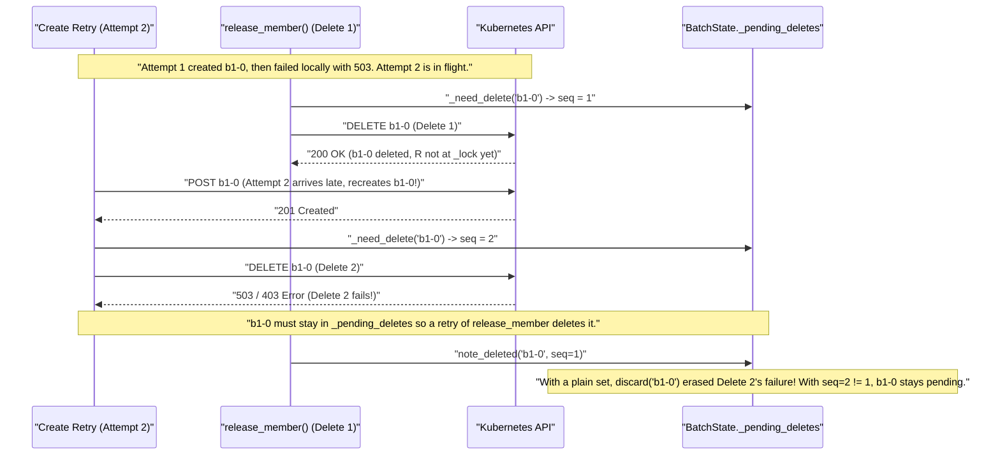

# Walkthrough of the `19/N` (`7a`) Round 2 Diff

> [!NOTE]
> **Why `+477 / -184` looks much bigger than it actually is**
> Out of `+477` insertions in `review-diff/r7a-r2`, **288 lines are unit tests** (one 7-case sync test plus its identical async mirror). Across production code, the entire Round 2 change is **net +37 lines total** (`+15` in [batch_state.py](https://github.com/briankhoi/agent-sandbox/blob/5e580174ff57e8b376d9ed0e49aa4128ed8becd9/clients/python/agentic-sandbox-client/k8s_agent_sandbox/batch_state.py), `+9` in [sandbox_batch.py](https://github.com/briankhoi/agent-sandbox/blob/5e580174ff57e8b376d9ed0e49aa4128ed8becd9/clients/python/agentic-sandbox-client/k8s_agent_sandbox/sandbox_batch.py), and `+13` in [async_sandbox_batch.py](https://github.com/briankhoi/agent-sandbox/blob/5e580174ff57e8b376d9ed0e49aa4128ed8becd9/clients/python/agentic-sandbox-client/k8s_agent_sandbox/async_sandbox_batch.py)).
>
> It feels overwhelming because **two unrelated concerns currently sit inside the same commit**:
> 1. **`19/N` warm-credit & `max_in_flight` wait fixes** (what `19/N` is actually about).
> 2. **The folded-in `15/N` `release_member()` + create-retry race fix** (which you chose to fold into `19/N` so you would not have to open an extra PR).

---

## 1. Answer to Question 1 (`_pending_deletes: dict[str, int]`, `_need_delete`, `delete_seq`)

### What `_pending_deletes` already did before `19/N`
In `15/N`, [`BatchState._pending_deletes`](https://github.com/briankhoi/agent-sandbox/blob/5e580174ff57e8b376d9ed0e49aa4128ed8becd9/clients/python/agentic-sandbox-client/k8s_agent_sandbox/batch_state.py#L259-L262) already existed as a `set[str]`. Whenever `release_member()` or `release_not_ready()` tried to delete `b1-0` and that HTTP `DELETE` failed, `"b1-0"` stayed in `_pending_deletes` so calling `release_member()` or `release_not_ready()` again would retry the delete. When `_delete_claim("b1-0")` succeeded, `note_deleted("b1-0")` removed `"b1-0"` from that set.

### What happened in Round 2 to make it `dict[str, int]`
When we folded the `release_member()` + create-retry fix into `19/N`, we added cleanup deletion (`Delete #2`) for the case where a retry (`Attempt 2` of `POST /sandboxclaims`) was already on the network socket when `release_member()` deleted `Attempt 1`'s claim (`Delete #1`), causing `Attempt 2` to recreate `b1-0` right after `Delete #1` removed it.

The Round 2 verifier then spotted an overlapping-thread race between `Delete #1` and `Delete #2` when `_pending_deletes` was a plain `set[str]`.



Because `Delete #1` carries `seq = 1` and `Delete #2` bumped `_pending_deletes["b1-0"]` to `seq = 2`, [`note_deleted("b1-0", seq=1)`](https://github.com/briankhoi/agent-sandbox/blob/5e580174ff57e8b376d9ed0e49aa4128ed8becd9/clients/python/agentic-sandbox-client/k8s_agent_sandbox/batch_state.py#L492-L495) sees `2 != 1` and leaves `"b1-0"` in `_pending_deletes`.

### Is all this delete stuff actually needed?
It depends on which layer of that race you want `release_member()` to guarantee:

| Layer | What it prevents | Production code cost | What happens without it |
| :--- | :--- | :--- | :--- |
| **Layer A** (`can_send` before `_in_flight` and retry backoff) | Stops `_create_one` from starting `Attempt 2` after `release_member`, `release_group`, `release_not_ready`, or `err()` already happened | **0 delete state** (needed by `19/N` anyway because warm credit queues creates on `_in_flight`) | Released claims sleep out retry backoff, take `create_rps` slots, and send `Attempt 2` |
| **Layer B** (`retried = sent > 1` cleanup delete) | Deletes `b1-0` if `Attempt 2` was *already on the wire* during `Delete #1` and recreated `b1-0` after `Delete #1` finished | ~15 lines across `batch_state.py` + `sandbox_batch.py` | Recreated claim lives until `release_group()`, `release()`, `shutdownTime`, or Lease GC (`18/N`) |
| **Layer C** (`_pending_deletes: dict[str, int]`, `_need_delete`, `delete_seq`) | Keeps `"b1-0"` retryable by a second `release_member()` call when **all of Layer B happens** AND `Delete #2` fails across all 3 of its own retries while `Delete #1`'s thread was paused between HTTP `200` and `with self._lock:` | ~15 lines (`_next_delete_seq`, `_need_delete`, `delete_seq`, `seq` in `_delete_claim`) | Second `release_member(m)` becomes a no-op; `release_group()`, `release()`, `shutdownTime`, and Lease GC (`18/N`) still delete the claim |

You have three clean ways to handle this (listed at the end under **Decisions**):
1. **Keep it, and optionally split the `release_member` retry fix into its own commit inside `19/N`** so the warm-credit commit is tiny and pure while GitHub still squashes both commits when `19/N` merges.
2. **Move the `release_member` retry fix (`Layer B + Layer C`) out of `19/N` into a small post-stack follow-up PR** so `19/N` goes back to pure warm-credit pacing.

---

## 2. Answer to Question 2 (Why `or self._state.get_member(claim_name) is not None` disappeared)

In Round 1 (`c4ff8fbd`), `acquire()` passed:

```python
if (
    self._state.acquired_member(claim_name) is not None
    or self._state.get_member(claim_name) is not None
):
    return False
```

In Round 2 (`review-diff/r7a-r2`), that became:

```python
def can_send() -> bool:
    return self._state.acquired_member(claim_name) is None
```

### What each call checks
Look at [`BatchState.acquired_member(claim_name)`](https://github.com/briankhoi/agent-sandbox/blob/5e580174ff57e8b376d9ed0e49aa4128ed8becd9/clients/python/agentic-sandbox-client/k8s_agent_sandbox/batch_state.py#L451-L466):
- Claim was released (`release_member` or `release_group`) -> **raises `BatchError`**
- Claim failed or was deleted (`FAILED` or `LOST`) -> **raises `TerminalMemberError`**
- Claim is `READY` -> returns `Member` (`is not None`, so `can_send()` returns `False` and skips sending)
- Claim is unseen (`None`) **or `PENDING`** -> returns `None`

So the **only** difference between keeping `get_member(claim_name) is None` vs removing it is when the watch has **already seen `Attempt 1`'s claim in `PENDING` state** before `Attempt 2` sends:
- **With `get_member(claim_name) is None`:** `acquire()` sees the claim already exists in `PENDING`, skips sending a redundant `Attempt 2` `POST`, and goes straight to `_wait_acquired()`.
- **Without `get_member(claim_name) is None`:** `acquire()` sends `Attempt 2` anyway (getting `409 AlreadyExists`, which counts as success).

> [!WARNING]
> **I was wrong to remove `self._state.get_member(claim_name) is None` in Round 2.**
> I removed it because in the new unit test `test_release_member_stops_create_retries_and_deletes_an_in_flight_retry` ([test_sandbox_batch.py](https://github.com/briankhoi/agent-sandbox/blob/5e580174ff57e8b376d9ed0e49aa4128ed8becd9/clients/python/agentic-sandbox-client/k8s_agent_sandbox/test/unit/test_sandbox_batch.py#L2424)), the mock pushed the `PENDING` watch event inside `attempts == 1` instead of pushing it once `attempts == 2` was already in flight. With `get_member` present, the test double saw `PENDING` before `attempts == 2` started and skipped `Attempt 2`.
>
> Changing production code to suit a test mock violates our rule (`working_rules.md:55`). In real Kubernetes, if the watch already saw `Attempt 1`'s claim in `PENDING`, skipping `Attempt 2` saves a pointless `409` POST and shrinks the retry race window. We should put `and self._state.get_member(claim_name) is None` back and move the mock's `push` in the `in_flight` subtest to `attempts == 2`.

---

## 3. Guided Tour of Every Production Hunk in `r7a-r2`

Because [sandbox_batch.py](https://github.com/briankhoi/agent-sandbox/blob/5e580174ff57e8b376d9ed0e49aa4128ed8becd9/clients/python/agentic-sandbox-client/k8s_agent_sandbox/sandbox_batch.py) and [async_sandbox_batch.py](https://github.com/briankhoi/agent-sandbox/blob/5e580174ff57e8b376d9ed0e49aa4128ed8becd9/clients/python/agentic-sandbox-client/k8s_agent_sandbox/async_sandbox_batch.py) are 1-for-1 mirrors, walking through the 5 small chunks below covers the entire diff.

### Chunk A. Do not mistake `BatchTimeoutError` for a retryable socket timeout (async only, +3 lines)
File: [`_is_transport_error`](https://github.com/briankhoi/agent-sandbox/blob/5e580174ff57e8b376d9ed0e49aa4128ed8becd9/clients/python/agentic-sandbox-client/k8s_agent_sandbox/async_sandbox_batch.py#L96-L99)

```diff
 def _is_transport_error(error: BaseException) -> bool:
+    # BatchTimeoutError subclasses TimeoutError, so exclude SDK errors before checking TimeoutError.
+    if isinstance(error, BatchError):
+        return False
```

**Why:** Python's `BatchTimeoutError` inherits from built-in `TimeoutError`. In async, `_TRANSPORT_ERRORS` includes `TimeoutError` (for `aiohttp` socket timeouts). Without these 3 lines, when `_send_create` raised `BatchTimeoutError` because `max_in_flight` stayed full past `acquire(timeout=...)`, `_create_one` treated `BatchTimeoutError` as a transient network glitch and retried instead of failing immediately.

---

### Chunk B. Simplify `_refresh_warm_credit` timeout check (-5 lines)
Files: [`SandboxBatch._refresh_warm_credit`](https://github.com/briankhoi/agent-sandbox/blob/5e580174ff57e8b376d9ed0e49aa4128ed8becd9/clients/python/agentic-sandbox-client/k8s_agent_sandbox/sandbox_batch.py#L894-L897) and [`AsyncSandboxBatch._refresh_warm_credit`](https://github.com/briankhoi/agent-sandbox/blob/5e580174ff57e8b376d9ed0e49aa4128ed8becd9/clients/python/agentic-sandbox-client/k8s_agent_sandbox/async_sandbox_batch.py#L909-L912)

```diff
             except Exception as e:
-                cause = e.reason if isinstance(e, urllib3.exceptions.MaxRetryError) else e
-                if time.monotonic() >= deadline or (
-                    request_timeout < batch_utils.BATCH_REQUEST_TIMEOUT_SECONDS
-                    and isinstance(cause, (TimeoutError, urllib3.exceptions.TimeoutError))
-                    and not isinstance(cause, urllib3.exceptions.NewConnectionError)
-                ):
+                if time.monotonic() >= deadline:
                     # This acquire's deadline cut the read short, so another acquire with more time
                     # left can still refresh the pool instead of waiting out the refresh interval.
                     return
```

**Why:** Whenever `request_timeout = min(10.0, deadline - now)` cuts the warm-pool GET short because of the caller's own `deadline`, `deadline` has already arrived by the time `get_sandbox_warmpool` raises. Checking `time.monotonic() >= deadline` alone handles it cleanly without inspecting `urllib3` internals.

---

### Chunk C. Replace `before_send() -> bool` + `_create_one() -> bool` with `can_send` + `on_send`
Files: [`_send_create`](https://github.com/briankhoi/agent-sandbox/blob/5e580174ff57e8b376d9ed0e49aa4128ed8becd9/clients/python/agentic-sandbox-client/k8s_agent_sandbox/sandbox_batch.py#L1685-L1729) and [`_create_one`](https://github.com/briankhoi/agent-sandbox/blob/5e580174ff57e8b376d9ed0e49aa4128ed8becd9/clients/python/agentic-sandbox-client/k8s_agent_sandbox/sandbox_batch.py#L1731-L1796)

```diff
-        wait = None if deadline is None else max(0.0, deadline - time.monotonic())
-        if not self._in_flight.acquire(timeout=wait):
+        with self._lock:
+            if not self._can_still_send(can_send):
+                return
+        wait = None if deadline is None else deadline - time.monotonic()
+        if (wait is not None and wait <= 0) or not self._in_flight.acquire(timeout=wait):
+            with self._lock:
+                if not self._can_still_send(can_send):
+                    return
             raise BatchTimeoutError(f"no create in flight slot for claim '{claim_name}' before the deadline")
         try:
             with self._lock:
-                if self._stop_creating.is_set() or self._state.error() is not None:
-                    return False
-                if before_send is not None and not before_send():
-                    return False
+                if not self._can_still_send(can_send):
+                    return
+                if on_send is not None:
+                    on_send()
             self._client.k8s_helper.create_sandbox_claim(...)
```

And inside `_create_one`'s `CreateOutcome.RETRY` branch:

```diff
                     if retry_after is None:
                         backoff = batch_utils.retry_delay(attempt, None)
                         with self._lock:
+                            if not self._can_still_send(can_send):
+                                return
                             self._check_retry_deadline(claim_name, deadline, time.monotonic() + backoff, e)
                         if self._stop_creating.wait(backoff):
                             return
                     with self._lock:
+                        if not self._can_still_send(can_send):
+                            return
                         earliest = time.monotonic() + (retry_after or 0.0)
                         self._check_retry_deadline(claim_name, deadline, earliest, e)
                         slot = self._reserve_create_slot(earliest)
```

**Why:**
1. **Dropped duplicate `bool` return type:** Both `acquire()` and `_create_worker` already increment `sent += 1` inside `on_send()`, so `sent > 0` already tells them whether any attempt sent HTTP `POST`. Having `_send_create` and `_create_one` also return `bool` expressed the same fact twice.
2. **No sending past `deadline`:** Previously `max(0.0, deadline - now)` passed `timeout=0.0` when `deadline` had already expired, which still succeeds immediately if a semaphore slot is free. Checking `wait <= 0` stops an expired `acquire()` from firing a `POST`.
3. **Right error when released while waiting:** Checking `_can_still_send(can_send)` before waiting on `_in_flight`, on `_in_flight` timeout, and before retry backoff / slot reservation ensures a released or detached `acquire()` raises `BatchError("...was released...")` instead of `BatchTimeoutError`, and stops released claims from sleeping backoff or taking `create_rps` slots.

---

### Chunk D. `_create_worker`, `_can_send_fill_create`, and `_delete_released_create`
Files: [`_create_worker`](https://github.com/briankhoi/agent-sandbox/blob/5e580174ff57e8b376d9ed0e49aa4128ed8becd9/clients/python/agentic-sandbox-client/k8s_agent_sandbox/sandbox_batch.py#L1562-L1634) and [`_delete_released_create`](https://github.com/briankhoi/agent-sandbox/blob/5e580174ff57e8b376d9ed0e49aa4128ed8becd9/clients/python/agentic-sandbox-client/k8s_agent_sandbox/sandbox_batch.py#L1655-L1683)

```diff
+    def _can_send_fill_create(self, claim_name: str, warmpool: str, *, retried: bool = False) -> bool:
+        """Whether a fill create may still send a request. The caller holds ``self._lock``."""
+        self._expire_fill_if_due()
+        if self._state.fill_creates_released(warmpool, claim_name):
+            if self._state.get_member(claim_name) is None:
+                self._state.release_claim(claim_name, warmpool)
+                self._changed.notify_all()
+            return False
+        if not retried and self._state.group_failed(warmpool):
+            self._state.record_skipped_create()
+            self._changed.notify_all()
+            return False
+        return True
```

**Why:**
- Previously those exact 10 lines sat inline at the top of `_create_worker`, so they ran **only once** (after pacing sleep, *before* waiting for `max_in_flight` and *never* before retries). Moving them into `_can_send_fill_create` lets `_send_create` and `_create_one` run the exact same check after waiting for `max_in_flight` and before every retry.
- `if self._state.get_member(claim_name) is None:` protects a fill member that landed on `Attempt 1`, turned `READY`, and was handed out before `release_not_ready()` ran, so skipping `Attempt 2` does not erase the kept `READY` member.
- `if not retried` on `group_failed` ensures `record_skipped_create()` only counts a claim we never sent at all (`sent == 0`).

---

### Chunk E. `BatchState` (`release_member`, `drop_acquired`, and `_pending_deletes`)
File: [`batch_state.py`](https://github.com/briankhoi/agent-sandbox/blob/5e580174ff57e8b376d9ed0e49aa4128ed8becd9/clients/python/agentic-sandbox-client/k8s_agent_sandbox/batch_state.py#L370-L496)

```diff
         self.release_claim(claim_name, member.warmpool)
+        self._acquiring.pop(claim_name, None)
         return bool(self._take_deletes([member]))
```

```diff
     def drop_acquired(self, claim_name: str, created: bool, *, retried: bool = False) -> bool:
-        self._acquiring.pop(claim_name, None)
+        was_acquiring = self._acquiring.pop(claim_name, None) is not None
         if claim_name in self._released:
-            if not created:
-                self._pending_deletes.discard(claim_name)
-            return created and claim_name in self._pending_deletes
+            if created and (was_acquiring or retried):
+                self._need_delete(claim_name)
+                return True
+            return False
```

**Why (beyond the sequence numbers covered in Section 1):**
When `acquire()` sends 1 create (`retried=False`), the watch sees the `PENDING` claim, and the caller runs `release_member(member)`:
- `release_member()` **already** deletes `claim_name` by name, AND wakes `acquire()` so `acquire()` exits through `_drop_acquired()`.
- Before this change, `drop_acquired()` saw `claim_name in self._pending_deletes` (put there by `release_member()` whose HTTP `DELETE` was still on the wire!) and returned `True`, causing `_drop_acquired()` to fire a **second concurrent `DELETE`** for the exact same claim!
- Popping `_acquiring` in `release_member()` means `was_acquiring` is `True` **only** when `release_group()` released an in-flight `acquire()` (where `deletecollection` by label may have run *before* the `POST` landed, so `_drop_acquired` must delete by name), and `False` when `release_member()` already owns the by-name delete (unless `retried=True`, meaning `Attempt 2` may have landed after `release_member()`'s delete).

---

## 4. Decisions to Make Reviewing Easy

1. **Restore `and self._state.get_member(claim_name) is None` in `acquire()`'s `can_send()`** (and fix the 2-line test mock so `in_flight` pushes the watch event on `attempts == 2`): **Recommended.**
2. **How would you like to handle the `release_member` retry-delete changes (Part B / `_pending_deletes` sequence)?**
   - **Option 1 (Recommended if keeping in `19/N`):** Split `19/N` into two clean logic commits inside the same PR (Commit 2 for pure `WarmCredit` + `max_in_flight` wait/deadline fixes, Commit 3 for the `release_member` create-retry fix) so you can review each half in isolation while GitHub still squash-merges them as one PR.
   - **Option 2 (Simpler code):** Keep `Layer A + Layer B`, or drop `Layer C` (`_pending_deletes: dict[str, int]` back to `set[str]`, removing `_need_delete`, `delete_seq`, `_next_delete_seq`).
   - **Option 3 (Smallest `19/N` PR):** Move the `release_member` create-retry fix (`Layer B + Layer C` and its 260 test lines) out of `19/N` into a standalone post-stack PR, leaving `19/N` strictly about warm-credit pacing.
