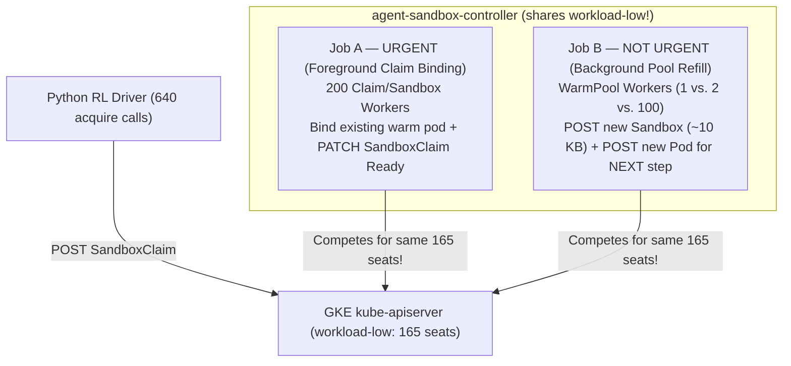

# Deep Dive (From Scratch): Why `--sandbox-warm-pool-concurrent-workers=100` Spikes GKE API Queue Wait `155×`

*(Written assuming zero prior background on Kubernetes API server internals or APF.)*

---

## 1. What Is "APF" (`API Priority and Fairness`) in Plain English?

Every single thing in Kubernetes — your Python RL client creating `SandboxClaim`s, `agent-sandbox-controller` binding warm pods, `kube-scheduler` placing pods, and `48` node kubelets sending heartbeats — talks to **one central brain: `kube-apiserver`** (backed by `etcd`, Kubernetes's database).

If `kube-apiserver` tried to execute `5,000` concurrent database writes at the exact same millisecond, `etcd` would run out of memory and crash the whole cluster. To prevent that, Kubernetes puts a smart traffic cop in front of `kube-apiserver` called **APF (API Priority and Fairness)**:

* Think of `kube-apiserver` as a **highway tollbooth with `404` total open lanes ("concurrency seats")** (the exact number GKE provisioned on our cluster).
* Instead of one giant first-come-first-served line (where one noisy app could block node health checks), APF divides those `404` lanes into **priority buckets (`PriorityLevelConfiguration`s)** using routing rules (`FlowSchema`s):
  * **`system` / `node-high` lanes:** Reserved for kubelets and core GKE components so nodes never disconnect.
  * **`workload-high` / `leader-election` lanes:** Reserved for controller leader leases and built-in Kubernetes controllers.
  * **`workload-low` (`165` lanes on our GKE cluster):** The bucket where **custom third-party controllers running as Kubernetes `ServiceAccount`s live by default** — including **`agent-sandbox-controller`**!

**What happens when `agent-sandbox-controller` sends more than `165` concurrent requests into `workload-low`?**
1. Requests `#1` through `#165` enter the tollbooths immediately.
2. Requests `#166+` sit in APF's **waiting room (queue)**. Every millisecond every request spends sitting in that waiting room is added to a Prometheus counter on the API server called **`apf_wait_s`** (`apiserver_flowcontrol_request_wait_duration_seconds_sum`).
   * *Note:* Because `apf_wait_s` is **summed across all queued requests**, `500` requests each waiting `2` seconds = `1,000s` of cumulative `apf_wait_s`.
3. If the waiting room fills up completely — or a request waits too long in line — `kube-apiserver` **rejects the request with `HTTP 429 Too Many Requests` (`Retry-After`)**, forcing the caller into multi-second backoff!

---

## 2. The Two Competing Jobs Inside `agent-sandbox-controller`

When your RL job claims `640` sandboxes from `160` pre-warmed `SandboxWarmPool`s (`4` pods per pool), `agent-sandbox-controller` suddenly has **two completely different jobs** to do at the exact same time:



* **Job A — Foreground Claim Binding (URGENT — blocks your RL step!):**
  Attach an **already-running** warm pod to your `SandboxClaim` and `PATCH` `SandboxClaim.status` to `Ready` so your Python `fleet.acquire()` call can return in milliseconds.
* **Job B — Background Warm-Pool Refill (NOT URGENT — only needed for the *next* RL step minutes later!):**
  The moment a warm pod is claimed out of `Pool #1`, `Pool #1` notices *"Hey, I only have `3/4` warm pods left!"* and immediately starts creating a brand-new `Sandbox` (`~10 KB` object in `etcd`) + a brand-new `Pod` (`POST sandboxes`, `POST pods`, `kube-scheduler` binding, `PATCH pods`).

**Notice the trap:** Both **Job A (urgent claim binding)** and **Job B (non-urgent pool refill)** come from the **exact same `agent-sandbox-controller` `ServiceAccount`** — so by default, **they fight for the exact same `165` lanes in `workload-low`!**

---

## 3. Why Self-Hosted Kubernetes Can Isolate Them, and Why Managed GKE Blocks It

In [`docs/performance-tuning.md`](../../../../docs/performance-tuning.md#L234-L246) and [`docs/apf-insulation.md`](../../../../docs/apf-insulation.md), the repo ships an overlay (`examples/apf-insulation/apf-insulation.yaml`) for self-managed clusters (`kops` / `kubeadm`) that creates **custom APF priority buckets** (`200` extra concurrency shares) so urgent `SandboxClaim` writes get their own VIP highway lane separate from background `SandboxWarmPool` refills.

**Why couldn't we apply `apf-insulation.yaml` on GKE?**
When we tried on GKE (`PROVENANCE.md` Step 7), GKE's built-in admission webhook (`flowcontrol-guardrails.common-webhooks.networking.gke.io`) **rejected it**:
1. GKE forbids mapping any user workload to `exempt` (`"can't reference cluster-critical priority level configuration"`).
2. GKE caps custom `PriorityLevelConfiguration` shares at `≤ 30` spare shares (`"requested shares 200 exceed available shares by 170"`) — which would actually *shrink* the controller from `workload-low`'s `165` seats down to `44` seats!

GKE enforces this intentionally so a user's runaway controller can never starve GKE's managed control plane. **That means on Managed GKE, `agent-sandbox-controller` MUST regulate its own background refill concurrency in flags.**

---

## 4. What Happened When We Set `--sandbox-warm-pool-concurrent-workers=100`

[`examples/agent-sandbox-rl/README.md`](../../README.md#L896) currently recommends:
```text
--sandbox-warm-pool-concurrent-workers=100
```
*(Why did the RL README suggest `100`? Because each warm-pool worker reconciles one `SandboxWarmPool` at a time, so `100` workers refills `100+` pools faster when warming a cluster from scratch.)*

**Here is what happened on live GKE at `640` warm sandboxes (`160` pools × `4` pods) when we turned on `--sandbox-warm-pool-concurrent-workers=100` (`bench-results/gke-tuned-wp100/`):**

1. At `t = 0s`, the Python driver sent `640` `SandboxClaim`s across `160` warm pools.
2. Within the first `~500 ms`, the controller's `200` claim/sandbox workers bound the first wave of warm pods across all `160` pools.
3. Instantly, all `160` `SandboxWarmPool` objects became "under-replicated" (`3/4` → `0/4` pods).
4. With **`--sandbox-warm-pool-concurrent-workers=100`** (and `--sandbox-warm-pool-replenish-delay=0`), **`100` warm-pool worker goroutines woke up at the exact same instant** and blasted heavy `POST sandboxes` + `POST pods` refill writes into `workload-low` **right on top of the `200` claim/sandbox workers still trying to finish binding your `640` claims!**
5. Now **`300` controller goroutines** (+ the Python driver!) were all slamming a `165`-seat `workload-low` tollbooth at once:

| Controller Warm-Pool Worker Setting (`w640` = `160` pools × `4`) | Cumulative APF Queue Wait (`apf_wait_s`) | Controller `PATCH` Latency | Full-Batch Ready (`batch-default`) |
|---|---:|---:|---:|
| **Out-of-the-Box (`warm-pool-workers=1`)** — refills 1 pool at a time | `9.5s – 22.3s` | `~42 ms` | `9.39s` |
| **Perf-Tuning Guide (`warm-pool-workers=2`, `rate=100`)** — gentle 2-pool refill | `497.8s` | `~75 ms` | **`8.73s` (`0` HTTP `429`s)** |
| **RL README (`warm-pool-workers=100`, `rate=100`)** — 100-pool refill stampede | **`1,043s – 1,473s` (`up to 155×`!)** | **`~290 ms` (`6.8×` slower + `49–104` HTTP `429`s!)** | `12.30s` (`+41%` slower!) |

---

## 5. The Simple Takeaway & Fix for GKE Users

You don't need custom APF manifests on GKE — you just want **background pool refills to stay out of the way while foreground claims are binding**:

1. **Keep `--sandbox-warm-pool-concurrent-workers` low (`2`, from [`docs/performance-tuning.md`](../../../../docs/performance-tuning.md#L517)) + `--sandbox-warm-pool-max-refill-rate=100`** so background refills trickle smoothly through 2 lanes instead of stampeding all `165` APF seats.
2. **Even better for bursty RL steps:** Add **`--sandbox-warm-pool-replenish-delay=5s`** (paired with **`claim_mode="batch"`**, which guarantees `0` claim creation failures). That tells the warm pool: *"Wait 5 quiet seconds before creating replacement pods"* — letting `100%` of your `165` APF lanes go to urgent claim binding first, and refilling the pools cleanly right after!
